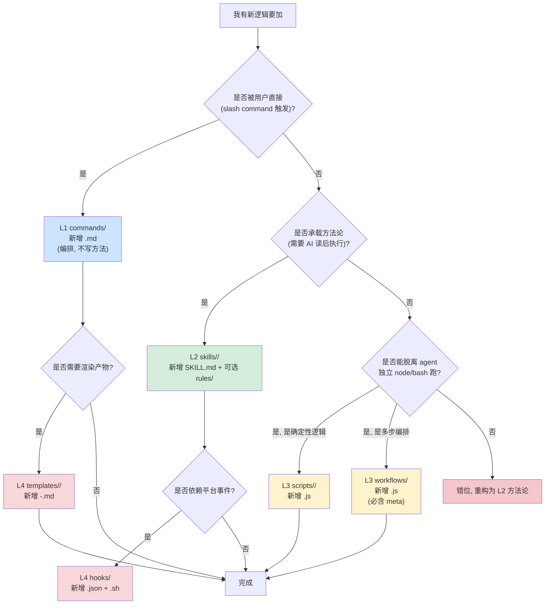

# god 架构（4 层 + 1 中心 + 1 真相源）

> 兑现 `CLAUDE.md` §2 承诺：定义 L1/L2/L3/L4 + 中心 + 真相源的**职责边界、跨层调用、禁止事项、文件组织、决策树、索引对照**。
>
> 改 god 方向 → `CLAUDE.md` §2；改本文 → 走 RFC。
> 产物格式 → [[spec-directory.md]]；Gherkin 语法 → [[../spec/SPEC-FORMAT.md]]；评审契约 → [[../skills/spec-review/SKILL.md]]。

---

## 1. 分层总览

```
┌──────────────────────────────────────────────────────────────────────┐
│ L1 commands/      编排（subagent 派遣、阶段门禁）         入口       │
├──────────────────────────────────────────────────────────────────────┤
│ L2 skills/        方法论（一文件一方法，SKILL.md）         脑         │
├──────────────────────────────────────────────────────────────────────┤
│ L3 scripts/ + workflows/  机械工具（独立 node 可跑）       手         │
├──────────────────────────────────────────────────────────────────────┤
│ L4 hooks/ + templates/    平台注入 + 产物模板             骨         │
├──────────────────────────────────────────────────────────────────────┤
│ 中心 = scenarios（spec.feature 的 SC 列表）                心         │
│ 真相源 = spec/（spec.feature + sources.md）              唯一真相     │
└──────────────────────────────────────────────────────────────────────┘
```

- **中心**：scenarios = 系统一切行为的索引。任何功能/修复/Bug 必先回答"对应哪个 SC"。
- **真相源**：spec/ 是唯一可信来源；L1-L4 都不持有真相，只引用/操作真相。

---

## 2. 各层职责（必查表）

| 层 | 路径 | 输入 | 输出 | 典型产物 | 禁止 |
|---|---|---|---|---|---|
| **L1** | `commands/` | 用户意图（自然语言 + 项目目录）| 编排完成的下一阶段产物 | `prd.md`/`dev.md`/`test.md` | 自己写方法论；直接改 `spec/`；不通过 subagent 派发就改代码；产出方法论白皮书 |
| **L2** | `skills/` | 阶段上下文（如 prd 阶段 1 输入 sources.md 草稿）| 下一阶段可消费的方法结论 + 外部化清单 | SKILL.md（方法论） + `rules/*.md`（子规则） + `templates/*`（可选模板） | 写代码；调 L3 workflow；自作主张跑命令；与同名 L1 command 重复定义边界 |
| **L3** | `scripts/`、`workflows/` | 文件路径 + CLI 参数 | 退出码 0/非 0 + stdout/stderr | 校验报告、代码骨架、并行评审产物 | 内嵌自然语言推理；硬编码路径；产出可读散文而非结构化报告 |
| **L4** | `hooks/`、`templates/` | 平台事件（hook）/ 阶段参数（template）| 自动注入 / 渲染产物 | `.json` + `.sh` + 模板文件 | 写业务逻辑；跨项目复用必须先 RFC；模板变量硬编码 |
| **中心** | `spec/spec.feature` 中 `@SC-xxx` 列表 | — | — | SC-001..SC-NNN | 直接修改 spec（必须经 build-spec skill）；给 SC 改 ID；复用已废 SC-ID |
| **真相源** | `spec/sources.md` + `spec/spec.feature` | REQ 草稿 / 已评审 SC 列表 | 被 dev/test 引用的唯一规格 | 见 [[spec-directory.md#1 目录树]] | L1-L4 直接编辑；旁路 build-spec 手改；与代码/测试单边漂移 |

**核心断言**：L1 编排、L2 思考、L3 执行、L4 注入；中心 = 索引；真相源 = 唯一可改的状态。层间不能错位。

---

## 3. 跨层调用规则

### 3.1 调用图（谁能调谁）

```
              ┌──────────┐
              │  L1 com. │  ← 唯一对外入口（用户调用）
              └────┬─────┘
                   │ 加载（Read + 执行内联流程）
                   ▼
              ┌──────────┐
              │  L2 skl  │  ← 方法论由 SKILL.md 承载
              └────┬─────┘
                   │ 调 node / bash（CLI 边界）
                   ▼
              ┌──────────┐
              │ L3 scr/wf│  ← 独立可跑（人/agent 都能直接调）
              └────┬─────┘
                   │ Read/Write 状态
                   ▼
              ┌──────────┐
              │  真相源  │  ← spec/sources.md + spec/spec.feature
              └──────────┘
                   ▲
                   │ 模板渲染/平台事件
              ┌────┴─────┐
              │ L4 hk/tpl│  ← 平台注入（hook 自动触发）+ 模板渲染
              └──────────┘
```

### 3.2 L1 → L2 → L3 → L4 规则

| 上层 | 可调下层 | 调用方式 | 例 |
|---|---|---|---|
| **L1** | L2（必须）、L3（必要时）、L4 模板（必要时） | L2 = Read SKILL.md 后内联执行方法论；L3 = `node ...` CLI；L4 = 渲染模板 | `commands/prd.md` 调 `skills/brainstorm/SKILL.md`，再 `node spec/scripts/spec-validate.js` |
| **L2** | L3（允许）、其他 L2（按 SKILL.md 引用） | L3 = `node`/`bash`；其他 L2 = 在 SKILL.md 中 Read 引用 | `skills/build-spec/SKILL.md` 调 `spec/scripts/spec-validate.js` |
| **L3** | 无（独立 CLI） | 仅 stdin/stdout/CLI 参数 | `node spec/scripts/spec-validate.js <project>` |
| **L4 hooks** | L3 工具（CLI 调用） | hook JSON 配置 `command` 字段 | `hooks/spec-drift.json` → 调 `spec-validate.js` |
| **L4 templates** | 无（被动渲染） | L1/L2 在 prompt 中按模板变量替换 | `templates/task/task-list.json` 被 L1 消费 |

### 3.3 禁止的调用

| 调用 | 禁止原因 |
|---|---|
| **L2 → L1** | skill 不是入口，被 command 编排 |
| **L2 → L2 直接嵌套**（一个 SKILL.md 内 Read 并执行另一个 SKILL.md 的内联方法）| 违反"一份方法一文件" |
| **L3 → L2/L1** | 脚本不是 agent，不能加载 SKILL.md |
| **L3 → L4** | 脚本不渲染模板，不挂 hook |
| **任何层 → 直接编辑 spec/** | 必须经 build-spec skill（单一入口，CLAUDE.md §4.1 铁律 3）|
| **L1 → 跨项目源码** | god 自身不实现产品代码；产出物只引用产品的 spec/code/test |
| **真相源 → 任何层** | 真相是被动的被引用方，不主动触发 |

---

## 4. 禁止事项清单（13 条 + 反例）

> 每条都有"违反 → 报错机制"，可在 PR review / validator / hook 处机械拦截。

| # | 禁令 | 反例 | 拦截机制 |
|---|---|---|---|
| 1 | L1 command 不得自己写方法论，必须 Read SKILL.md 后内联执行 | `prd.md` 内 30 行"如何做 brainstorm" | PR review 必查 |
| 2 | L2 skill 不得产出代码或 commit，只能产出方法结论 + 外部化清单（如 sources.md 草稿）| `brainstorm` SKILL.md 写"修改 game.js..." | `<HARD-GATE>` 字段 + PR review |
| 3 | L3 script 不得内嵌自然语言推理或 LLM 调用 | `spec-validate.js` 调用 claude API 评分 | 人工 review + 零依赖原则（见 [[../spec/SPEC-FORMAT.md#1 设计理念]]）|
| 4 | 任何层不得直接编辑 `spec/spec.feature` 或 `spec/sources.md`，必须经 build-spec skill | `commands/dev.md` 用 Edit 工具改 spec.feature | `build-spec` 流程 + dev 阶段 validator 校验双向绑定 |
| 5 | 任何层不得复用已废 SC-ID 或给 SC 改 ID | `SC-001` 删除后新建场景仍用 `SC-001` | `spec-validate.js` #4/#5（ID 唯一 + 全文件唯一）|
| 6 | 任何层不得绕过 C5 锚点直接进入 dev 阶段 | dev 阶段 spec 无 C5 锚点直接读 spec.feature | `spec-validate.js` #11 + `commands/dev.md` 阶段 1 机械门禁 |
| 7 | L1 不得直接写产品代码，必须经 `/god:dev` 编排（且 dev 必以 spec 为输入）| `prd.md` 在阶段 4 直接写 game.js | `commands/prd.md` 流程编排 |
| 8 | L2 skill 不得调 L1 command（skill 非入口）| build-spec SKILL.md 内调用 `/god:dev` | 流程边界 + 入口唯一 |
| 9 | L3 workflow 不得在无 inputs/outputs schema 的情况下被 L1 调用 | `eval-loop-review.js` 无 `meta` 字段 | workflow 文件必含 `meta` 导出（见 [[../workflows/self-check-gate.js#L1]] 现有范式）|
| 10 | L4 hook 不得绕过 spec-validate 写 spec 状态（必须 validator 先通过）| hook 直接 Edit spec.feature | hook 必调用 L3 validator，hook JSON schema 校验 |
| 11 | templates/ 不得硬编码项目路径或业务常量 | 模板含 `/Users/fan/project/...` | 模板变量必走 `${VAR}` 或 mustache 替换 |
| 12 | 任何层不得让 `spec-review` reviewer subagent 改 spec 文件（只评不改）| reviewer 在隔离 worktree 中 Edit spec.feature | reviewer prompt 模板明文禁止 + 物理隔离 worktree |
| 13 | 任何层不得在 spec-review 失败时跳过锚点写"通过" | 无评分结果时 sources.md 写"通过" | `spec-validate.js` #11（格式校验）+ PR review |

---

## 5. 文件组织规范

### 5.1 目录约定

```
god/
├── CLAUDE.md                 宪法（必读，禁止随手改）
├── README.md                 使用入口（用户视角）
├── docs/                     设计/规范/约定（本目录）
├── spec/                     活规格子系统自身的设计
│   ├── SPEC-FORMAT.md        Gherkin 格式 + SC 绑定规则
│   ├── TESTING.md            spec 系统自身回归手册
│   ├── scripts/              spec 子系统自身的 L3 工具
│   └── __tests__/            spec 子系统自身的测试（可选）
├── commands/                 L1（顶层）
├── skills/                   L2（每个 skill 一个子目录）
│   └── <skill-name>/
│       ├── SKILL.md          必含（YAML frontmatter + 正文）
│       ├── rules/            可选（子规则）
│       └── templates/        可选（本 skill 专用模板）
├── scripts/                  L3（按子领域分子目录）
│   ├── dev/                  dev 领域工具
│   ├── test/                 test 领域工具
│   └── ...                   其他领域
├── workflows/                L3 workflow（评审/校验/并行）
├── hooks/                    L4 顶层 hook 配置（roadmap G3 重建 — 原 scripts/hooks/ 7 个孤岛脚本已删）
└── templates/                L4 产物模板（按消费者分子目录）
```

### 5.2 命名规范

| 层级 | 命名 | 例 |
|---|---|---|
| L1 command | `<动词>.md`（小写、连字符）| `prd.md`、`dev.md`、`test.md` |
| L2 skill 目录 | `<动词-名词>/`（连字符、动宾结构）| `brainstorm/`、`build-spec/`、`spec-review/` |
| L2 SKILL.md | 必填 `name`（与目录名一致）、`description`、`user-invocable` | 见 [[../skills/brainstorm/SKILL.md#L1]] |
| L3 script | `<领域-动作>.js` | `task-cli.js`、`spec-validate.js` |
| L3 workflow | `<动词>-<名词>.js` + 顶部 `meta` 导出 | `eval-loop-review.js`、`self-check-gate.js` |
| L4 hook | `<事件>.json` + `<事件>.sh`（如有 shell）| `spec-drift.json` |
| L4 template | `<阶段>-<类型>.<ext>` | `task-list.json`、`task-detail-backend.md` |

### 5.3 文件大小上限

| 类型 | 上限 | 理由 |
|---|---|---|
| `commands/*.md` | 200 行 | 编排文档，超长=方法论没下沉到 skill |
| `skills/<name>/SKILL.md` | 600 行 | 方法论主文档，超长=该拆 skill |
| `scripts/*.js` | 500 行 | 超长=抽 `lib/<util>.js` 子模块 |
| `workflows/*.js` | 400 行 | 超长=拆 phase 子脚本 |
| `templates/*.md` | 300 行 | 超长=拆多模板 |
| `docs/*.md` | 400 行 | 超长=拆子文档 |

**例外**：`gen-skeleton.js`（77K）是已知领域专用生成器（骨架模板多），单独评估。

### 5.4 文件头规范

- **SKILL.md**：YAML frontmatter 必含 `name`、`description`、`user-invocable`。
- **workflows/*.js**：必含 `export const meta = { name, description, phases }`。
- **commands/*.md**：YAML frontmatter 必含 `description`、`argument-hint`。
- **scripts/*.js**：Shebang `#!/usr/bin/env node` + 顶部注释说明用法/参数/输出。

---

## 6. 新模块放置决策树

> "我有一段逻辑/方法论/工具/入口该放哪？"



### 6.1 决策要点

| 决策 | 关键问题 | 错放症状 |
|---|---|---|
| L1 vs L2 | 用户是否会输入 `/god:<cmd>`？会=L1，不会=L2 | L1 内 100+ 行方法论 = 该下沉 L2 |
| L2 vs L3 | 需要 LLM 推理吗？需要=L2，不需要=L3 | L3 调 LLM = 错位（脚本应零依赖） |
| L3 scripts vs workflows | 是单步确定性操作还是多步编排？单步=scripts，多步=workflows | workflow 无 `meta` = 必补 |
| L4 hooks vs templates | 由平台事件触发？事件=hook，被 L1/L2 渲染=template | hook 写业务 = 错位 |
| 任何层 vs 真相源 | 是否直接 Edit `spec/`？是=违规，必须经 build-spec | 见 §4 #4 |

### 6.2 反例速查

| 我想加... | 错放 | 正放 |
|---|---|---|
| "用户输入 `/god:refactor` 触发重构" | L2 skill（user-invocable=false） | L1 command `commands/refactor.md` |
| "AI 怎么打分 spec 质量的方法" | L3 script（调 LLM 评分） | L2 skill `skills/spec-review/SKILL.md` |
| "自动并行跑 5 个 reviewer" | L2 skill（确定性逻辑） | L3 workflow `workflows/parallel-review.js` |
| "用户保存文件时校验 spec 漂移" | L1 command（不是用户触发） | L4 hook `hooks/spec-drift.json` + 调 `spec-validate.js` |
| "新 dev 任务模板" | scripts（不是机械工具） | L4 template `templates/task/task-list.json` |

---

## 7. 与 `CLAUDE.md` §3 索引图的对照表

| §3 索引项 | 真实路径 | 当前状态 | 备注 |
|---|---|---|---|
| `CLAUDE.md` | `/Users/puyifan/project/github/claude-plugins/plugins/god/CLAUDE.md` | 已存在 | 宪法 |
| `docs/architecture.md` | 本文件 | **本 PR 新建** | L1-L4 职责详情 |
| `docs/spec-directory.md` | `docs/spec-directory.md` | 已存在 | spec/ 目录结构与产物 |
| `docs/conventions.md` | `docs/conventions.md` | **v0.2.0 新建** | 开发规范（命名/版本/提交流程） |
| `docs/human-ai-contract.md` | `docs/human-ai-contract.md` | **v0.2.0 新建** | 人机协作契约（6 个必介入点）|
| `docs/failure-modes.md` | `docs/failure-modes.md` | **v0.2.0 新建** | 失败模式 + 恢复手册 |
| `docs/roadmap.md` | `docs/roadmap.md` | **v0.2.0 新建** | 改造优先级 |
| `spec/SPEC-FORMAT.md` | `spec/SPEC-FORMAT.md` | 已存在 | Gherkin + SC 绑定规则 |
| `spec/scripts/spec-validate.js` | `spec/scripts/spec-validate.js` | 已实现 | 机械校验 14 项 |
| `spec/scripts/spec-cli.js` | — | 规划中 | SC 状态机 |
| `spec/scripts/spec-render.js` | — | 规划中 | 渲染 review.md |
| `spec/scripts/spec-archive.js` | — | 规划中 | 版本快照 |
| `spec/TESTING.md` | `spec/TESTING.md` | 已存在 | spec 系统自身回归手册 |
| `commands/prd.md` | `commands/prd.md` | 已实现 | 需求 → spec |
| `commands/dev.md` | `commands/dev.md` | 已实现 | spec → 代码 |
| `commands/test.md` | `commands/test.md` | 已实现 | spec → 测试 → 验收 |
| `skills/brainstorm/` | `skills/brainstorm/SKILL.md` | 已实现 | 模糊→清晰 |
| `skills/build-spec/` | `skills/build-spec/SKILL.md` | 已实现 | sources.md → spec.feature |
| `skills/spec-review/` | `skills/spec-review/SKILL.md` | 已实现 | 语义评审 |
| `skills/dev-gen/` | — | 规划中 | spec → 代码骨架 |
| `skills/test-gen/` | — | 规划中 | spec → 测试桩 |
| `skills/spec-render/` | — | 规划中 | spec → review.md |
| `skills/spec-summary/` | — | 规划中 | spec → 产品说明 |
| `scripts/dev/` | `scripts/dev/` | 已存在（含 build.sh、start.sh 等） | dev 领域工具 |
| `scripts/test/` | `scripts/test/` | 已存在 | test 领域工具 |
| `workflows/` | `workflows/` | 已存在 7 个 | 评审/校验/并行 |
| `hooks/` | — | **待重建（G3）** | L4 hook（原 `scripts/hooks/` 7 个文件已删；需重建 + 挂载 `.claude/settings.json`，见 [[roadmap#G3]]） |
| `templates/` | `templates/task/` | 已存在 | 产物模板（task 子目录） |

### 7.1 索引图已实现 vs 规划 vs 待集成

| 状态 | 数量（v0.2.0） | 处理 |
|---|---|---|
| **已实现/已存在** | 21 项 | 维持现状，改动走 PR |
| **规划中** | 7 项 | 占位不实现，进 [[roadmap]] G1-G7 |
| **待重建（G3）** | 1 项 | `hooks/` 顶层配置（脚本已删，需重建 + 挂 `.claude/settings.json`）|

---

## 8. 与三条铁律的对应

| 铁律 | 架构如何保障 |
|---|---|
| **铁律 1**：需求→规格→代码/测试 | L1 编排强制 prd→dev→test 顺序；L2 skills 严格分阶段（brainstorm/build-spec/spec-review 互不替代）|
| **铁律 2**：人看得懂第一 | L2 skill 输出"对话+外部化清单"（如 sources.md）而非直接 spec.feature；L1 命令自带 `<HARD-GATE>` 标注 |
| **铁律 3**：改 spec 是单一入口 | §4 #4 + §6 决策树双拦截；任何层绕开 build-spec 改 spec 必报 |

### 5 大防漂移机制的架构落点

| 防什么 | 机制 | 架构落点 |
|---|---|---|
| 绕过 build-spec 改 spec | spec-cli.js 强校验 | L3 `spec/scripts/spec-cli.js`（规划） |
| 代码 `@spec` 标了 spec 没的 SC | spec-validate.js #9 | L3 `spec/scripts/spec-validate.js`（已实现）|
| spec 加 SC 漏写 REQ | spec-cli add --req 强校验 | L3 `spec/scripts/spec-cli.js`（规划） |
| spec 改了代码没改 | spec-drift hook | L4 `hooks/spec-drift.json`（roadmap G3 待重建，原 `scripts/hooks/prd-sync-detector.js` 已删）|
| OPC 评审缺失（机制名沿用 PM）| C5 锚点 | L3 `spec-validate.js` #11 + L1 `commands/prd.md` 阶段 3b |

---

## 9. 自检清单（PR review 用）

每改一处 god，按本表逐项过：

- [ ] 改的是 L1/L2/L3/L4 哪一层？决策树（§6）走对了？
- [ ] 是否触碰 `spec/` 直写？→ 必须经 build-spec skill
- [ ] 新文件大小是否超 §5.3 上限？
- [ ] 新文件命名是否符合 §5.2？
- [ ] 新文件头是否含必需 frontmatter / meta？
- [ ] 是否违反 §4 任一禁令？
- [ ] 跨层调用是否符合 §3.2？
- [ ] §7 索引图是否需要更新？
- [ ] CLAUDE.md §9 三问（系统意义 / roadmap / 三条铁律）是否答完？

任一未通过 = PR 不收。

---

## 10. 版本

- **v0.1.0** (2026-06-16)：初版，定义 L1-L4 + 中心 + 真相源职责边界、跨层调用、13 条禁令、文件组织、决策树、索引对照。
