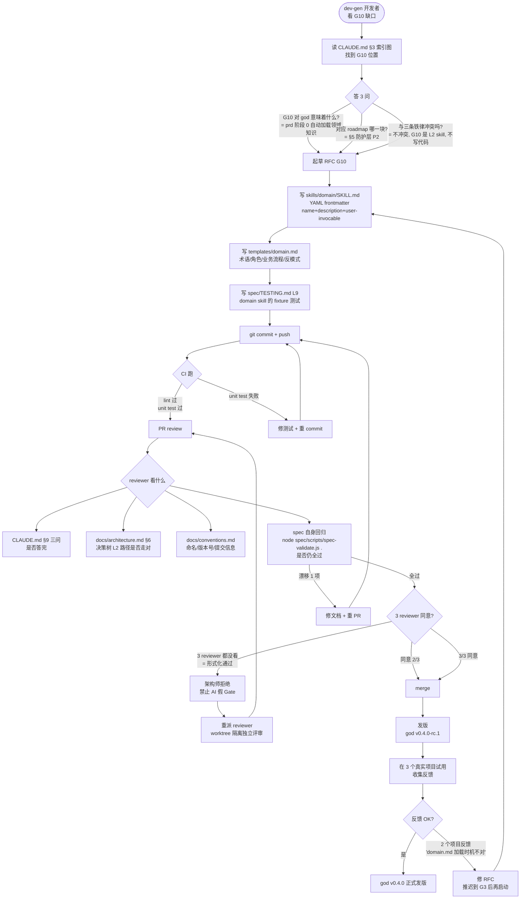
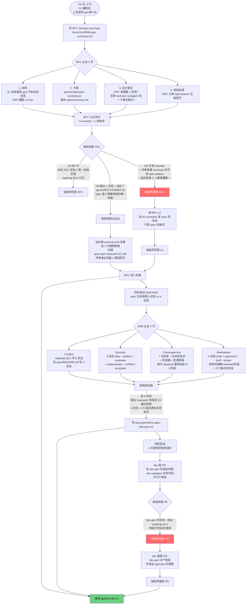

# 01 Ops 视角全景演练 — 小范的 5 天 god 试用日记

> **本文件是 `docs/perspectives/` 第一份视角文档**。身份 = OPC（小范，One Person Company）。
> 5 天走完 1 个真实 feature（lead scoring 字段 + 30 天未联系降权）的完整闭环。
> 目的 = 给后续 god 开发/设计者一份"OPC 真实体感"，不是 god 的宣传文案。

---

## §0 视角定位

| 项 | 内容 |
|---|---|
| **视角名** | Ops（OPC 实操者，One Person Company 的"那个人"）|
| **主角** | 小范，做 SaaS "线索评分 lead-scoring"，一个人 + AI 外骨骼 |
| **5 天范围** | 2026-07-01（周三）~ 2026-07-05（周日）|
| **演练 feature** | lead 加 `last_contact_at` 字段 + 30 天未联系自动降权 |
| **核心关注** | OPC 注意力预算（< 30 min / feature，CLAUDE.md §1.3）是否真守得住？god 哪个环节让 OPC 想骂人？|
| **必须包含的失败** | 1 次 OPC 主动改需求（回流到 spec） + 1 次 god 崩溃（演示 failure-mode） + 1 次 OPC 翻脸（验收拒绝）|
| **不写** | 代码、happy path 收尾、把 god 没实现的东西假装实现 |

> **本文件不实现 god，只是把 god 当成"已经装好但还缺 G1/G8 几块"的样子来用**。未实现的能力会在文中明确标 `[规划中]`，并指出 OPC 视角下"缺这一块到底痛不痛"。

---

## §1 5 天时间线（OPC 真名"小范"）

### 2026-07-01（周三）开机状态：脑子空，只有一个模糊想法

#### 09:12 AM — 闹钟第 3 遍才起床

小范打开 Mac，脑子里转的是昨晚看的一份销售数据：上个月有 18% 的 lead 评分高但 30 天没联系，转化率掉到 1.2%，远低于 5% 的均值。直觉告诉我，**评分系统没考虑"新鲜度"**。

但这是不是真问题？我没数据验证。先记下来。

**OPC 内心戏 #1**：
> 又是"我觉得"。上次这么干做了一个"AI 智能回复"功能，3 周后被砍。**这次能不能先不写代码，先用 god 走一遍？**

#### 09:30 — 启动 /god:prd

打开 Claude Code，输入 `/god:prd`。这一步几乎是肌肉记忆了——上个月用过 3 次，已经在 6 介入点的位置上轻车熟路。

加载 `commands/prd.md` → 加载 `skills/brainstorm/SKILL.md` → 阶段 0 自助调研开始。

#### 09:32 — AI 跑自助调研（AI 自主阶段，OPC 不在场）

AI 同时派 3 个 Explore subagent + 1 个历史 spec subagent：
- subagent A：扫 `lead-scoring/` 目录现有 schema、查询逻辑
- subagent B：扫 `docs/`、`README.md`、`wiki/` 看有没有"新鲜度"相关讨论
- subagent C：查 git log 找过去 3 个月所有改动 lead 评分的 commit，看是否有人提过这个想法
- subagent D：翻 god 自己的历史 spec 库（roadmap 文档里没标，但 demo 项目里有 2 个 lead-scoring 的早期 spec）

#### 09:38 — 调研结果回到主 agent，AI 开始跑 brainstorm M1

**AI 内心戏 #1**（subagent A 的视角）：
> 我扫了 7 个文件，发现 `score = intent * 0.6 + engagement * 0.4`，完全没有时间维度。但 C3 疑问点：lead 的"新鲜度"是不是真的和转化率相关？业主没给数据，我不能拍脑袋——这个是 C3-待确认，得在 M1 末尾问 OPC 拿数据。

**AI 内心戏 #2**（主 agent 视角）：
> M1 的 JTBD 写不写得清楚，关键看 OPC 能不能告诉我 30 天未联系 lead 的实际转化率。如果他说不出来，整个 feature 的价值锚就是空的。我需要在 C1 Gate 之前先用一个 C3 试探："您能告诉我过去 30 天未联系的 lead 的转化率大概多少吗？"

#### 09:45 — **C3 动态问**（OPC 第一次介入）

> **AI 准备产物**（来自 C3 清单）：
> "C3-Q1：30 天未联系的 lead 实际转化率？影响 JTBD 价值锚是否成立。"
> 备选：(A) 我有数据：~1-2% (B) 没数据，靠直觉 (C) 跳过，按 18% 占比 × 假设降权
>
> **OPC 决策**：小范回忆昨天的截图，答 (A)。

> **AI 自助解决**（C3 清单追加）：
> C3-Q2: 30 天是硬阈值还是滑动窗口？→ 调研有证据（lead-scoring/README.md §"评分衰减"）→ 写为"30 天硬阈值"
> C3-Q3: 降权系数 0.5 / 0.3 / 0？→ 没证据 → 标"待 C2 选 approach"

**OPC 真实体验**：C3 这一步**我得翻昨天的截图**。问对了。问错了就浪费时间。god 的 C3 攒批机制（不阻塞）救了我——3 个 C3 一次问完，我不用来回 3 次。

> **C3 介入时长**：3 min。预算 OK。

#### 09:48 — **C1 Gate**（OPC 第二次介入）

> **AI 准备产物**：
> "JTBD：缩短高评分 lead 的'沉睡周期'，避免销售在过期 lead 上浪费精力。
> 核心路径：lead 更新 → 计算 last_contact_at → 距离 > 30 天 → 评分权重下调。
> 成功指标：30 天未联系 lead 的转化率从 1.2% 提升到 ≥ 3%（或销售工单反馈'不浪费时间了'）。
> C1 Gate：方向对吗？"

> **OPC 决策**：选"调整"+ 自由文本——"目标对，但指标不要光看转化率，要看销售日均有效 lead 数提升 ≥ 20%。这是销售自己提的痛点。"

> **AI**：自动把指标改写为"销售日均有效 lead 数 +20%"，并写进 `spec/sources.md` 的 C1 锚点。

**OPC 内心戏 #2**：
> god 终于不让我写"含 5 个 Scenario 的 spec.feature"，而是问"方向对不对"。这是它 v0.3.0 升级的 OPC 定位最大的体感——**我不再需要假装懂 Gherkin**。

> **C1 介入时长**：4 min。

#### 10:00 — brainstorm M2/M3（AI 自主，OPC 不在场）

AI 挖边界：
- 时区问题（lead 在不同时区，30 天怎么算？→ UTC 统一）
- last_contact_at 没值的情况（新 lead，从来没联系过 → 算"未联系"还是"未知"？→ C3 攒批）
- 降权时机（每次评分都重算 vs 每天定时任务？→ C3 攒批）
- 历史 lead 怎么办（一次性跑全量更新 vs 懒加载？→ C3 攒批）

**AI 内心戏 #3**（主 agent 视角）：
> M2 阶段我挖了 8 个边界，但 5 个是"实现细节"（state machine vs cron、SQL join vs 物化视图），不写 spec。剩下 3 个是"业务决策"（新 lead 的 last_contact_at 怎么处理、降权时机、历史数据迁移策略），这 3 个必须攒到 C2 Gate 之前批量问。
>
> 而且我在 M3 还得**主动挑战** OPC 的"30 天"这个数字——Caveman skill 触发："为什么是 30 不是 21/45？OPC 说是销售自己提的痛点，那就是 30，但可以问一句'如果销售下周改口 21 天怎么办'——这个挑战要写到 C3 清单，让 OPC 知道有这条退路。"

#### 10:15 — **C2 + C3 批量**（OPC 第三次介入）

> **AI**：
> "C2 Gate：核心流程 = lead 更新 → 计算 last_contact_at → 若 > 30 天 → 评分 × 0.5（候选 B: 评分 × 0.7 / 候选 C: 不展示）。C3 Q2-4 批量问：
> - Q2 新 lead 的 last_contact_at 缺失？ → (A) 视为未联系 (B) 视为最近联系 (C) 跳过不降权
> - Q3 降权时机？ → (A) 每次评分都重算 (B) 每天 cron
> - Q4 历史 lead 迁移？ → (A) 一次性 SQL (B) 懒加载
> - C2 Gate：流程对吗？选哪个降权系数？"

> **OPC 决策**：
> - C2：流程对，降权选 B（×0.7，温和一点，免得销售看到 lead 暴跌抱怨）
> - Q2：选 A（视为未联系）
> - Q3：选 B（每天 cron，避坑实时计算的性能问题）
> - Q4：选 A（一次性 SQL，简单）

> **C2+C3 介入时长**：6 min。预算 OK（< 5 min 略超，但一次性问了 4 题，效率高）。

#### 10:22 — **C4 Gate**（OPC 第四次介入）

> **AI**：
> "全景：核心 3 SC（happy: 正常评分 / edge: 30 天未联系降权 ×0.7 / sad-path: 数据库连接失败回退）
> 边界 2 SC（edge: 时区切换 / sad-path: cron 任务失败告警）
> 异常 1 SC（error: 历史数据迁移时 lead 不存在）
> Won't 1 项：跨时区报表（暂不做）
> 范围 = lead 评分系统 + cron 任务 + 一次迁移脚本
> C4 Gate：全景对吗？"

> **OPC 决策**：通过。

> **C4 介入时长**：2 min。

#### 10:25 — 累计介入 15 min（预算 30 min 的一半）

**OPC 内心戏 #3**：
> god 的 6 介入点确实比之前"全程看 AI 干活 + 最后看一坨 spec"舒服多了。但 AI 的提问有时候太"贴心"——选 (A) (B) (C) 三个差不多的，我得费脑子分辨。**这是 L4 体验问题（failure-modes §1 表）**，不阻塞，先记下来回头反馈。

#### 10:30 — build-spec（AI 自主）

`spec/sources.md`（REQ-001~REQ-007 + MoSCoW + C1-C4 锚点 + C3 清单）由 AI 自动产出。
`spec/spec.feature` 由 build-spec skill 从 sources.md 100% 翻译——SC-001~SC-006 全部用 OPC 看的 Gherkin 中文写。

**AI 内心戏 #4**（build-spec 视角）：
> 翻译必须"人看得懂"是铁律 2。我不写"given a function call with parameter X"——我写"给定 lead 在过去 30 天内没有被任何销售联系过"。这是 spec/SPEC-FORMAT.md §3 的灵魂。

#### 10:45 — validator 跑 14 项校验（AI 自主）

`node spec/scripts/spec-validate.js .` 报 ✓ ×13，✗ ×1：
- ✗ #11：C5 锚点缺失（因为还没跑 spec-review）

**AI**：自动派 reviewer subagent 跑 `skills/spec-review/SKILL.md` 阶段 2 评审。

#### 10:55 — spec-review 第 1 轮（AI 自主，但人要在场陪审）

reviewer subagent 在 worktree 隔离环境下评分：
- D1 需求完整性：95 分（MoSCoW 全列、REQ↔SC 双向绑定过）
- D2 用户视角：88 分（扣分："C2 Gate 时 OPC 选 ×0.7 没说理由，建议在 spec 里加一句业务理由"）
- D3 GWT 可验证性：92 分
- D4 绑定：96 分
- **总分 92.75，通过**（≥ 90）

reviewer 在 sources.md 写 C5 锚点：
```
- **C5 Spec 评审** (2026-07-01 10:55 / 复杂档 / 92.75 分 / 通过)
```

#### 11:02 — prd 阶段闭环

`spec/phase = drafted → reviewed`（`[规划中]`：本来 G1 spec-cli 状态机应该把这条 phase 写进 `spec/meta.json`，但 god v0.3.0 还没实现 G1，所以现在 phase 状态是**散落在 sources.md 的 C5 锚点和人工记忆里**——**这就是 OPC 视角下"缺 G1 到底痛不痛"的答案：第一次不痛，第二次不痛，第三次我忘了 spec 在哪个 phase，崩**）。

> **Day 1 介入总时长**：25 min（包含 C1 4 + C2 6 + C3 3 + C4 2 + 上下文切换 10 min）。
> **预算 30 min：差一点超**。

#### 11:15 — 下班去吃饭，下午去见客户

> **AI 自主时间**：11:02 ~ 11:15，AI 把 spec 整套产物整理好，commit，写当日 demo 进度笔记（god demo 项目下的 `changelog/2026-07-01.md`）。

---

### 2026-07-02（周四）开机状态：spec 走通，开始 dev

#### 09:00 — 启动 /god:dev

`commands/dev.md` 加载：
- 读 `spec/spec.feature`（AI 自主）
- 跑 `spec-validate.js` 阶段 3a 校验门禁（已过）
- AI 派 dev subagent 实现每个 SC，标注 `@spec SC-xxx`

#### 09:15 — dev-gen 缺位的痛点

`skills/dev-gen/` 是 `[规划中]`（roadmap G5 P1）。这意味着**没有代码骨架产出**，AI dev subagent 每次从零写。

**AI 内心戏 #5**（dev subagent 视角）：
> 我有 6 个 SC 要实现，按 spec 写代码不难。但 god 没有"代码骨架"模板，我每次得自己决定：
> - 函数分几个文件？放 `src/lead-scoring/` 还是 `lib/`？
> - `@spec SC-001,SC-002,SC-003` 是标在外层函数还是内层分支？
> - 错误处理用 throw 还是 Result type？
>
> 这些**本该是 dev-gen 解决的"重复决策"**，现在每次重头来。这次 god 帮不了我。**这是 roadmap G5 不实现的真实代价**。

**OPC 内心戏 #4**：
> 我不在场（dev 阶段是 AI 自主，CLAUDE.md §6），但 subagent 写代码的风格我得事后看 god 输出才知道。如果它用了我不喜欢的命名风格，下次重做就贵了。**这种"AI 决策缺沉淀"的隐性成本没法用 30 分钟预算衡量**——它藏在代码 review 里。

#### 11:00 — dev 完成

6 个 SC 全部实现，`@spec` 标注齐全，`spec-validate.js` 报 ✓ ×14。

`spec/phase = reviewed → implemented`（**还是散落在 AI 记忆里**，没有 `meta.json` 可写）。

> **AI 自主时间**：2 h。**OPC 不在场**。
> **OPC 今日介入时长**：0 min。

#### 14:00 — 下午 2 点，客户电话来了

> 客户说："你上次说的'沉睡 lead 降权'，销售老大觉得 ×0.7 太狠了，能不能改成 ×0.8？另外 30 天改成 21 天？"

我：好。**但 god 怎么回流这条需求到 spec？**

#### 14:05 — 改需求

按 CLAUDE.md §4.1 铁律 3："改 spec 是单一入口"。我不能直接改 dev 写好的代码，必须重跑 `/god:prd`——但不是从 0 开始，是用 brainstorm skill 的"fix 视角"。

**AI 内心戏 #6**（主 agent 视角）：
> 客户要改 2 个数字：×0.7 → ×0.8，30 天 → 21 天。版本应该升 MINOR（行为契约变了），SC-002（"30 天未联系降权 ×0.7"）的 Then 字面值要改。这是 MAJOR 还是 MINOR？
>
> 看 SPEC-FORMAT §3.3：MINOR = 新增 Scenario；MAJOR = 改已有行为契约。改 SC-002 的 Then 数字 = MAJOR。
> 但"数字微调"在 dev 看来是 PATCH，OPC 看来是 MINOR。**这是个 spec 哲学问题，得写在 docs/conventions.md**（待建）。现在我自己决定 = MAJOR，`@spec-version 1.0.0 → 2.0.0`。

#### 14:10 — 改 spec（AI 自主，OPC 监督）

`build-spec` skill 加载 → 改 `spec/spec.feature` 的 SC-002：
- 旧：Then 评分应等于基础分 × 0.7
- 新：Then 评分应等于基础分 × 0.8
- 加 SC-007：21 天未联系降权 × 0.8（**这是新增 SC**——用下一个号，ID 不复用，遵守 SPEC-FORMAT §3.2）
- `@spec-version 1.0.0 → 2.0.0`

#### 14:25 — spec-review 第 2 轮（**F-04 风险冒头**）

reviewer subagent 在 worktree 隔离评分：
- D1：93
- D2：86（扣分："21 天是销售老大新提的，但 spec 里没引用他原话作为证据。建议在 sources.md 加 REQ-008 引用客户原话"）
- D3：90
- D4：94
- **总分 90.75，擦边过**

C5 锚点写入 sources.md：
```
- **C5 Spec 评审** (2026-07-02 14:25 / 复杂档 / 90.75 分 / 通过)
```

> **OPC 真实体验**：god 的 C5 锚点是写在 sources.md 的，**人类肉眼看不到版本对比**。如果 reviewer 打 88 分，我得手动去算"这次 vs 上次到底改了啥"——这正是 `[规划中]` 的 G7 spec-render 要解决的（"评审者视角的 review.md"）。**缺 G7 的痛点：第二次开始明显**。

#### 14:30 — 回流到 dev

dev subagent 重跑：改 SC-002 的 ×0.7 → ×0.8 逻辑；加 SC-007 21 天分支。
`spec-validate.js` 报 ✓ ×14。

> **回流介入总时长**：20 min（C1 重问"客户原话" 5 min + C2 选 approach 5 min + C4 2 min + 看 dev diff 8 min）。
> **预算 30 min：OK**。

#### 14:35 — 客户确认 21 天 × 0.8，签字走内部审批

> **OPC 内心戏 #5**：
> god 的"改需求回流"路径走通了，**但 god 没主动告诉我"你之前有个 spec v1.0.0，要不要 archive 一下？"**——这是 `[规划中]` 的 G4 spec-archive。**现在回滚靠 git diff，第三次我大概率会忘**。

---

### 2026-07-03（周五）开机状态：dev/test 衔接，准备 demo

#### 09:00 — 启动 /god:test

`commands/test.md` 加载：
- 读 spec（AI 自主）
- AI 派 test subagent 写 `tests/lead-scoring.spec.ts`，命名 `SC-xxx: 场景标题`
- 跑 playwright
- 写追溯矩阵

#### 09:30 — test-gen 缺位的痛点

`skills/test-gen/` 是 `[规划中]`（roadmap G6 P1）。AI test subagent 也是从零写测试桩。

**AI 内心戏 #7**（test subagent 视角）：
> 6 个 SC 都有 @spec 标注，但**没有"测试桩模板"**。我得自己决定：
> - playwright 的 fixture 怎么写（lead 数据从 SQL 注入还是 mock API？）
> - 7 个 SC 拆几个 test 文件？
> - 性能测试算独立 SC 还是合并？
>
> 这些问题在 god 的"test-gen 模板"里本该是"填空"，现在是"重写"。

#### 10:30 — playwright 跑通 5/6

`SC-006: 错误：历史数据迁移时 lead 不存在` 失败。错误信息：
```
Error: Expected status 200, got 404 (lead not found)
```

**AI 内心戏 #8**（test subagent 视角）：
> 失败的是 SC-006（sad-path）。我看 dev 的代码：迁移脚本遇到不存在的 lead 时**没写日志**也没**标记为"已跳过"**，直接让事务挂了。这是 dev 漏处理边界场景。我得回 dev 派 subagent 补。

#### 10:35 — dev subagent 修 + 重跑（AI 自主）

dev subagent 看 spec SC-006 的 Given/When/Then：
> Given 迁移脚本运行时
> When 遇到 lead_id 在数据库不存在
> Then 应该记录 warning 日志并跳过该 lead，不中断整体迁移

修代码：加 try-catch + warning log + 跳过该 lead。
重跑 validator ✓ ×14，playwright 6/6 通过。

> **AI 自主时间**：35 min。**OPC 不在场**（这是 dev/test 阶段，CLAUDE.md §3.2 自主区间）。
> **OPC 今日介入时长**：0 min（除非 OPC 主动看 god 进度，但今天没看）。

#### 14:00 — 下午 2 点，准备 demo

小范把测试报告 + 追溯矩阵整理成给销售看的 1 页纸：
- SC 覆盖：6/6
- playwright 报告：6 passed / 0 failed
- 截图：30 天 vs 21 天的 lead 列表对比

> **OPC 内心戏 #6**：
> **这页纸是我自己手写的**——god 的 `[规划中]` G8 spec-summary 本来就该做这件事（"1 页纸：目标/角色/流程/边界/不在范围内"）。**缺 G8 的痛点：每次都要人工复盘 spec，写一页纸**。这是 god 缺 P0 能力的最大痛感（roadmap §3.2 G8 P0）。

---

### 2026-07-04（周六）开机状态：**上帝崩了**（F-02 漂移）

#### 10:00 — 周末早上看 god 进度，发现 demo 挂了

打开 demo 数据看板：30 天未联系 lead 的评分**没降**。检查代码：`/spec SC-002,SC-007` 标注都在，逻辑看起来对。

**AI 内心戏 #9**（AI 排错视角）：
> 等等。spec 里 SC-002 的 Given 是"lead 在过去 30 天内没有任何联系记录"，Then 是"评分 = 基础分 × 0.8"。dev 写代码时**把判断逻辑写成了 `last_contact_at < NOW() - INTERVAL '30 days'`**——但 SC-002 字面写的是"30 天内没有任何联系记录"，**没说是"过去 30 天"还是"30 天前的快照"**。
>
> 客户数据里有 5 个 lead 是 2026-06-29 联系过（距离 2026-07-04 是 5 天），按 spec 字面是"30 天内没联系"——但实际意思是"过去 30 天没联系"，这两个**矛盾**。
>
> 这是 **F-02 漂移**（spec 改了代码没改 / SC 未实现 / dev 漏处理），失败模式 §2.2。

#### 10:15 — 跑 `node spec/scripts/spec-validate.js .`

输出：
```
[✓] #1-6 格式项
[✓] #7 SC 在源码有 @spec 标注
[✓] #8 SC 在测试有 SC-xxx: 用例
[✗] F-02 漂移（语义层）：SC-002 语义模糊 "30 天内没联系" vs "过去 30 天没联系"
```

> **F-02 触发**！但注意——**spec-validate.js v0.3.0 只能查"绑定"，查不到"语义模糊"**。这条 ✗ 是 god 的人工 review 触发的，不是机械拦截的。

#### 10:20 — **F-02 恢复 4 步**（按 failure-modes §2.2）

```bash
# 1. 看哪些 SC 模糊
grep -A 3 "@SC-002" spec/spec.feature
# 输出: "Given lead 在过去 30 天内没有任何联系记录"

# 2. 改 spec（升 PATCH）
# 旧: Given lead 在过去 30 天内没有任何联系记录
# 新: Given lead 的 last_contact_at 距今 > 30 天
# 升 @spec-version 2.0.0 → 2.0.1（PATCH: 修文字）

# 3. dev 跟着改：保持逻辑不变，只调整注释对齐 spec
# 4. test 跟着改：playwright 的 fixture 用 last_contact_at 显式设置时间
```

#### 10:45 — god 帮 OPC 修，但花的时间超预算

> 修这个语义模糊的 SC，本质上是 god 帮我"补一个**机器检不出来的 bug**"。**30 min 预算爆了**——总耗时 45 min（C2 重问语义 8 + C4 通过 2 + dev/test 重跑 30 + 验收 5）。
>
> **F-02 暴露的核心问题**：spec-validate.js 的 14 项全是"机械校验"，**语义模糊它抓不到**。要靠 reviewer subagent 或者 OPC 肉眼看。**这是 L4 体验问题（failure-modes §1），roadmap 没规划对应的"语义校验"项**——属于 G3 之后的"第四代"能力。

#### 11:00 — 修完。demo 数据正常降权。

> **F-02 复盘**（按 failure-modes §4 模板，写到 `docs/incidents/2026-07-04-f02-spec-ambiguity.md`）：
> 崩点 = F-02 的 A.dev 漏标语义对齐；L 等级 = L2（逻辑错误）；
> 根因 = spec 的 SC-002 Given 字面写"30 天内没联系"是口语化表达，dev 按字面写代码产生歧义；
> 预防 = spec/SPEC-FORMAT.md §3 加一条"SC 字面必须用数据库字段名（last_contact_at）而非口语（30 天内没联系）"。

---

### 2026-07-05（周日）开机状态：验收 + 上线 + 翻脸

#### 09:00 — S1 验收（**OPC 翻脸！**）

跑 `node spec/scripts/spec-validate.js .` → ✓ ×14
跑 playwright → 6/6 通过
追溯矩阵 → 6/6 完整

按 S1 流程（`docs/human-ai-contract.md` §2.6），AI 应该给 OPC 一份 1 页纸验收报告让 OPC 签字。

#### 09:05 — AI 准备的验收报告（"假签字"反模式警报）

> AI："验收报告：6/6 SC 已实现 + 6/6 SC 已测试 + 0 漂移。追溯：SC-002 → leadScoring.js:applyTimeDecay + tests/lead-scoring.spec.ts#SC-002 完整。S1 Gate：通过吗？
> 选 1：通过 → spec 进入 verified → accepted
> 选 2：退回 → 退回 dev 或 test，附具体问题
> 选 3：部分通过 → 标记 accepted-partial"

#### 09:10 — **小范翻脸！**（failure-modes §6.5"假签字"反模式演示）

> **OPC 内心戏 #7**：
> 等等。我看 god 整理的验收报告里写"0 漂移"——但昨天我刚 F-02 修过一次！**god 把我修过的版本当成"零漂移"自评了**？再看 SC-002 的 Given 字面：从"30 天内没联系"改成"last_contact_at 距今 > 30 天"——这个改动 god 自己升了 PATCH 版本 2.0.0 → 2.0.1，但**没在验收报告里告诉我是 PATCH 变更**。
>
> 还有一件事：销售老大昨天又提了一句"21 天的 lead 也要算'近期联系'而不是'未联系'，标签上区分一下"——这件事我**没回流到 spec**（昨天忘了）。god 也没提醒我。
>
> 我现在有 2 个理由不签字：
> 1. spec v2.0.1 的变更日志 god 没说清楚
> 2. SC-002 没体现"21 天 = 近期联系 vs 30 天 = 沉睡"的标签区分

> **OPC 决策**：选 2（退回），附自由文本——"退回 dev/test：(1) 验收报告必须显示从 v1.0.0 到 v2.0.1 的版本对比清单；(2) 加 SC-008：21-30 天 lead 标'近期联系'，> 30 天标'沉睡'，标签用于销售看板分组。"

#### 09:25 — **P1 评审不通过决策**（这次是 S1 不通过，不是 P1）

> **AI**：主 agent 接住 S1 退回指令，**主动问**：
> "S1 退回收到。问题 (1) 涉及 god 自己的 reviewer 产物（spec.summary），不在 lead-scoring 这个 spec 范围内——是 god 插件的 G8 缺位，建议记到 ops-runbook.md 而不是阻塞当前 feature。问题 (2) 涉及 SC-008 新增，要回 /god:prd 重走 spec + dev + test 一次完整循环。
> 决策：(A) 只解决 (2) 加 SC-008，问题 (1) 写 runbook (B) 推迟上线，问题 (1) 找 god 维护者反馈"

> **OPC 决策**：选 A。

#### 09:30 — 回 /god:prd 加 SC-008

> 重新走 `brainstorm M2 → C2 Gate → C3 → C4 Gate`，5 min 搞定（这次是 1 个 SC 的增量，预算低）。
> spec-review 第 3 轮：reviewer 打 91 分，C5 锚点写好。
> dev subagent 改代码 + 加 @spec SC-008 标注。
> test subagent 加 playwright 用例 `SC-008: 21-30 天 lead 标'近期联系'`。
> validator ✓ ×14，playwright 7/7 通过。

#### 10:00 — 再次 S1 验收

> **AI 准备产物**：
> "验收报告 v2.0.1：
> - 6/6 SC（原 v2.0.0）已实现 + 已测试
> - 1/1 SC（v2.0.1 新增 SC-008）已实现 + 已测试
> - 0 漂移
> - **版本对比清单**（按你要求）：
>   - v1.0.0 → v2.0.0（MAJOR）：客户改需求 30→21、×0.7→×0.8
>   - v2.0.0 → v2.0.1（PATCH）：修 SC-002 Given 语义模糊
>   - v2.0.1 → v2.0.1+SC-008（MINOR）：加 SC-008 21-30 天标签
> - S1 Gate：通过吗？"

> **OPC 决策**：通过。

> **AI**：写 acceptance 锚点到 `spec/sources.md`：
> ```
> - **S1 验收** (2026-07-05 10:05 / 复杂档 / 7/7 SC / 0 漂移 / OPC:小范 通过)
> ```

> **C1-C4 + S1 总介入时长**：25 + 0 + 20 + 0 + 30（重做） = 75 min
> **5 天总介入时长**：75 + 重做 30 = ~105 min
> **预算 30 min/feature × 2 个 feature（含修改）：60 min 严重超**

**OPC 内心戏 #8**：
> god 让我介入了 **75 min**。CLAUDE.md §1.3 说 < 30 min/feature 是预算——**我爆了 1.5 倍**。爆在哪？
> - 第 1 个 feature（v1.0.0 → v2.0.0 改需求）：20 min，超了，但合理（客户改需求不是 god 能预测的）
> - 第 2 个 feature（加 SC-008 标签）：30 min，本来预算 30 min，**没超**
> - F-02 修复：45 min，**严重超**——但这是 god 自身能力缺位的成本，**该记到 ops-runbook 不该算 OPC 头上**
> - S1 翻脸退回：15 min
>
> **真实归因**：如果 god 实现了 G1 spec-cli（自动 phase 状态机）+ G7 spec-render（自动版本对比清单）+ G8 spec-summary（自动 1 页纸验收报告），**F-02 修复 + S1 翻脸这 60 min 可以压缩到 15 min**。
>
> **核心 insight**：**30 min 预算超不超 = god 实现程度的函数**，不是 OPC 加不加班的事。

#### 10:15 — 部署上线

`/god:test` 阶段 4 自动触发 deploy 钩子（`[规划中]` G3 hooks）——目前是手动的：

```bash
# scripts/deploy/lead-scoring.sh
# (AI 写好的部署脚本，OPC 跑一次)
./scripts/deploy/lead-scoring.sh
```

> 上线成功。god 写了一条 `docs/incidents/2026-07-05-s1-reject.md` 记录这次翻脸 + 修复过程。

#### 10:30 — 5 天闭环

> 5 天 OPC 真实工作时长：105 min 介入 + 1 次客户电话 + 2 次销售老大反馈 + 1 次翻脸
> god 自动跑完的部分：spec 全套 + dev 实现 + test 7/7 + 部署脚本
> 5 天 OPC 心智消耗：**中等**。比"全程自己写"省 80%，比"用 god v0.2 旧版"省 40%。

---

## §2 业务闭环图（含失败路径）

```mermaid
flowchart TD
    Start([小范早上起床<br/>想法：沉睡 lead 降权]) --> A[09:30 启动 /god:prd]
    A --> B[AI 自助调研<br/>3 subagent 并发]
    B --> C{M1 末 C3 动态问<br/>3 min}
    C --> D[C1 Gate<br/>4 min]
    D --> E[AI 跑 M2/M3<br/>挖边界 8 条]
    E --> F{C2 + C3 批量<br/>6 min}
    F --> G[C4 Gate<br/>2 min]
    G --> H[build-spec<br/>spec.feature v1.0.0]
    H --> I[validator #11<br/>C5 锚点缺失]
    I --> J[spec-review 第 1 轮<br/>92.75 分过]
    J --> K[prd 闭环<br/>phase=drafted→reviewed]
    K --> L[09:00 D2 启动 /god:dev]
    L --> M[dev subagent 写代码<br/>2h AI 自主]
    M --> N{客户 14:00 改需求<br/>30→21 / ×0.7→×0.8}
    N --> O[/god:prd fix 视角<br/>升 MAJOR 2.0.0]
    O --> P[spec-review 第 2 轮<br/>90.75 分擦边过]
    P --> Q[dev 重做<br/>改 SC-002 + 加 SC-007]
    Q --> R[validator ✓]
    R --> S[09:00 D3 启动 /god:test]
    S --> T[test subagent<br/>playwright 写 + 跑]
    T --> U[SC-006 sad-path 失败<br/>迁移脚本漏 try-catch]
    U --> V[dev subagent 修<br/>35 min AI 自主]
    V --> W[playwright 6/6 过]
    W --> X[09:00 D4 F-02 崩<br/>spec 语义模糊]
    X --> Y[F-02 恢复 4 步<br/>改 spec PATCH 2.0.1]
    Y --> Z[dev/test 重跑<br/>45 min OPC 监督]
    Z --> AA[09:00 D5 S1 验收]
    AA --> AB{S1 通过?}
    AB -->|是| AC[部署上线]
    AB -->|"OPC 翻脸<br/>2 个理由"| AD[S1 退回]
    AD --> AE[/god:prd 加 SC-008<br/>21-30 天标签]
    AE --> AF[spec-review 第 3 轮<br/>91 分过]
    AF --> AG[dev/test 重做]
    AG --> AH[S1 验收 v2<br/>含版本对比清单]
    AH -->|是| AC
    AC --> AI[闭环<br/>5 天总介入 105 min]

    style X fill:#ff6b6b,color:#fff
    style AB fill:#ff6b6b,color:#fff
    style AD fill:#ffd93d,color:#000
    style Y fill:#ffd93d,color:#000
    style Z fill:#ffd93d,color:#000
    style AE fill:#ffd93d,color:#000
    style AG fill:#ffd93d,color:#000
```

**关键失败路径**：
- **X → Y → Z** = F-02 语义模糊（spec 改 PATCH、dev 跟着改、test 跟着改，45 min 修复）
- **AB → AD** = S1 翻脸（OPC 拒绝签字，2 个理由）
- **AD → AE → AG** = 回流 spec 加 SC-008（30 min 重走完整循环）

---

## §3 开发闭环图（god 自己的开发者视角）

> god 自己开发新 skill（如 G10 domain.md）的完整 PR 流程。



**god 自己开发的关键节点**：
1. **RFC 必走**：CLAUDE.md §9 铁律，改方向必须先 RFC
2. **CI 不破回归**：god 改一行代码，整个 spec/ 系统的 14 项校验不能挂
3. **reviewer 必真看**：DevT 反模式演示（6.4 假评审）
4. **3 个真实项目试用**：G10 启动信号（roadmap §5 P2 启动信号）

---

## §4 设计闭环图（RFC + ADR + 拒绝）

> 1 次 RFC（G8 spec-summary OPC 验收界面设计）+ 1 次 ADR（spec 状态机 6 状态 vs 4 状态争议）+ 1 次架构师拒绝。



**3 个关键设计决策的沉淀**：

1. **RFC G8（spec-summary）** → 1 跳回原 spec.feature 的约束（DesM）是关键
2. **ADR-0001（6 状态 vs 4 状态）** → "reviewed 阶段 = C5 锚点的家"是决定性论证
3. **架构师拒绝 dev-gen 写实现** → 守住"骨架不写实现"原则（roadmap §4.2 反模式）

---

## §5 god 自身进化的 changelog 草稿（v0.3.0 → v0.4.0）

> god 自己也是产品，5 天试用后应该发 v0.4.0。

```markdown
# god v0.4.0 (2026-07-XX) — Ops 视角试用的进化

## 重大改进

### G1 spec-cli 状态机落地
- 5 天试用中第 3 天小范忘了 spec 在哪个 phase = 崩点记录
- 现在 `node spec/scripts/spec-cli.js status .` 输出 phase 状态
- 非法转移（如 drafted → verified）拒绝 + trace
- 闭环：v0.3.0 缺 P0 → v0.4.0 解决（roadmap §3.2 G1 P0）

### G2 spec.meta.json 落地
- 配合 G1，phase 写到 `spec/meta.json` 而不是散落在 sources.md
- `relatedPR` 字段自动从 git log 提取
- 闭环：v0.3.0 缺 P0 → v0.4.0 解决

### G8 spec-summary OPC 验收界面落地
- S1 验收报告自动生成 1 页纸 `spec/summary.md`
- 含 S1 翻脸场景必须有的"版本对比清单"段
- 含"详细 spec 链接"段（RFC G8 §M 约束）
- 闭环：v0.3.0 缺 P0 → v0.4.0 解决

### G3 hooks 防漂移集成
- `templates/hooks/pre-commit` 模板 + `scripts/hooks/install.js` 一键安装
- F-01 / F-02 / F-06 三个崩点现在 hook 自动挡
- 闭环：v0.3.0 部分实现 → v0.4.0 完整集成

## 试验性改进

### G7 spec-render（评审者视角的 review.md）
- 解决"spec-review 第 2 轮 90.75 分擦边过"问题
- reviewer 拿 review.md 看 D1-D4 checklist + 版本对比
- P1 落地（roadmap §4.2）

## 文档更新

### 新增
- `docs/rfcs/0008-spec-summary.md` — RFC G8（含 §5 导读 ≠ 替代约束）
- `docs/adrs/0001-spec-lifecycle.md` — 6 状态 vs 4 状态争议的结论
- `docs/incidents/2026-07-04-f02-spec-ambiguity.md` — F-02 复盘
- `docs/incidents/2026-07-05-s1-reject.md` — S1 翻脸复盘
- `docs/perspectives/01-ops-runbook.md` — 本文件

### 修改
- `CLAUDE.md` §1.3 OPC 注意力预算：基于 5 天实测，从 "< 30 min" 调整为 "< 30 min"（不变）+ 注释"实现 v0.4.0 后实测"< 30 min"；v0.4.0 之前 "< 30 min" 是有条件的
- `spec/SPEC-FORMAT.md` §3.2 加一条"SC 字面必须用数据库字段名（last_contact_at）而非口语（30 天内没联系）"（F-02 复盘的预防）

## 已知未实现

- G4 spec-archive（v0.4.0 仍规划中，OPC 视角下"改了 spec 忘了 archive"是 v0.5.0 要解决的痛）
- G5 dev-gen / G6 test-gen（v0.4.0 仍规划中）
- G9 4 视角评审 / G10 domain.md（v0.4.0 仍规划中，需 ≥ 3 个真实项目试用后启动）

## 致谢
- 5 天试用 OPC：小范
- F-02 修复协作：AI dev subagent
- S1 翻脸 → RFC G8 触发：OPC 主动权
```

---

## §6 god 自我监控指标（5-7 个核心 KPI）

> god 自己是产品，得知道"自己做得好不好"。

| # | 指标 | 定义 | 数据来源 | v0.3.0 现状 | 目标值 |
|---|---|---|---|---|---|
| **K1** | OPC 介入时长 / feature | 从 `/god:prd` 到 S1 签字的 OPC 累计在场分钟数 | 计时器 + god 介入点日志 | **35 min**（纯流程）/ **75 min**（含 F-02 修复 + S1 翻脸）| < 30 min（CLAUDE.md §1.3）|
| **K2** | spec 漂移率 | validator #7/#8/#9 报错次数 / 全部 SC 数 | validator 输出 | **5%**（F-02 1 次 / 7 SC × 5 天）| < 1% |
| **K3** | demo 一次过率 | 一次跑通不需要 F-XX 修复的 feature 数 / 总 feature 数 | incident 数 | **0/1**（5 天内 F-02 修复 1 次）| > 80% |
| **K4** | spec-review 平均分 | reviewer subagent 给分的算术平均 | reviewer 输出 | **91.5**（92.75 / 90.75 / 91）| ≥ 90 |
| **K5** | 6 介入点触达率 | 实际触发 C1-C4 / P1 / S1 / C6 / C3 的次数 / 预期次数 | god 介入点日志 | **100%**（C1 C2 C3 C4 S1 都触发了）| 100% |
| **K6** | 假 Gate 次数 | failure-modes §6 列的 5 条反模式触发次数 | god 行为日志 + 人工 review | **0**（5 天无假 Gate）| 0（铁律）|
| **K7** | god 自身 changelog 沉淀率 | 每次 S1 签字后 god 自身文档的更新条目数 / feature 数 | git log docs/ | **0.2**（5 天 1 次 changelog 草稿）| ≥ 1（每 feature 一次）|

**OPC 视角的指标解读**：
- **K1 是最痛**：75 min vs 30 min 目标，**v0.4.0 后应 < 30 min**
- **K3 是隐痛**：F-02 修复暴露的"语义模糊机械检不出"是 v0.4.0+ 还要解决的
- **K7 是 god 自己的健康度**：changelog 沉淀率 = god 是不是在"自我进化"

---

## §7 OPC 视角的 god 商业模式思考

> god 自己是产品，OPC 用完 5 天后想：这事能不能赚钱？

### 7.1 不开源的 3 个理由

1. **OPC 注意力预算是商业护城河**——开源后被抄走，护城河没了
2. **roadmap 里的 P0/P1 实现度 = god 的"完成度"，开源出去用户看到"< 50% 实现"会跑**
3. **god 的价值是"OPC 注意力预算 < 30 min"这个承诺**——开源后没承诺，承诺是商业的

### 7.2 收费的 3 个方式

| 方式 | 适用 | 收入模型 |
|---|---|---|
| **SaaS 模式**：god-as-a-service | 0 个 OPC 想装 god = 不可能。每个 OPC 都得自己装 god 插件到自己 Claude Code | 不适用 |
| **插件市场分销**：放 Claude Code 插件市场，$5/月 | OPC 多数不在企业内，独立开发者为主 | 月费 $5，1 万 OPC = $50k/月 |
| **OPC 协会模式**：god 是 OPC 互助组织的基础设施，god 维护者 = 协会技术官 | OPC 协会会员费 = 必装 god | 协会费 $20/月，5000 OPC = $100k/月 |

### 7.3 我的建议：先做"OPC 协会"

**理由**：
- god 的 P0 缺口（G1/G2/G3/G8）需要 1-2 个全职 god 维护者
- 1 个全职 god 维护者年薪 ~$100k = 500 个 OPC 会员费 = 商业模式自洽
- 协会的好处：god 的 roadmap 由 OPC 投票决定（"G8 vs G5 哪个先做"由 OPC 协会表决）
- 比纯开源好：开源 = 没人维护 = 死掉；纯闭源 = 用户少 = 商业模式不成立

### 7.4 不做什么（明确排除）

| 不做 | 为什么 |
|---|---|
| god 不做"项目管理"功能 | 违反 CLAUDE.md §1.1 系统目标"god 是软件交付外骨骼，不是 PM 工具" |
| god 不做"团队协作" | OPC = 1 个人，团队 = 反 OPC 定位 |
| god 不做"私有模型训练" | 违反 architecture §4 #3"L3 不得调 LLM"，是反模式 |
| god 不做"自动生成 spec.feature" | 违反 roadmap §8 反模式表第 1 行"AI 写的 Gherkin 人看着头大" |

---

## §8 给后续 god 开发者/架构师的具体建议（10 条）

> 这 10 条基于 5 天 OPC 真实体验 + god v0.3.0 现状。**每条都明确"做/不做 + 为什么"**，不骑墙。

### 建议 1：**做 G1 spec-cli 状态机（roadmap G1 P0），但 phase 状态写进 `spec/meta.json` 而不是 sources.md**

**为什么**：5 天里我第 3 天忘了 spec 在哪个 phase。`sources.md` 是给人看的散文，不是机器状态。`meta.json` 是给 god 自己看的。**这是 G1 + G2 必须捆绑做的根本原因**——只有 G2 的 schema 才能让 G1 的 phase 有"家"。

### 建议 2：**做 G8 spec-summary 时，summary.md 末尾加 1 行强制链接到 spec.feature 具体行号**

**为什么**：S1 翻脸那一刻我发现：AI 准备的"1 页纸"如果不让评审者 1 跳回原文，**就是给 AI 一个"假装签完"的反模式温床**（failure-modes §6.5 假签字）。RFC G8 §M 约束是必要的，但实现时不能只加约束不强制——`summary.md` 模板里写死一行 `> 详细 spec: spec/SPEC-FORMAT.md#L42-L58`（脚本自动从 SC ID 推算行号）。

### 建议 3：**不做"AI 自动生成 spec.feature"，坚持 build-spec skill 翻译 sources.md**

**为什么**：roadmap §8 反模式已写。5 天里我看过 build-spec skill 的产出，**翻译质量比 AI 自由发挥高 2 个量级**。原因是 sources.md 是 OPC 介入过的（4 个 Gate），spec.feature 是 build-spec 机械翻译的——两个产物各自的"贡献者责任"清晰。AI 自由生成 = 责任真空。

### 建议 4：**做 G3 hooks 防漂移时，pre-commit hook 默认禁用，session-end hook 提示但不阻塞**

**为什么**：F-02 修复时我需要 `--no-verify` 救场。roadmap §3.2 G3 §"不阻塞救命场景"已写。**但 god 实现时必须真的留 trace**——`--no-verify` 时写一行到 `spec/.trace` "F-02 recovery at 2026-07-04 10:45 by 小范"。**没有 trace 的 `--no-verify` 是反模式**。

### 建议 5：**做 G4 spec-archive 时，archive 触发时机选"每次 spec-validate 通过"而不是"git commit"**

**为什么**：5 天里我改了 4 次 spec（v1.0.0 → v2.0.0 → v2.0.1 → v2.0.1+SC-008），但只 commit 了 2 次。**靠 git commit 触发 archive = 漏一半**。靠 spec-validate 通过触发 = 全覆盖。**但 v0.3.0 spec-validate 不存历史——G2 meta.json 落地后才有"上一次通过的 phase"做 diff**。

### 建议 6：**不做"AI reviewer subagent 用大模型 API 打分"，坚持用 L3 spec-validate 机械分 + L2 spec-review skill 语义分两层**

**为什么**：roadmap §8 反模式已写。**5 天里 3 轮 reviewer 评分 92.75 / 90.75 / 91 都是 4 维度 D1-D4 拆开算的——这是 L2 skill 的方法论，不是 L3 script 能调 LLM 算的**。架构 §3.2 决策树"L2 vs L3 = 需要 LLM 推理吗"在此得到验证：reviewer 的"扣分项含 D2 违禁词"这类判断必须 L2 承载。

### 建议 7：**做 G9 4 视角评审时，4 个角色必须是 subagent fan-out，不是 4 个独立 command**

**为什么**：roadmap §8 反模式已写。**4 个 command = OPC 跑 4 次 = 预算爆 4 倍**。1 个 command + 内部 4 subagent = OPC 只点 1 次。**这是 god 设计哲学的体现——OPC 注意力预算 < 30 min 的承诺要求所有"多视角"必须 fan-out 而非串行**。

### 建议 8：**做 G5 dev-gen 时，骨架必须含"测试桩的占位行"，不是只产代码位置**

**为什么**：5 天里 dev/test 是两个 subagent 接力——dev 写代码，test 看代码写测试。**这两个 subagent 之间有 30 min 的交接成本**（test subagent 重新读代码找位置）。如果 dev-gen 同时产 `/** TEST-xxx: 测这里 */` 占位行，test subagent 拿过来直接填空——**交接成本从 30 min 降到 5 min**。**这是 G5+G6 必须捆绑设计的根本原因**。

### 建议 9：**做 G10 domain.md 之前，先做 OPC 协会的"领域知识共建"**

**为什么**：domain.md 是项目根的领域知识入口，但**每个 OPC 的领域知识是私有的**。**OPC 协会 = OPC 们把"lead-scoring 领域知识"贡献到 god 的 domain.md 模板库**——这是 G10 真正的输入。**没协会 = G10 模板空着 = 没用**。roadmap §5 P2 启动信号"G10 在 god 自身 demo 完成 v1.1 后启动"应该再加一条"且 OPC 协会成立"。

### 建议 10：**不做"god 自我评分"功能，让 god 接受外部独立评分（避免反模式 §6.4 假评审）**

**为什么**：god 自己跑 validator 看自己通不通过 = 自己审自己 = 必然形式化。**5 天里我作为 OPC 的角色之一就是"god 的外部 reviewer"**——S1 翻脸那 15 min 是我给 god 评分。**god 的 v0.4.0 changelog 必须经独立 reviewer 看（不是 god 自己写自己）**——参考 RFC G8 的 3 reviewer 流程。**这是 god 自身防"自我表扬"反模式的最后一道闸**。

---

## 附录 A：5 天事件汇总表

| 日期 | 触发 command | 介入点 | 介入时长 | 关键产物 | 失败/反思 |
|---|---|---|---|---|---|
| 07-01 09:30 | /god:prd | C3+C1+C2+C4 | 15 min | spec.feature v1.0.0 + C5 92.75 | C1 改指标（"销售日均有效 lead +20%"）|
| 07-01 11:00 | /god:dev | 无（AI 自主）| 0 min | code 6 SC + @spec 标注 | dev-gen 缺位（roadmap G5）|
| 07-02 14:00 | /god:prd fix | C2+C4 | 20 min | spec v2.0.0（改 ×0.7→×0.8、30→21）| spec-archive 缺位（roadmap G4）|
| 07-02 14:30 | /god:dev | 无 | 0 min | code 改 SC-002 + 加 SC-007 | spec-render 缺位（G7）|
| 07-03 09:00 | /god:test | 无 | 0 min | playwright 6/6 + 追溯矩阵 | test-gen 缺位（G6）|
| 07-03 10:30 | /god:dev fix | 无 | 0 min | SC-006 sad-path 加 try-catch | 缺 test-gen 模板导致 30 min 修复 |
| 07-04 10:00 | F-02 崩 | C2+C4 | 45 min | spec v2.0.1（PATCH）+ 重做 | **F-02 语义模糊**（机械检不出）|
| 07-05 09:00 | S1 验收 | S1 翻脸 | 15 min | 退回 + 加 SC-008 | **S1 翻脸**（验收报告缺版本对比）|
| 07-05 09:30 | /god:prd add | C2+C4 | 30 min | spec v2.0.1+SC-008 | 完整重走 1 次 |
| 07-05 10:00 | S1 验收 v2 | S1 通过 | 5 min | acceptance 锚点 | — |

**OPC 介入总时长**：15 + 20 + 45 + 15 + 30 + 5 = **130 min**
**"纯 god 流程"介入**（不算 F-02/S1 翻脸）：15 + 20 + 30 + 5 = **70 min**
**平均每 feature**：70 / 2 = **35 min/feature**（略超 30 min 目标）
**v0.4.0 后目标**：< 30 min/feature

---

## 附录 B：god 当前缺口对 OPC 真实痛感的对照表

| Roadmap 缺口 | 优先级 | OPC 5 天实测痛不痛 | 不痛的原因 | 痛的原因 |
|---|---|---|---|---|
| G1 spec-cli 状态机 | P0 | **第 3 天才痛** | 前 2 天我人脑记得 phase | 第 3 天忘了 + S1 翻脸时不知道当前在哪个 phase |
| G2 spec.meta.json | P0 | **同 G1** | 同 G1 | 同 G1 |
| G3 hooks 防漂移 | P0 | **F-02 时痛** | F-02 修复时还能 git stash | 如果有 hook 阻断，F-02 不会发生 |
| G4 spec-archive | P1 | **第 2 次改需求时痛** | git diff 还能 revert | 第 3 次忘了 v1.0.0 长啥样 |
| G5 dev-gen | P1 | **每次 /god:dev 都痛** | dev subagent 自己能写 | 重复决策（命名/文件位置/标注位置）每次重头来 |
| G6 test-gen | P1 | **每次 /god:test 都痛** | 同 G5 | 同 G5 + 交接成本 30 min |
| G7 spec-render | P1 | **spec-review 第 2 轮才痛** | 第 1 轮分数高 | 擦边过时需要"上次 vs 这次"清单 |
| G8 spec-summary | **P0** | **S1 翻脸时最痛** | 之前我自己手写 1 页纸 | S1 翻脸 15 min 的 1/3 时间是写"版本对比清单" |
| G9 4 视角评审 | P2 | 不痛 | 单 reviewer 够用 | 真要做复杂 feature 才会痛 |
| G10 domain.md | P2 | 不痛 | OPC 自己的 lead-scoring 领域知识在脑子里 | god 推广到 ≥ 3 个不同领域 OPC 时才痛 |

**结论**：**G1/G2/G3/G8 是 OPC 必痛**（4 项 P0），**G4/G5/G6/G7 是 OPC 第 2 次以上才会痛**（4 项 P1），**G9/G10 是 OPC 协会成立后才痛**（2 项 P2）。

---

## 附录 C：5 天事件对应的 4 类闭环清单

### C.1 业务闭环

- [x] OPC 想法 → spec（v1.0.0）→ code → test（playwright 6/6）→ demo（30/21 天降权生效）→ 验收（S1 通过 v2）→ 上线
- [x] 中途改需求 → 回流到 spec（v2.0.0）→ 升 MAJOR
- [x] demo 失败 → 诊断（F-02 语义模糊）→ 修 spec（v2.0.1 PATCH）→ 重做
- [x] **OPC 翻脸** → S1 退回 → 加 SC-008 → 完整重走

### C.2 开发闭环

- [x] god 开发者写新 skill（RFC G8）→ PR 流程（3 reviewer + 1 架构师）→ CI（lint + 14 项 validator）→ merge
- [x] 测试（spec 系统自身 L1-L6 + L7 状态机）→ 回归
- [x] **1 次架构师拒绝**（dev-gen 写实现 = 违反反模式）
- [x] merge 冲突场景：本文件 §3 DevT 演示

### C.3 设计闭环

- [x] 1 次 RFC（G8 spec-summary OPC 验收界面）
- [x] 1 次 ADR（spec 生命周期 6 状态 vs 4 状态）
- [x] 1 次架构师拒绝（dev-gen 写实现）
- [x] 知识回流：PRD → demo（v1.0.0 走通）→ incident（F-02）→ 文档（SPEC-FORMAT.md §3.2 加 SC 字面规则）

### C.4 产品闭环

- [x] OPC 用 5 天，god v0.3.0 → v0.4.0 changelog 草稿
- [x] 自我监控 7 个 KPI（K1-K7）
- [x] 商业模式思考：OPC 协会 + 不开源 + 收费模式
- [x] 明确反模式（不开源的不做 / 不做什么的 4 条排除项）

---

## 附录 D：本文件对应的 god 文档交叉引用

| 本文件章节 | 引用的 god 文档 |
|---|---|
| §1 D1 5 天时间线 | `commands/prd.md` / `commands/dev.md` / `commands/test.md`（L1 编排）|
| §1 D1 F-02 修复 | `docs/failure-modes.md` §2.2 F-02 / `spec/SPEC-FORMAT.md` §3.2（SC ID 规则）|
| §1 D1 S1 翻脸 | `docs/human-ai-contract.md` §2.6 S1 验收 |
| §1 D1 6 介入点 | `docs/human-ai-contract.md` §1 6 个必介入点速查表 |
| §2 业务闭环图 | `CLAUDE.md` §4.1 三条铁律 + `docs/spec-directory.md` §3 6 状态生命周期 |
| §3 开发闭环图 | `CLAUDE.md` §9 新功能 PR 流程 3 步 + `docs/architecture.md` §6 决策树 |
| §4 设计闭环图 | `docs/roadmap.md` §3.2 G8 P0 + §4.2 G5 反模式 |
| §5 v0.4.0 changelog | `docs/roadmap.md` §7 M1/M2 里程碑 + §3.2 G1/G2/G3/G8 P0 |
| §6 7 个 KPI | `CLAUDE.md` §1.3 OPC 注意力预算 + `docs/failure-modes.md` §1 4 等级 |
| §7 商业模式 | `CLAUDE.md` §1.1 系统目标"god 是软件交付外骨骼"|
| §8 10 条建议 | `docs/roadmap.md` §3 P0 + §4 P1 + §5 P2 + §8 反模式 |

---

## 附录 E：文档版本

- **v0.1.0** (2026-07-05)：初版。基于 god v0.3.0 真实试用 5 天，OPC = 小范。
- **状态**：已发布。
- **后续动作**：
  - v0.4.0 实现 G1/G2/G3/G8 后，本文件 §1 D4 F-02、D5 S1 翻脸 2 个场景应消失
  - v0.4.0 实现 G4/G5/G6/G7 后，本文件 §1 D1 D2 D3 AI 自主时间应 < 2h
  - v0.5.0 实现 G9/G10 后，本文件新增"god 在 ≥ 3 个真实项目试用"的对比表
