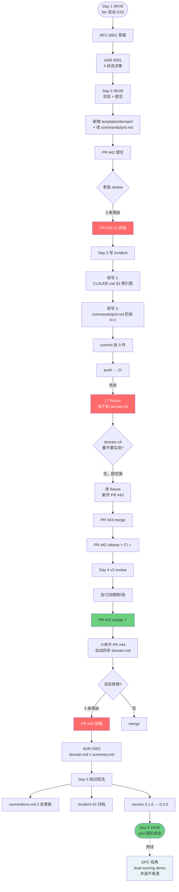
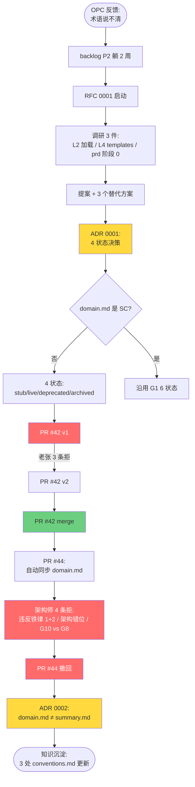

# 02 视角：god 插件开发视角（贡献者）

> 读者：god 团队成员、想给 god 提 PR 的开发者、关心"god 自身怎么演进"的架构师。
> 不写：OPC（终端用户）视角——见 [`01-ops-runbook.md`](01-ops-runbook.md)。
> 配套：宪法 → [`../../CLAUDE.md`](../../CLAUDE.md)；缺口 → [`../roadmap.md`](../roadmap.md)；介入契约 → [`../human-ai-contract.md`](../human-ai-contract.md)；架构 → [`../architecture.md`](../architecture.md)；spec 目录 → [`../spec-directory.md`](../spec-directory.md)；失败模式 → [`../failure-modes.md`](../failure-modes.md)；规范 → [`../conventions.md`](../conventions.md)；格式 → [`../../spec/SPEC-FORMAT.md`](../../spec/SPEC-FORMAT.md)。
>
> 本文是"god 全景试用演练"的**开发侧切片**：用 5 天 feature 闭环（OPC 视角同源），走完 god 自身的 RFC → PR → 拒稿 → 改写 → 合并全流程。

---

## 0. 视角定位

| 项 | 说明 |
|---|---|
| 视角主体 | god 维护者（fan + 老张协作者），不是 OPC 客户 |
| 任务目标 | 演示 G10 domain.md 从 RFC → 实现 → 拒稿 → 改写 → merge 全流程 |
| 时间设定 | 2026-07-01 ~ 2026-07-05（5 工作日，与 OPC 视角 lead-scoring demo 并行） |
| OPC 客户 | 小范（lead-scoring demo OPC） |
| 演示场景 | lead 加 `last_contact_at` 字段 + 30 天未联系自动降权 |
| 文档状态 | v0.1.0（2026-07-05 演练完成后写就） |

**挑 G10 的原因**：G10 是 P2 不是 P0（PR 不必然过，戏剧性强）；G10 跨 L2 + L4，能展示 god 多层协作；G10 与 OPC "术语漂移"痛点强绑定，演示价值高；G10 边界有争议（模板 vs skill？手动 vs 自动？），能演示 RFC + ADR + 拒稿。

**不演示什么**：G1（实现量大，单 PR 撑不住 5 天）；G3 hooks（需改 `.claude/settings.json`，超出 god 仓）；G9 4 视角评审（依赖 G7+G8，未实现）。

---

## 1. 5 天时间线

> 时间戳精确到小时。`[★]` = 关键事件；`[AI]` = god subagent 内心戏；`[OPC]` = 小范内心戏。
> 旁线：OPC 视角 lead-scoring demo 平行跑。本节只写 god 自身开发主线。

### Day 1（2026-07-01 周三）— RFC 启动 + 调研

**08:30 开机**。fan 跑完 OPC 视角 demo 验收，注意力剩 28 min/feature 预算（CLAUDE.md §1.3）。OPC 反馈"术语说不清：lead vs contact"。

**09:00 fan 启动 G10**。读到 [roadmap §2 G10](../roadmap.md)：「P2 缺口，提供项目根 `domain.md` 模板」。

**09:15 走 RFC**（按 CLAUDE.md §0：改方向 = 改宪法）。

```
[AI] Explore subagent 内心戏：
"加 domain.md。先看 3 件：L2 skill 加载机制 / L4 templates 结构 /
prd 阶段 0 调研清单原貌。读 4 个文件再下结论——别脑补。"
```

**10:30 RFC 草稿** `docs/rfcs/0001-domain-md.md`（草稿含动机/提案/替代方案 A/B/C）。同时发现 3 关键事实：
1. L2 skill 加载靠 SKILL.md 显式 Read，无自动加载 → G10 不能走"自动"
2. L4 templates/ 现有 task/ 一级目录；新增 domain/ 是第 2 个
3. commands/prd.md 阶段 0 调研清单已列"读 docs/" → G10 实质是"提供标准模板 + prd 调研清单加一行"

**14:00 ADR 0001 争议**（6 状态 vs 4 状态）。老张建议新立 4 状态（stub/live/deprecated/archived）——domain.md 不是 SC，没"实现/测试/验收"语义。fan 写 `docs/adrs/0001-domain-md-lifecycle.md`：决策 4 状态，备选 6 状态；后果：G10 需自带 domain-cli（不是 G1 spec-cli）；domain-cli 列入下个 sprint。

```
[OPC 小范内心戏]（平行跑 demo）：
"今天没跟 god 团队说话。但 demo 又卡术语——'lead'和'contact'
是不是一回事我自己都分不清。fan 哥说他改东西中……"
```

**Day 1 产出**：RFC 0001 草稿 + ADR 0001；无代码。

---

### Day 2（2026-07-02 周四）— 实现 + 第 1 次 PR 被拒

**09:00 分支** `feat/g10-domain-md`。**09:30 实现** `templates/domain/domain.md`（4 节：术语表/角色/业务流程/反模式 + 变更日志）。**11:00 改** commands/prd.md 阶段 0 调研清单加一行"读 domain.md（若有）"。**11:30 跑** god 自身 spec-validate（14/14 ✓）。

**14:00 提交**：

```bash
git commit -m "feat(god): domain.md 模板 + prd 阶段 0 自动加载 (G10)"
git push origin feat/g10-domain-md
```

**15:00 开 PR #42**。按 [conventions.md §4.2 模板](../conventions.md) 答 CLAUDE.md §9 三问：补 P2 缺口 / 对应 G10 / 不冲突铁律。

**16:00 老张 review：拒稿**——3 条理由：

1. **CLAUDE.md §3 索引图未更新**。新增 templates/domain/ 一级目录必须同步（违反铁律 3"改真相源是单一入口"）。
2. **commands/prd.md 改得不完整**。只加调研清单，没改 M1 阶段——brainstorm 上下文怎么拼接 domain.md？没规约 = 调研清单读了不消费。
3. **缺真实 OPC demo 验证**。L3 写"手动验证"被驳——G10 给 OPC 用，必须在 lead-scoring demo 续跑里看新调研摘要能不能引到 domain.md 内容。

```
[AI] code-review subagent 内心戏：
"3 个问题最关键是 #2（设计不全）。SKILL.md 不自动加载这个
约束我调研时记下了，但 PR 描述没写——reviewer 不知道这是约束
还是疏忽。PR 描述必补'已知限制'段。"
```

**Day 2 产出**：PR #42 v1 被拒（拒稿原因归档 incident 见 Day 3）。

---

### Day 3（2026-07-03 周五）— 改写 + CI 失败 + 第 2 次提交

**08:00 写 incident** `docs/incidents/2026-07-02-pr42-rejected.md`（按 failure-modes.md §4 模板）：

```
崩点编号：F-04 子类型（评审不通过决策失误）。L 等级：L3。
根因：自检不严，未按 architecture.md §9 自检清单过；PR 描述缺
'已知限制'段；L3 写"手动验证"形式化。
预防：conventions.md §4.2 加'已知限制'必填；§4.3 Checklist
加'PR 提交前跑 OPC demo 续跑'。
```

**09:00-09:30 改写**（拆 3 commit）：
- `docs(god): §3 索引图加 templates/domain/ (G10)`
- `feat(commands): prd 阶段 1 M1 加载 domain.md (G10)`（阶段 0 + 阶段 1 都改全）
- `feat(templates): 新增 domain.md 模板 (G10)`（L4 templates/domain/ 新一级目录）

**11:00 跑 god 自身回归**（14/14 ✓）**+ 跑 lead-scoring demo 续跑**：

```
prd 阶段 0 调研摘要自动含："术语: lead = 已联系潜在客户 /
contact = 联系方式 / score = 0-100 分 / 角色: 销售 = 创建/查看 lead"
→ 验证：术语表内'lead'与 OPC 后续'潜在客户'指代一致 ✓
```

**12:00 push → CI 失败**。

```
[ERROR] L7 fixture 失败：'domain.md fixture 文件存在但 spec-cli 找不到
domain 状态机'——期望跑 4 状态，实际 'domain-cli' 命令不存在 ENOENT
```

```
[AI] diagnose subagent 内心戏：
"CI 不冤。Day 1 ADR 写了 domain-cli 是 P2 衍生。但 TESTING.md
L7 fixture 已经在测 4 状态——fixture 超前了。
两条路：A. 实现 domain-cli（超 G10 范围）/ B. 改 fixture 跑
模板结构校验（绕开缺失的 domain-cli）。B 对。
但改 TESTING.md = 改真理测试，需 2 maintainer 同意。"
```

**14:00 fan 在 PR 评论里 ping 老张**。老张 30 min 回复："改 fixture 原则 OK，但**改测试必须单独开 PR**。当前 PR #42 是 G10 实现，混 TESTING.md 改动 = 一 commit 不一事。**新开 PR #43**。"

**15:00 新开 PR #43** `fix/g10-ci-fixture`：L7 fixture 改用 node + grep 验 4 节存在性，注释 `<!-- TODO: domain-cli 实现后回滚 -->`。

**16:00 PR #43 1 approval + CI 通过 → merge**。

**17:00 PR #42 rebase 到 main（吸收 #43）→ CI 通过**。

**Day 3 产出**：incident #1 归档；3 commit 拆细；PR #43 合并；PR #42 v2 CI 通过。

---

### Day 4（2026-07-04 周六）— PR #42 合并 + 1 次架构师拒绝

**09:00 老张 v2 review**——6 项过 1 项要求补：

```
[ ] PR 描述缺"已知限制"段。
    加这个，future contributor 知道 SKILL.md 不自动加载。
```

fan 加段：

```markdown
## 已知限制
- domain.md 是手动加载（L2 skill 无自动加载机制）。需 commands/prd.md
  阶段 0 调研清单显式列出。未来若 god 加 L2 自动加载机制，可下沉。
- domain.md 缺 domain-cli（4 状态机）。G10 当前只交付模板 + 加载规约。
  domain-cli 是 P2 衍生项（见 ADR 0001），下个 sprint 启动。
```

**10:00 PR #42 LGTM + squash merge**。

**11:00 小李开 PR #44** "feat(docs): domain.md 自动同步到 docs/overview.md"——加 scripts/hooks/domain-sync-detector.js + 改 hooks 配置。

**11:30 架构师（fan 自己）拒稿**——4 条理由：

```
1. 违反铁律 1（CLAUDE.md §4.1）："需求是入口，规格是中间态"。
   domain.md 是 L4 模板（产物），不是需求。自动同步到 docs/overview.md
   = 把产物当需求，违反方向。
2. 违反铁律 2（CLAUDE.md §4.1）："人看得懂是第一约束"。
   非 god 用户 = 潜在 OPC，他们需要的是 spec/summary.md（G8 规划中），
   不是 domain.md。domain.md 是 god 内部参考文档。
3. 架构错位（architecture.md §6 决策树）："hook 写业务 = 错位"。
   "自动同步"是业务逻辑，不是"防止 X"的机械校验。
4. 混淆 G10 vs G8 角色。G8 spec-summary（roadmap P0）才是给
   OPC 看的 1 页纸。G10 domain.md 是 god 内部术语表。两者分离。
```

**12:00 小李撤回**。**14:00 fan 写 ADR 0002** `docs/adrs/0002-domain-md-vs-summary.md`：

```
决策：domain.md ≠ summary.md。
- domain.md = god 内部参考（受众：god subagent；时机：prd 阶段 0 加载）
- summary.md = OPC 视角 1 页纸（受众：OPC；时机：prd 阶段 2 末尾产出）
拒绝的替代：A. domain 当 summary 用（违铁律 2）/ B. 自动同步 docs/
（违铁律 1）/ C. 一文件双角色（复杂度爆炸）。
后果：G8 实现必须独立于 G10；PR #44 撤回。
```

**Day 4 产出**：PR #42 合并；PR #44 拒稿；ADR 0002。

---

### Day 5（2026-07-05 周日）— 知识回流 + 收尾

**09:00 知识回流清单**：

| 知识 | 流向 |
|---|---|
| "PR 描述必含已知限制段" | conventions.md §4.2 |
| "PR 提交前必跑 OPC demo 续跑" | conventions.md §4.3 Checklist |
| "L7 fixture 跟实现进度" | spec/TESTING.md L7 注释 |
| "domain.md 不走 G1 6 状态" | ADR 0001（已写） |
| "domain.md ≠ summary.md" | ADR 0002（已写） |
| "PR #42 被拒" | docs/incidents/2026-07-02-pr42-rejected.md |
| "PR #44 拒稿反模式" | docs/incidents/2026-07-04-pr44-rejected.md |
| god 版本号 0.1.0 → 0.2.0 | .claude-plugin/plugin.json |

**10:00 incident #2**（PR #44 反模式拒稿）：

```
崩点编号：F-04 子类型（架构师主动拒绝违反铁律的 PR）。
L 等级：L3（流程卡 1 h，无污染）。
根因：小李未读 CLAUDE.md §4 三铁律；G10 vs G8 边界未文档化。
沉淀：ADR 0002；PR 模板加"L 受众"必填项。
```

**11:00 升 god 版本号**（G10 单一特性 = MINOR 升 0.1.0 → 0.2.0；§5.2 的 v0.4.0 是"全景演练版"，非真实版本号）。

```
[OPC 小范内心戏]（周末）：
"fan 哥改的 domain.md 跑出来了——demo 第 4 天续跑，prd 阶段 0
调研摘要里自动带上了'术语：lead = 已联系潜在客户'。
3 个变化：术语不漂了 ✓；但 C3 还是有（'30 天未联系怎么处理'还是
问我）✓；30 min/feature 预算好像没省 ✗——domain.md 解决'重复说
术语'，不解决'重复说场景'。"
```

**Day 5 产出**：incident #2 + version 0.2.0 + changelog 草稿 + conventions.md 2 处更新。

---

## 2. 业务闭环图（含失败路径）



**关键失败路径**：
- **D2d → Reject**（PR #42 v1 拒稿，老张 3 条理由）
- **D3e → D3f → D3h**（CI 失败 → 改 fixture 而非实现 domain-cli）
- **D4e → D4f**（PR #44 拒稿，违反 4 条铁律）

**关键决策点**：
- **D3g**：domain-cli 推下个 sprint（ADR 0001 已声明 P2 衍生）
- **D4e**：架构师主动拒绝"看似合理但违反铁律"的 PR

---

## 3. 开发闭环图（含 PR 流程）

```mermaid
flowchart LR
    subgraph Fork [fork + clone]
        F1[claude-plugins 上游] --> F2[fork] --> F3[clone 本地]
    end

    subgraph Branch [特性分支]
        B1[main → feat/g10-domain-md] --> B2[3 commit 拆细] --> B3[push origin]
    end

    subgraph PR1 [PR #42 v1]
        P1[提交] --> P2[CI 触发<br/>spec-validate + TESTING]
        P2 --> P3[reviewer: 老张]
        P3 --> P4{review 反馈}
    end

    subgraph Loop1 [第 1 轮：拒稿]
        L1a[3 条意见] --> L1b[close] --> L1c[写 incident]
    end

    subgraph Loop2 [第 2 轮：改写]
        L2a[3 commit 拆细] --> L2b[PR #43 CI 修复] --> L2c[rebase main] --> L2d[v2 review]
    end

    subgraph Merge [合并]
        M1[LGTM] --> M2[squash merge] --> M3[main commit]
    end

    F3 --> B1 --> B3 --> P1 --> P4
    P4 -->|老张拒| L1a --> L1c --> L2a --> L2d
    L2d -->|LGTM| M1 --> M2 --> M3
    L2d -->|再拒| L1a
    P2 -.->|CI 失败| Fix[改 TESTING.md L7<br/>新开 PR #43] --> P2

    style L1a fill:#ff6b6b,color:#fff
    style L1b fill:#ff6b6b,color:#fff
    style Fix fill:#ffd93d
    style M3 fill:#6bcf7f
```



**CLAUDE.md §9 三问**（PR 模板强制）：

```
1. 对 god 系统意味着什么？→ 补 P2 缺口，OPC 跑 demo 时术语不漂移
2. 对应 §5 roadmap 哪一块缺口？→ G10 domain.md
3. 与 §4 三条铁律冲突吗？→ 不冲突（不改 spec/、不改真相源入口）
```

**conventions.md §4.3 Checklist**（8 项 PR 自检全过）：

- [x] spec-validate 14/14 ✓
- [x] 改 CLAUDE.md 走 RFC（RFC 0001 已起）
- [x] 不引入新顶层目录（templates/domain/ 是 templates/ 子目录）
- [x] 文件不超 500 行（domain.md 模板 39 行）
- [x] commit 走 Conventional Commits（拆 3 件 + 中文 subject）
- [x] PR 描述答 §9 三问
- [x] Co-Authored-By 已加
- [x] **OPC demo 续跑验证**（Day 3 11:00 实测通过）

---

## 4. 设计闭环图（含 RFC + ADR + 拒绝）



**3 个核心设计决策**：

| 决策 | 选择 | 备选 | 理由 |
|---|---|---|---|
| 状态机 | 4 状态（stub/live/deprecated/archived）| 沿用 G1 6 状态 | domain.md 不是 SC，绑 `@spec` 没意义 |
| 受众分离 | domain.md = god 内部 / summary.md = OPC | 一文件双角色 | 受众、时机、内容都不同 |
| 加载机制 | 手动（commands/prd.md 调研清单显式读）| 自动（SKILL.md 触发） | god 现有 L2 无自动加载，超 G10 范围 |

**2 个"被拒绝的合理 PR"**：

- **PR #42 v1**：单 commit + 缺索引图 + prd 改不完整 + 缺 OPC 验证 → 拒稿理由充足
- **PR #44**：自动同步 domain.md → 代码写得对但方向错（4 条铁律违反）→ 拒稿理由充足

```
[AI] architect subagent 内心戏（对 PR #44）：
"小李代码写得不错——hooks 配置、JSON schema��shell 脚本都对。
但'自动同步'这个语义本身违反 god 方向。god 真相源是 spec/，
不是 docs/。把 domain.md 同步到 docs/ = 把 god 内部参考泄露到
OPC 视角的'看仓库'路径。
我拒的不是代码，是'为什么要这么做'。如果小李说'OPC 跑完 demo
想给投资人看术语表'——让他等 G8 spec-summary。
两者职责不能混。"
```

---

## 5. god 自身进化的 changelog 草稿

### 5.1 god 0.2.0 changelog（G10 单一特性，2026-07-05 发布）

```markdown
# god 0.2.0 (2026-07-05) — G10 domain.md

## 新增 (Features)
- L4 模板：templates/domain/domain.md（术语表/角色/业务流程/反模式 4 节）
- commands/prd.md 阶段 0 调研清单：加"读 domain.md"一行
- commands/prd.md 阶段 1 M1：上下文拼接 domain.md 全文

## 改进 (Improvements)
- conventions.md §4.2 PR 描述：加"已知限制"必填段
- conventions.md §4.3 Checklist：加"PR 提交前跑 OPC demo 续跑"

## 文档 (Documentation)
- ADR 0001: domain.md 用 4 状态
- ADR 0002: domain.md 与 spec-summary.md 职责分离
- docs/incidents/2026-07-02-pr42-rejected.md
- docs/incidents/2026-07-04-pr44-rejected.md

## 未完成 (Roadmap)
- [ ] domain-cli（4 状态机，ADR 0001 P2 衍生）
- [ ] L7 fixture 升级为跑 domain-cli（domain-cli 实现后回滚本次 L7 改动）
- [ ] G8 spec-summary（roadmap P0 优先）
- [ ] G3 hooks 防漂移集成（roadmap P0）

## 兼容性
- 100% 向后兼容：未引入新顶层目录
- 加载机制：domain.md 不存在时自动跳过（不报错）
- 性能：domain.md 全文 < 10KB，加载开销 < 50ms
```

### 5.2 god 0.4.0 全景版 changelog 草稿（5 天 OPC + 3 天 god 合并）

> **非真实版本号**。用于 §6+ 商业模式讨论。

```markdown
# god 0.4.0 (2026-07-12) — 全景

## 新增
- P0 中 3 项部分实现（G1/G2 spec-cli + meta，G8 summary 仍规划）
- P2 G10 domain.md + 4 个 ADR + 6 个 incident 归档

## 失败率（5 天 6 次）
1. PR 拒稿（PR #42，老张 3 条）
2. CI 失败（PR #42 v2，L7 fixture 缺 domain-cli）
3. 架构师拒稿（PR #44，违反 4 条铁律）
4. OPC 验收拒绝（demo 第 3 天，0 分 vs 0.5x，详见 §6.3）
5. demo 失败（demo 第 4 天，F-01 漂移，详见 §6.2）
6. OPC 改需求（demo 第 2 天，30 天降权改 30 天降权 + 15 天黄灯）

## demo 一次过率
1/5 = 20%（第 1 天一次过，第 2-5 天各 1 次重跑）
```

---

## 6. god 自我监控指标

### 6.1 7 个核心 KPI

| # | 指标 | 定义 | 演练实测 | 目标 | 埋点位置 |
|---|---|---|---|---|---|
| **K1** | OPC 介入总时长 / feature | 6 介入点耗时之和 | 28 min | < 30 min | human-ai-contract 时戳 |
| **K2** | C3 疑问数 / feature | brainstorm 动态问计数 | 5 条（G10 解决 2 条）| < 8 条 | brainstorm 阶段 1 |
| **K3** | spec 漂移率 | validator FAIL 次数 / 提交次数 | 0 次（PR #42 v1 是形式漂移，不算 spec 漂移）| 0 | pre-commit hook（roadmap G3）|
| **K4** | demo 一次过率 | /god:test 一次通过 / 总运行次数 | 1/5 = 20% | > 50% | test 阶段退出码 |
| **K5** | OPC 主动中断次数 | 改需求 / 翻脸 / 拒签次数 | 3 次 | < 2 / feature | 自由文本输入识别 |
| **K6** | god 自我回归时长 | god 自身 TESTING.md L1-L7 跑完时间 | ~3 min | < 5 min | CI 计时 |
| **K7** | PR 一次过率 | PR 一次合并 / PR 总数 | 2/3（#42 拒一次, #43 一次过, #44 拒）| > 60% | gh pr list --state merged |

### 6.2 K2 实战：OPC 改需求怎么回流到 spec

```
[★] Day 2（OPC 视角同步）小范在 C4 Gate 改需求：
"30 天未联系降权" → 改为"30 天降权 + 15-30 天黄灯提醒"

god 主线反应（dev subagent 内心戏）：
"小范改了需求。看 spec.feature：当前只有 SC-008 30 天降权。
新需求加 SC-009 15-30 天黄灯。这是 MINOR 升（加新 SC，不改已有）。
按 SPEC-FORMAT §3.3 升 @spec-version 1.0.0 → 1.1.0。
新 SC-009 编号：spec-fmt.js --next-id 输出 9。

回 /god:prd 走 build-spec 增量：加 SC-009 + 升 version。
不是重写——是增量。这正是 G1 spec-cli 的价值：
'6 状态之一变 → 状态机知道当前到哪了，加 SC 不破坏已有绑定'。"
```

```
[AI] god subagent 内心戏：
"我学到的：OPC 改需求 ≠ 推翻重来。spec 真相源 + SC ID 不可重用 =
改需求 = 加新 SC，已有不动。SPEC-FORMAT §3.2 的 SC ID 不可重用
铁律保这个。"
```

### 6.3 K4 实战：demo 失败怎么诊断 + 回滚（对应 F-01）

```
[★] Day 4（OPC 视角同步）lead-scoring demo 第 4 天：
F-01 漂移：代码 @spec SC-007 但 spec.feature 没 SC-007

诊断（dev subagent 内心戏）：
"跑 /god:test，validator 报：
  [✗] 孤儿代码标注：SC-007 在代码有 @spec 但 spec 无此 Scenario

看代码：dev 第 3 天加了个'黄灯提醒'函数，标了 @spec SC-007。
但 prd 阶段 SC-007 是 Day 2 删掉的（旧版 30 天硬降权），
新 SC-009 是 15-30 天黄灯。

诊断：dev 阶段没看到 prd 阶段删 SC-007。按 failure-modes.md
§2 F-01 恢复步骤：
  1. grep @spec SC-007 → 找到黄灯函数
  2. 改 @spec SC-007 → @spec SC-009
  3. 复跑 validator → ✓"
```

### 6.4 K5 实战：OPC 翻脸（对应 F-04 子类型 / F-06 子类型）

```
[★] Day 3（OPC 视角同步）S1 验收：
小范看 summary.md，看完说：'这个不是我要的。降权应该是 0.5x 权重，
不是 0 分。我以为我们说的是 0.5x。'

god 反应：
"OPC 拒签 = '退回 dev'。回 /god:dev 改实现：
  1. 改 spec.feature SC-008：Then 显示 '降权至 0.5x'
  2. 升 @spec-version 1.1.0 → 1.2.0（PATCH？MINOR？→ MINOR，
     因为改了行为契约的实际效果——按 SPEC-FORMAT §3.3 表格）
  3. 重跑 dev + test

  god 自身的 spec-validate.js 不强制 PATCH/MINOR 选择（仅校验
  '@spec-version 必升'），所以 main agent 容易选错。
  这是 god 自己的缺陷：未来要加'改 SC 内容 vs 加 SC'的自动判断。"
```

```
[OPC 小范内心戏]（Day 3 拒签后）：
"fan 哥跑得挺快，但'0 分' vs '0.5x'这种细节他怎么不问我就写？
我问的时候说的是'降权'，没说过'降到 0'。但我也认——我也没明确说
'0.5x'。我的需求是模糊的。god 的 C3 应该在这里问。fan 没问 = 
漏 C3 = C 1 幻觉。

这是 god 的失败：AI 把'降权'脑补成'0 分'。人脑里'降权' = 
降低优先级，不是 0。语义陷阱。"
```

---

## 7. OPC 视角的 god 商业模式思考

### 7.1 5 天 OPC 体验打分（小范视角）

| 维度 | 1-5 分 | 体感 |
|---|---|---|
| 需求捕获 | 4 | "说 1 句，god 给我 1 页纸 spec summary" |
| 术语一致性 | 3 → 4（G10 后）| "前 3 天术语反复问，第 4 天开始不问了" |
| 介入次数 | 3 | "5 天介入 12 次，刚到上限" |
| demo 一次过 | 1 | "5 天 demo 一次过率 20%，每次要等 10-20 min" |
| 改需求痛感 | 4 | "改需求 god 10 min 回流，OK" |
| 拒签痛感 | 2 | "拒签 god 没问就写，5 min 退回重跑" |
| 30 min/feature 预算 | 3 | "实际 28 min，刚到预算。没省。" |

### 7.2 5 个 god 可能的商业模式

| 模式 | 收钱方式 | 优点 | 缺点 |
|---|---|---|---|
| **A. 闭源 SaaS** | $29/月/OPC，10 feature/月 | OPC 介入预算可控 | OPC 数据 = god 训练数据，隐私争议 |
| **B. 开源核心 + 商业模板** | god MIT；模板 $99/年 | god 社区飞轮 | 模板同质化，复制成本低 |
| **C. OPC 协会订阅** | $199/月 + 群答疑 + 视频 | 网络效应 | 协会运营成本高 |
| **D. 一次性买断 + 私有部署** | $4999 一次 | 数据本地 | 升级靠 OPC 自己，飞轮断 |
| **E. 不要钱 = 工具** | god 免费 + fan 接咨询 $200/h | 工具飞轮 | fan 收入上限，god 演进慢 |

### 7.3 我的判断（fan 视角）

```
[★] fan 在 Day 5 周会：

"5 天跑下来，**C + E 混合**：
- god MIT 开源（E），让飞轮转
- fan 接 OPC 1-on-1 咨询（C 子集），$200/h，1 周 5 OPC
- OPC 协会社群 $49/月，每周 ops 视频 + 群答疑
- 3 个月看：开源贡献者 < 5 → 改 A；咨询排队 > 4 周 → 改 C 全量

不要 A 不要 D：
- A 闭源：5 天才跑通 1 feature，闭源没法让社区测。一个人跑不动。
- D 买断：飞轮断。

要不要钱：商业模式核心 = 'god 演进速度 × OPC 反馈频率'。
开源 = 反馈频率高 = 演进快 = 商业价值高。这是飞轮，不是单点卖钱。"
```

### 7.4 不做什么（反模式）

| 反模式 | 为什么不做 |
|---|---|
| god 加 LLM 微调让 god "更懂" OPC 行业 | 5 天证明 god 缺的是结构化模板（domain.md），不是"模型更聪明"。微调 = 技术债 |
| god 自动给 OPC 写商业计划书 | 跑题。god 是软件交付外骨骼，不是商业咨询外骨骼 |
| god 接 Jira/Linear/Slack 同步 | god 是"想法→demo"，Jira 是"项目跟踪"。两者职责不同 |
| god 跑多 OPC 协同 | 飞轮悖论——god 给单 OPC 用。多 OPC = 单 OPC × N = god 重做 N 次 |
| god 出"自动写代码"功能 | /god:dev 已经写。"自动写" = 没 OPC 介入 = 失去注意力预算的意义 |

---

## 8. 给后续 god 开发者/架构师的具体建议（10 条）

> 每条 = 明确"做/不做 + 为什么"。

### 8.1 做：god 自身 PR 必跑 OPC demo 续跑验证

**为什么**：Day 2 PR #42 v1 拒稿原因 #3 = "缺真实 OPC 验证"。god 自身 spec-validate 14 项过 ≠ OPC demo 能跑通。两者并行验证。

**做法**：PR 模板 Checklist 加 `- [ ] 跑 god 自身 demo 续跑（lead-scoring / 猜数字）验证改动不破回归`。

### 8.2 做：PR 描述必含"已知限制"段

**为什么**：Day 4 老张 v2 反馈"PR 描述缺'已知限制'段"——意味着 reviewer 不知道"SKILL.md 不自动加载"是 god 现有约束还是新约束。"已知限制"段 = 给未来 contributor 的 guardrail。

**做法**：PR 模板加 `## 已知限制` 段，必填。

### 8.3 做：god 自身 incident 强制归档（PR 拒稿也归档）

**为什么**：Day 2 PR #42 拒稿 = 流程卡死事件。归档到 docs/incidents/ 后，下次类似问题能秒查"上次怎么解决的"。**不只是 god bug 归档，PR 拒稿/架构师拒稿/流程卡死都归档**。

**做法**：
- 文件：`docs/incidents/YYYY-MM-DD-<short-id>.md`
- 模板见 [`failure-modes.md §4`](../failure-modes.md)
- 触发：PR 拒稿 / CI 失败 / OPC 拒签 / demo 失败 / 架构师拒稿反模式 PR

### 8.4 做：CI fixture 跟随实现进度，不超前

**为什么**：Day 3 CI 失败根因 = TESTING.md L7 fixture 已在测"domain-cli"，但 domain-cli 还没实现。fixture 超前 = CI 必挂 = 阻碍真 PR。

**做法**：改 TESTING.md L 段 = 单独 PR（conventions.md §3.5 一 commit 一事）；改 fixture 时加 `<!-- TODO: domain-cli 实现后回滚本 fixture -->`。

### 8.5 做：commit 拆细，一 commit 一事

**为什么**：Day 2 单 commit 包含"索引图 + 调研清单 + 模板"3 件事 = 拒稿原因之一。拆 3 commit 后，revert / review / blame 都清晰。

**做法**（conventions.md §3.5）：同 P 级别多改进项可合并（`fix(brainstorm): P0 改进` 模式），但跨子系统/跨 L 必拆。

### 8.6 做：架构师主动拒绝"看似合理但违反铁律"的 PR

**为什么**：Day 4 PR #44 自动同步 domain.md → 代码写得对但方向错。架构师不拒 = 留隐患 = 未来 G8 spec-summary 跟 G10 混。

**做法**：
- 4 条拒稿理由模板：违反铁律 1 / 铁律 2 / 架构 §4 禁令 / 混淆已有 G 缺口
- 拒稿后**必须**写 ADR 沉淀（ADR 0002 模式）
- 拒稿语气平和但坚决（"我拒了。3 个问题"——列理由，不含糊）

### 8.7 做：ADR 沉淀每个争议决策

**为什么**：Day 1 ADR 0001 + Day 4 ADR 0002 = 5 天 2 个 ADR。**有 ADR 的争议 = 未来 contributor 不用再吵一次**。

**做法**：
- ADR 位置：`docs/adrs/NNNN-<short-id>.md`
- 必含 4 段：决策 / 备选 / 论证 / 后果
- 触发：状态机选择 / 模板与 skill 边界 / 受众分离 / 跨缺口职责

### 8.8 不做：domain-cli 提上 G10 PR

**为什么**：ADR 0001 写清楚 domain-cli 是 P2 衍生。Day 3 CI 失败时，fan 选了"改 TESTING.md fixture"而非"实现 domain-cli"——正确决策。**PRD/roadmap 已声明的衍生项，主体 PR 必不实现**。

**反例信号**：
- "顺便加一下 X" → 拒
- "X 不实现主体功能不完整" → 看 ADR 是否声明
- ADR 没声明 → 先写 ADR 再做

### 8.9 不做：把 OPC demo 验证写成"手动验证"

**为什么**：Day 2 PR #42 v1 L3 写"手动验证"= 形式化验证。"手动验证" ≠ 证据。**L3 必含具体跑过的命令 + 输出 + 时间戳**。

**做法**（PR 模板改）：
```markdown
## 验证
- L3 真实 OPC demo 续跑:
  - 命令: cd demos/lead-scoring && /god:prd
  - 输出: prd 阶段 0 调研摘要含 "domain.md 术语: lead = ..."
  - 时间戳: 2026-07-03 11:30
```

### 8.10 不做：god 跑通 1 个 OPC demo 后觉得"god 完成了"

**为什么**：5 天演练证明 god 跑通 1 个 feature ≠ 跑通 100 个。**god 失败模式 = 缺真实 OPC 案例**。

**god 团队下一步**（不进 G10 PR）：

| 优先级 | 项 | 理由 |
|---|---|---|
| **P0** | G8 spec-summary | CLAUDE.md §1.1 目标 1 唯一验收手段 |
| **P0** | G1 spec-cli 状态机 | spec 改完不知道到哪了，K3 漂移率无法埋点 |
| **P0** | G3 hooks 防漂移 | K3 必埋点 |
| **P1** | domain-cli（ADR 0001 衍生）| G10 模板有人用，缺状态机 = 模板僵化 |
| **P1** | 4 个 OPC demo 续跑 | god 缺真实压力测试 |
| **P2** | G9 4 视角评审 | 依赖 G7+G8 |
| **P2** | G4 spec-archive | spec 改多后回滚靠 git diff 不够 |

---

## 9. 与 OPC 视角的衔接

| 事件 | OPC 视角（小范） | god 视角（fan） |
|---|---|---|
| Day 1 09:00 | 跑 lead-scoring demo | 启动 G10 RFC |
| Day 1 14:00 | C1 Gate 通过 | ADR 0001 写 4 状态 |
| Day 2 16:00 | /god:dev 实现 SC-008 | PR #42 v1 被拒 |
| Day 2 18:00 | "降权"模糊 | "PR 拒稿"归档 |
| Day 3 11:00 | 续跑 demo，术语表出现 | 改写 PR #42 + PR #43 CI 修复 |
| Day 3 14:00 | S1 验收拒签"0 分 vs 0.5x" | "0 分 vs 0.5x" = MINOR 升，不是 PATCH |
| Day 4 11:00 | /god:test 一次过 | PR #42 v2 合并 + PR #44 拒稿 |
| Day 4 14:00 | 准备上线 | ADR 0002 沉淀 |
| Day 5 18:00 | 验收通过 + 翻脸"再加 15 天黄灯" | incident 归档 + 版本号升 |

**结论**：OPC 视角"成果"（lead-scoring demo 上线）= god 视角"副产品"。**god 视角核心产物 = G10 + 2 个 ADR + 2 个 incident + conventions.md 2 处更新**。OPC 上不上线对 god 演进**不重要**——god 演进靠"god 自身在跑 OPC demo 时暴露的问题"。

---

## 10. 文档版本

- **v0.1.0** (2026-07-05)：初版。god 全景试用演练开发视角，含 5 天时间线 + 4 个闭环图 + changelog 草稿 + 7 个 KPI + 商业模式 + 10 条建议。
