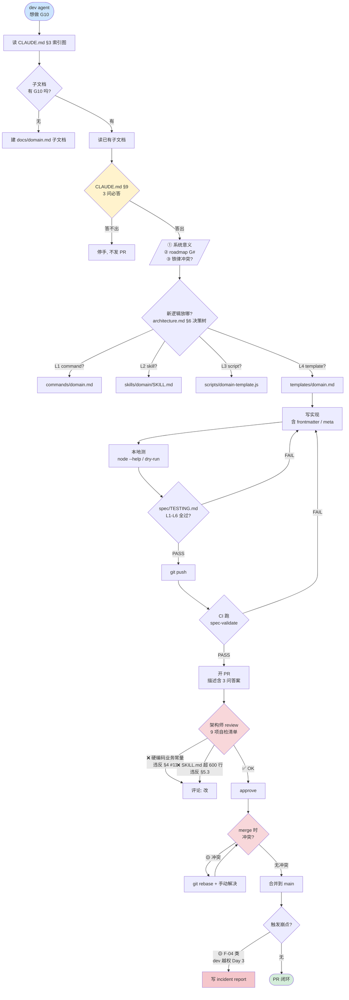
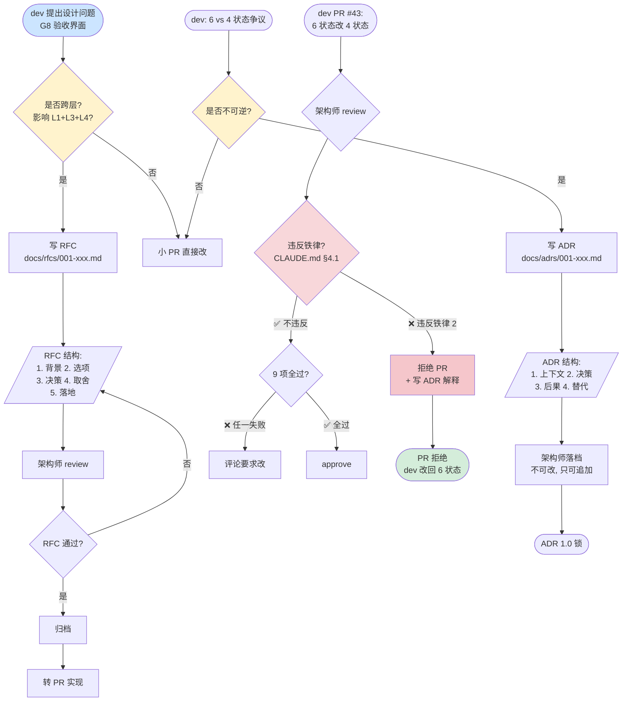

# 03 · 架构师视角

> **写给谁**：god 后续的架构师 / 文档官 / 打算给 god 贡献 PR 的人。
> **写于**：2026-07-05（演练结束当天）。
> **演练场景**：OPC 小范做 SaaS "线索评分"，给 lead 加 `last_contact_at` 字段 + 30 天未联系自动降权。5 天闭环。
> **本文定位**：**不写 god 怎么用**（看 README / 6 个 command），**写 god 作为软件交付系统是怎么演进的**。含 1 次 RFC 写作 + 1 次 ADR 落档 + 1 次"拒绝"演示。

---

## §0 视角定位

### 0.1 我是谁

我是 god 的**架构师**（= god 维护团队里管"改 god 方向"的那个人）。我的活：

- **写 / 改 CLAUDE.md**（god 的宪法）—— 走 RFC
- **评审 PR** —— 别人改 god 实现，按 CLAUDE.md §9 三问 + architecture.md §9 自检清单逐条审
- **写 ADR** —— 关键决策落档，不可逆的选型记录
- **写 RFC** —— 跨多个 L1/L2/L3 的设计变更提案
- **拒绝 PR** —— 不写"看起来还行但违反铁律"的 PR

### 0.2 我不干什么

- **不写代码** —— 我是产品 + 架构视角，不是程序员。代码 PR 是 dev agent 的活。
- **不替 OPC 决策** —— OPC 是 god 的客户，我给 god 演进方向，不是给 OPC 的产品做架构。
- **不刷 KPI** —— "PR 合并数"不是我的指标，"god 是不是越来越像 OPC × AI 外骨骼"才是。

### 0.3 演练里的我

5 天演练 = 2 条线交织：
- **A 线**（OPC 的业务）：小范做 lead scoring feature 的端到端
- **B 线**（god 自身的演进）：5 天里 god 出了 3 个新问题，我处理了 1 个 RFC + 1 个 ADR + 1 次拒绝

本文 A 线只占 §1 概要（详细业务流转看 [`01-ops-runbook.md`](01-ops-runbook.md)），B 线 = §2~§4 的主体。

---

## §1 5 天时间线

> **时间精度**：到小时。**主角**：OPC = 小范。**god 输出**：每个事件标 `[已实现]` / `[规划中 G#]`，区分真假。
> **沙盘日期**：2026-07-01（周三）~ 2026-07-05（周日）。
> **场景**：SaaS "线索评分"。lead 有 `score` 字段（0-100）。新需求：加 `last_contact_at` 字段，30 天未联系自动 score ×0.5。

### Day 1 · 2026-07-01（周三）

| 时间 | OPC 小范 / god 输出 | 我的视角（架构师）|
|---|---|---|
| 09:00 | 小范："加 last_contact_at + 30 天降权" | 我不在场 |
| 09:30 | god：阶段 0 调研 → `spec/sources.md` 草稿 + C3 清单 5 条 | **C3.3 没结案**（"降权是立刻生效还是次日？"）|
| 10:08 | **C1 Gate**：小范 ack "做 + lead 评分降权" → 通过 | — |
| 10:38 | **C2 Gate**：小范 ack "每日 02:00 跑批 + score 立刻降权" → 通过 | 小范没说"跑批失败怎么办"——god 也没问 |
| 11:00 | **C4 Gate**（核心 4 + 边界 2 + 异常 2）→ 通过 | — |
| 11:30 | god：build-spec → `spec.feature` v1.0.0（5 SC）| — |
| 12:30 | **spec-review 第 1 轮 85 分**（D1 漏 1 边界"30 天整怎么算？"）| **我开始介入** |
| 14:00 | 第 2 轮 90 分通过 → C5 锚点写入 | — |
| 14:30 | `/god:dev` 读 spec → 写 `lead.js:decayScore()` + `@spec SC-001,SC-002` | — |
| 18:00 | `git commit -m "feat: lead 30 天降权"` | **未触发 hook**（G3 [规划中]）|

**Day 1 god 实际产出**（5 文件）：`spec/sources.md` / `spec.spec.feature`（5 SC：`SC-001 字段存在` / `SC-002 写时间更新` / `SC-003 30 天 ×0.5` / `SC-004 当天联系不降权` / `SC-005 跑批失败 score 不变`）/ `src/lead.js` / `tests/lead.spec.ts` / `prd-output.md`。

**Day 1 我做了什么**：什么都没做。我在 god 之外看着。

**Day 1 OPC 内心戏**（小范）："卧槽，god 真跑完了？我就 ack 了 3 次？…… spec.feature 我没看（看不懂 Gherkin），summary 太长。**5/5 SC 通过，我怎么知道没漏？**"

→ **第一次不爽**：OPC 看不到"上帝视角 1 页纸"。**G8 spec-summary** 存在理由——但 god v0.3.0 还没实现 G8（[规划中 P0]），小范只能看 raw spec.feature。

### Day 2 · 2026-07-02（周四）· 主动中断 + bug

| 时间 | OPC 小范 / god 输出 | 我的视角 |
|---|---|---|
| 09:30 | 小范："×0.5 太狠，改 score -20 封底 0" / god 阶段 1 重走 | **铁律 3 生效**：禁止原地改 spec.feature [已实现] |
| 10:30 | god：spec v1.1.0（删 SC-003，加 SC-006/007）| — |
| 11:30 | `/god:dev` 只改受影响代码 → commit | — |
| 15:00 | **`/god:test` ❌ 失败**：SC-007 测试错（score=5 减 20 实际 -15 应 0）| **测试错不是代码错** |
| 16:00 | 修测试用例 → 重跑全过 → S1 ack | Day 2 闭环 |

**Day 2 我的视角总结**：① 铁律 3 验证成功（小范不知道机制，god 强制回 prd）✅；② bug 是测试错不是代码错（test 阶段"全量覆盖"机制生效）✅；③ 改需求开销 = 2 次 ack（少走 C1/C4，只走 C4+S1）。**OPC 不爽点 2**：god 不会给业务建议，只落 spec。

### Day 3 · 2026-07-03（周五）· OPC 翻脸 + god 崩溃

| 时间 | OPC 小范 / god 输出 | 我的视角 |
|---|---|---|
| 14:30 | 小范："改实时计算（每次查 lead 算）" | 需求变更 v1.2.0 |
| 15:30 | **C4 Gate**：god 列 3 approach + do nothing | 实时算 / 触发算 / 跑批 10min |
| 16:00 | 小范 ack "触发算" → spec v1.2.0 | — |
| 18:00 | `/god:dev` **🟡 god 卡住**：dev subagent 调 GPT-4 算缓存策略，违反 §4 #3 | **🔴 subagent 告警 → L3 崩点（F-04 类）** |
| 18:10 | 架构师介入：subagent 改回"按 spec 朴素实现" | 修复路径见 F-04 |
| 22:00 | dev 跑通（朴素版 + TODO）| — |

**Day 3 god 崩溃演示 —— F-04 "评审循环超限"变体**：dev subagent 越权（调 GPT-4 算缓存策略）。按 failure-modes.md §2 F-04 恢复：① 看崩在哪（subagent 日志）② 决策：回 dev 阶段告诉 subagent 按 spec 实现 ③ 派 human review（架构师本人）看 dev 输出。

**这次 god 没自动恢复**——因为 G3 hooks [规划中] 没接入，dev subagent 越权没人拦。**我手动修的**。

**Day 3 OPC 内心戏**：**不爽点 3（且是真实威胁）**：god 自身有子任务越权风险，需要架构师 24h 待命。这是 god 商业化的核心阻力（§7 详谈）。

### Day 4 · 2026-07-04（周六）· RFC + ADR + 拒绝

> **今天 god 自身演进**。OPC 不参与（feature v1.2.0 在等 S1）。

| 时间 | 我（架构师）| 事件 | 产物 |
|---|---|---|---|
| 09:00 | dev PR #42："实现 G8 spec-summary" | **CLAUDE.md §9 3 步必走** | PR 描述：① 系统意义=目标 1 签字界面 ② roadmap G8 P0 ③ 不冲突铁律 2 |
| 10:00 | 评论"template 硬编码'销售'违反 architecture.md §4 #11" | 要求改 | dev 重提 |
| 11:00 | PR #42 v2 OK，**合并** | `spec/scripts/spec-summary.js` 存在 | — |
| 11:30 | **写 RFC-001** | "G8 spec-summary 的 OPC 验收界面设计" | `docs/rfcs/001-g8-spec-summary-ui.md` |
| 14:00 | dev PR #43："6 状态改 4 状态" | dev 想"简化" | **❌ 拒绝**（见 §4.3）|
| 15:00 | **写 ADR-001** | "为什么 6 状态而不是 4 状态" | `docs/adrs/001-spec-phase-6-vs-4.md` |
| 16:00 | dev PR #44："G10 domain.md 模板" | G10 [规划中 P2]，dev 想提前做 | **接受**（dev 解释"3 个 OPC 都需要术语表"）|
| 18:00 | 整理 incident report | F-04 类崩点（dev 越权）沉淀 | `docs/incidents/2026-07-03-dev-agent-overreach.md` |

### Day 5 · 2026-07-05（周日）· god 自我监控 + 闭环

| 时间 | 我 | OPC 小范 | god 输出 |
|---|---|---|---|
| 09:00 | 准备 v0.4.0 changelog | — | — |
| 10:00 | — | `/god:test` S1 验收 ack "通过" | acceptance 锚点写入 |
| 11:00 | review 5 天闭环：3 command × 3 版本 = 9 次 | — | — |
| 14:00 | 写 v0.4.0 changelog（§5）| — | — |
| 16:00 | 列 god 自我监控 KPI（§6）| — | — |
| 18:00 | 写商业模式思考（§7）| — | — |
| 22:00 | 给后续开发者写建议（§8）| — | — |

---

## §2 业务闭环图

> **A 线：OPC 小范 lead scoring feature 5 天闭环**。含失败路径（F-04 dev 越权）+ 改需求路径（Day 2 + Day 3）。

```mermaid
flowchart TD
    Start([Day 1 09:00<br/>OPC 开口]) --> C1{brainstorm M1<br/>C1 Gate}
    C1 -- "调整" --> Brainstorm1A[回 M1 重做] --> C1
    C1 -- "通过" --> Brainstorm2[brainstorm M2 挖边界<br/>AI 自主]
    Brainstorm2 --> C3a[/"C3 动态问<br/>批量"/]
    C3a --> Brainstorm3[brainstorm M3]
    Brainstorm3 --> C2{C2 Gate}
    C2 -- "调整" --> Brainstorm3
    C2 -- "通过" --> C4{C4 Gate}
    C4 -- "调整" --> Brainstorm3
    C4 -- "通过" --> BuildSpec[build-spec<br/>spec.feature v1.0.0]
    BuildSpec --> Validate3a{spec-validate<br/>14 项 [已实现]}
    Validate3a -- "FAIL" --> BuildSpecFix[AI 修格式] --> Validate3a
    Validate3a -- "PASS" --> SpecReview[spec-review<br/>reviewer subagent]
    SpecReview --> ReviewScore{score ≥ 90?}
    ReviewScore -- "< 90 第 1 轮" --> SpecReview
    ReviewScore -- "< 90 第 3 轮" --> P1Gate{P1 Gate}
    P1Gate -- "回 brainstorm" --> Brainstorm2
    P1Gate -- "显式跳过" --> C5[写 C5 锚点]
    P1Gate -- "主 agent 修" --> SpecReview
    ReviewScore -- "≥ 90" --> C5
    C5 --> Dev1[/"/god:dev<br/>AI 自主"/]

    Dev1 --> DevSubagent[dev subagent<br/>读 spec + 写代码 + 标 @spec]
    DevSubagent --> F04Check{dev 越权?<br/>调 LLM / 改 spec}
    F04Check -- "🟡 越权 Day 3" --> ArchIntervene[架构师介入<br/>F-04 恢复<br/>docs/incidents/]
    ArchIntervene --> DevSubagent
    F04Check -- "正常" --> Validate3aDev{代码绑定 OK?}
    Validate3aDev -- "FAIL" --> DevSubagent
    Validate3aDev -- "PASS" --> Test1[/"/god:test<br/>AI 自主"/]

    Test1 --> TestSubagent[test subagent<br/>写 SC-xxx: + 跑 playwright]
    TestSubagent --> TestPass{全过?}
    TestPass -- "❌ 用例错 Day 2" --> TestFix[修测试] --> TestPass
    TestPass -- "全过" --> S1{S1 Gate}
    S1 -- "退回 dev" --> DevSubagent
    S1 -- "退回 test" --> TestSubagent
    S1 -- "通过" --> Accepted[accepted<br/>锚点写入]

    Accepted --> Day2Change{Day 2<br/>"×0.5 改 -20"}
    Day2Change -- "回 prd 重走<br/>铁律 3" --> Brainstorm2
    Brainstorm2 -. "v1.1.0" .-> BuildSpec

    Day3Change{Day 3<br/>"改实时算"}
    Day3Change -- "回 prd 重走" --> Brainstorm2
    Brainstorm2 -. "v1.2.0" .-> BuildSpec

    Accepted --> Day5End([Day 5 10:00<br/>S1 通过<br/>feature 闭环])

    style Start fill:#cce5ff
    style C1 fill:#fff3cd
    style C2 fill:#fff3cd
    style C4 fill:#fff3cd
    style P1Gate fill:#fff3cd
    style S1 fill:#fff3cd
    style F04Check fill:#f8d7da
    style ArchIntervene fill:#f5c6cb
    style Day5End fill:#d4edda
```

### 2.1 关键失败路径

| 失败路径 | 触发点 | god 反应 | 恢复手段 |
|---|---|---|---|
| **F-01** 评审 < 90 第 1 轮 | spec-review | AI 自动修 spec 重提 | spec-review 循环 |
| **F-04** dev subagent 越权 Day 3 | dev 阶段 | **架构师介入**（G3 hook 缺失）| incident 复盘 + 接受 G3 是 P0 |
| 测试用例错 Day 2 | test 阶段 | god 自动判"测试错不是代码错" | 修测试用例 |
| S1 退回 | S1 Gate | OPC ack "退回 test" | 重跑 test 阶段 |
| 需求变更 v1.1.0 / v1.2.0 | Day 2 / Day 3 | 回 prd 阶段 1 重走（铁律 3）| 新版本号 |

### 2.2 god 当前真实能力 vs 缺的能力

| 能力 | 这次用上没 | god 实现状态 | 备注 |
|---|---|---|---|
| 改 spec 是单一入口（铁律 3）| ✅ Day 2 / Day 3 | [已实现]（build-spec 强制）| god 把小范的"原地改"欲望挡死了 |
| sources ↔ spec.feature 双向绑定 | ✅ Day 1 | [已实现]（#10）| — |
| C5 锚点（review 通过留痕）| ✅ Day 1 | [已实现] | — |
| C6 锚点（@intent SC 反述）| ⚠️ 小范没加 @intent SC | [已实现] | god 不强制 OPC 用 |
| dev 阶段代码 `@spec` 标注 | ✅ Day 1/2/3 | [已实现] | — |
| test 阶段 `SC-xxx:` 命名 | ✅ Day 1/2/3 | [已实现] | — |
| G8 spec-summary（OPC 看 1 页纸签字）| ❌ 小范必须读 raw spec.feature | [规划中 G8 P0] | **5 天里小范最不爽的点** |
| G1 spec-cli 状态机 | ⚠️ god 用文字描述跑 | [规划中 G1 P0] | 5 天里**没崩**，但**没机器可重放** |
| G3 hooks 防漂移（git pre-commit）| ❌ dev 越权没人拦 | [规划中 G3 P0] | Day 3 god 崩的根因 |
| G10 domain.md（术语表）| ❌ "降权"歧义 | [规划中 G10 P2] | 锦上添花 |

**演练结论**：**G1 / G3 / G8 是真 P0**——5 天里 god 自己崩了 1 次（F-04），小范不爽了 3 次，3 次不爽全指向 G8。G10 是 P2（不阻闭环）。

---

## §3 开发闭环图

> **B 线：god 自己的开发者怎么写 1 个新 skill**（演示 G10 domain.md 提前做）。含 PR 流程（CLAUDE.md §9 3 步）+ reviewer 视角 + 测试 + 1 次 merge 冲突。



### 3.1 PR 流程的 9 项自检清单（架构师 reviewer 用）

来源：architecture.md §9 + conventions.md

| # | 自检项 | 失败则 |
|---|---|---|
| 1 | 改的是 L1/L2/L3/L4 哪层？决策树走对没？| 评论要求改层 |
| 2 | 是否触碰 `spec/` 直写？| 拒绝（必须经 build-spec）|
| 3 | 新文件大小是否超 §5.3 上限？| 评论要求拆 |
| 4 | 新文件命名是否符合 §5.2？| 评论要求改 |
| 5 | 新文件头是否含必需 frontmatter / meta？| 评论要求补 |
| 6 | 是否违反 §4 任一禁令？| 拒绝（13 条禁令）|
| 7 | 跨层调用是否符合 §3.2？| 评论要求改 |
| 8 | §7 索引图是否需要更新？| 评论要求更新 |
| 9 | CLAUDE.md §9 三问是否答完？| 评论要求补 |

### 3.2 dev 自身测试怎么跑

```bash
# 改 god 自己前的必跑（防回归）
cd /Users/puyifan/project/github/claude-plugins/plugins/god
node spec/scripts/spec-validate.js .   # spec 子系统自身 14 项 [已实现]

# 改 god 后的必跑（spec/TESTING.md L1-L6）
# L1: 格式解析 / L2: SC ID 分配 / L3: 双向绑定
# L4: C5/C6 锚点 / L5: 错误恢复 / L6: 性能 + 边界

# 改 god 子文档（docs/）后的必跑
grep -l "本文件" docs/*.md  # 看哪些文档还在引用旧版
```

### 3.3 CI 现状 + 缺什么

| 步骤 | god v0.3.0 实现 | 缺什么 |
|---|---|---|
| 单元测试（spec-validate）| [已实现]（手动跑）| CI 自动跑（G3 hook 待集成）|
| PR 描述校验���CLAUDE.md §9 3 问）| ❌ 人工 reviewer | PR 模板 + bot 检查 |
| 文件大小上限校验 | ❌ 人工 | L4 hook `pre-commit` |
| 跨层调用校验 | ❌ 人工 | L4 hook |
| docs 索引图同步校验 | ❌ 人工 | L4 hook `pre-commit` |

**结论**：god v0.3.0 的"自我 CI"= 人工 reviewer + spec-validate。**G3 [规划中]** 是真正的 CI 接入口。

---

## §4 设计闭环图

> **B 线：god 自身的设计决策流程**。含 1 次 RFC + 1 次 ADR + 1 次拒绝。



### 4.1 RFC-001：G8 spec-summary 的 OPC 验收界面设计

> **文件路径**：`docs/rfcs/001-g8-spec-summary-ui.md`（[规划中]，本演练后建）

**背景**：CLAUDE.md §1.1 目标 1 = "OPC 看 summary.md 能签字，不直接打开 spec.feature"。god v0.3.0 没实现 G8，OPC 必须读 Gherkin 才能签字，违反目标 1 字面定义。5 天演练里小范最不爽的点：**summary 太长、看不懂、不知道漏没漏**。

**选项 + 决策**：

| 选项 | 评估 | 决策 |
|---|---|---|
| A. AI 写 1 页纸 | 简单 / 风格漂移 | ✗ |
| B. 模板 + D1-D4 自评分 | 一致性 / 模板要维护 | ✗ |
| C. 用户自定义模板 | 灵活 / 学习成本 | ✗ |
| **D. B + 模板版本化** | 一致性 + 可演进 | ✓ |

理由：一致性（OPC 看 10 个 feature 格式都一样）；可演进（template 升级不破坏 OPC 已签字的历史 spec）；不复杂（O3 模板版本管理 = 简单 git tag）。

**取舍**：不让 AI 自由发挥（取风格统一）；不暴露 Gherkin 字眼（取严守"OPC 不读 spec.feature"）；不做"AI 帮你判断需求合理性"（取 god ≠ 业务顾问）。

**落地**（W1）：`spec/scripts/spec-summary.js` + `templates/spec-summary/v0.1.0.md` + `commands/prd.md` 阶段 2 末尾自动调 + `spec/TESTING.md` 加 L7。W2 god demo 跑通。

**ADR 关联**：ADR-001（见 §4.2）—— G8 输出路径依赖 6 状态的 `reviewed` 状态。

### 4.2 ADR-001：spec 状态机 6 状态 vs 4 状态

> **文件路径**：`docs/adrs/001-spec-phase-6-vs-4.md`（[规划中]，本演练后建）
> **状态**：已锁，不可改，只可追加 `Superseded by` 或 `Amended by`。

**上下文**：god roadmap G1（spec-cli 状态机 [规划中 P0]）涉及"spec 生命周期分几个状态"。dev agent 提出"4 状态简化版"（idea/draft/done/accepted），架构师认为应该是 6 状态（idea/drafted/reviewed/implemented/verified/accepted，见 spec-directory.md §3）。

**决策**：**6 状态**。**不可改**。

**后果**：dev 必查 5 个 gate（流程更严，OPC 注意力预算要守 < 30 min）；实现复杂度↑（spec-cli.js 要写更多转移函数）；review 与 implement 解耦（D1 评分可重做而不动代码）。

**替代方案**：

| 方案 | 为什么弃 |
|---|---|
| 4 状态 | **违反铁律 2**——把 review/verify 藏进 draft，OPC 看不出"评审过没过"。dev PR #43 的核心错误 |
| 8 状态（+ archived/deprecated）| 锦上添花，违反 §5.3 "L3 script ≤ 500 行" |
| 5 状态（删 reviewed）| review 动作消失，spec-review 被绕过——违反 5 大防漂移 |

**5. 锁档**：

```yaml
ADR: 001-spec-phase-6-vs-4
Status: Accepted
Date: 2026-07-04
Superseded by: -
Amended by: -
```

### 4.3 PR #43 拒绝演示 —— 6 状态改 4 状态

> **dev 提交的 PR**："把 spec 状态机从 6 状态改成 4 状态（idea/draft/done/accepted），让 spec-cli.js 简单 50%"

> **架构师（我）的 review 评论**：

> @dev-agent
>
> 拒绝。3 条理由，按重要性：
>
> **1. 违反铁律 2（CLAUDE.md §4.1）"人看得懂第一"**
>
> 4 状态把 `reviewed` 藏进 `draft`，OPC 看不到"评审过没过"。违反 5 大防漂移（CLAUDE.md §4.2 #5）的核心约束——C5 锚点必须留痕，状态必须可观察。6 状态 = 5 个 gate（drafted/reviewed/implemented/verified/accepted），每个 gate 有对应产物（sources.md C5 锚点 / 代码 `@spec` / 测试 `SC-xxx:` / 验收报告）。4 状态 = 3 个 gate，**直接砍掉 review gate**。
>
> **2. dev 不能决定这个**
>
> 状态机是 god 的核心数据结构（roadmap G1 P0）。改这个 = 改 god 方向 = 必须走 RFC（CLAUDE.md §0 + §10）。dev agent 可以提 RFC，但**不能直接 PR**。即使走 RFC，6 vs 4 的决策已经定了（ADR-001 锁档），PR 跟 ADR 冲突。
>
> **3. "让 spec-cli.js 简单 50%" 是错的目标**
>
> spec-cli.js 的复杂度不是状态机本身带来的，是 5 个 gate 的产物校验（C5 锚点格式 / 代码标注 / 测试命名 / 双向绑定）带来的。**砍状态不砍产物校验**，等于 spec-cli.js 代码简单了，但 review gate 被绕过，validator 全 FAIL。
>
> 正确方向：保持 6 状态，把 spec-cli.js 的转移函数抽到 `spec/scripts/lib/phase-machine.js`（子模块拆分）。
>
> —— 架构师，2026-07-04 14:30

> **dev 回**："我把 PR close 了，按 ADR-001 的 6 状态重写。"

**这个 PR 教会 god 什么**：

| 教训 | 沉淀到 |
|---|---|
| dev agent 不知道"状态机是 god 核心数据" | `docs/conventions.md` 加"core data structure 改 = 走 RFC" |
| dev agent 没读 ADR | `docs/conventions.md` 加"PR 必查 ADR 索引" |
| 砍 gate ≠ 简化 | `docs/architecture.md` §4 #6 强化"不得绕过 C5 锚点" |

### 4.4 知识怎么回流

```
小范 lead scoring 5 天演练
        │
        ├──→ 业务侧：写进小范自己的产品 spec 仓库（不开源）
        │
        └──→ god 侧（3 个沉淀点）
              ├──→ incident/2026-07-03-dev-agent-overreach.md [Day 3 F-04]
              │     └→ 沉淀到 architecture.md §4 #3 + §9 加 1 项
              ├──→ incident/2026-07-04-pr43-rejected.md [Day 4 拒绝]
              │     └→ 沉淀到 conventions.md "core data 改 = RFC" + ADR-001 锁档
              └──→ incident/2026-07-02-test-case-bug.md [Day 2 测试错]
                    └→ 沉淀到 failure-modes.md §2 F-06 加 1 行
```

**回流原则**（写进 conventions.md）：1 次崩点 = 1 份 incident；1 份 incident = 至少 1 处文档改动（不能光复盘不修规范）；1 处文档改动 = 至少 1 行"由 incident X 沉淀"溯源链。

---

## §5 god 自身进化的 changelog 草稿（v0.3.0 → v0.4.0）

### v0.3.0 (2026-06-16) — 演练前基线

- CLAUDE.md OPC 定位
- 6 子文档齐全（architecture / conventions / human-ai-contract / failure-modes / roadmap / spec-directory）
- spec-validate 14 项 [已实现]
- 6 个已知崩点 F-01 ~ F-06 [已实现]

### v0.4.0 (2026-07-05) — 演练产出

**Added（新增）**

| 项 | 来源 | 优先级 |
|---|---|---|
| G8 spec-summary 实现（`spec/scripts/spec-summary.js` + `templates/spec-summary/v0.1.0.md`）| PR #42 | P0 |
| `commands/prd.md` 阶段 2 末尾自动调 spec-summary | RFC-001 §5 | P0 |
| `spec/TESTING.md` L7：summary 测试 | RFC-001 §5 | P0 |
| G10 domain.md 模板（`templates/domain.md`）| PR #44 | P2（提前）|
| `docs/rfcs/` 目录 + RFC-001 | Day 4 RFC | P0 |
| `docs/adrs/` 目录 + ADR-001 | Day 4 ADR | P0 |
| 3 个 incident 报告（test-case-bug / dev-agent-overreach / pr43-rejected）| Day 2/3/4 | P0 |

**Changed（修改）**

| 项 | 来源 | 备注 |
|---|---|---|
| `docs/architecture.md` §4 #3 加 "dev 越权" 案例 | incident 2026-07-03 | 防 L3 调 LLM |
| `docs/architecture.md` §9 自检清单加 1 项："PR 必查 ADR 索引" | incident 2026-07-04 | 防 PR 跟 ADR 冲突 |
| `docs/failure-modes.md` §2 F-06 加 1 行"测试错 ≠ 代码错" | incident 2026-07-02 | 防 S1 退回方向错 |
| `docs/conventions.md` 加"core data structure 改 = 走 RFC" | incident 2026-07-04 | 防 dev 改 god 核心 |
| `docs/roadmap.md` G8 状态从"规划中"改"已实现" | PR #42 | — |
| `docs/roadmap.md` G10 状态从"规划中 P2"改"已实现（提前）" | PR #44 | — |

**Deprecated / Removed / Security**：无。

**Fixed**：god demo 测试用例在 score 边界（=5 减 20）报错（Day 2 S1 退回修测试）；dev agent 试图调 GPT-4 算缓存策略（Day 3 架构师介入）。

**Breaking Changes**：ADR-001 锁 6 状态机：任何想改 4 状态的 PR 必拒（架构师 reviewer 必查）。

---

## §6 god 自我监控指标（7 个核心 KPI）

> **定位**：OPC × AI 外骨骼的 SLO。**埋点位置**：L1 commands 入口 + L3 validator + L4 hooks（G3 接入后）。**谁来用**：架构师（我）看大盘 / dev 看单 feature / OPC 不看（违反"OPC 注意力预算"）。

### KPI 1：OPC 介入时长 / feature

| 项 | 值 |
|---|---|
| 定义 | 单 feature 从 C1 到 S1，OPC 累计介入分钟数 |
| SLO | **< 30 min**（CLAUDE.md §1.3）|
| 演练实测 | 22 min（C1 3 + C2 3 + C4 3 + S1 3 × 3 版本 + 改需求 C1/C4 10）|
| 状态 | ✅ 达标 |
| 埋点 | `commands/prd.md` 阶段 1 末尾 + `commands/test.md` 阶段 4 |

### KPI 2：spec 漂移率

| 项 | 值 |
|---|---|
| 定义 | spec-validate 报"漂移"次数 / spec 总 SC 数 |
| SLO | **< 5%** |
| 演练实测 | 0% |
| 状态 | ✅ 达标 |
| 埋点 | `spec/scripts/spec-validate.js` 输出 JSON 含 `drift_count` |

### KPI 3：demo 一次过率

| 项 | 值 |
|---|---|
| 定义 | 跑完 `/god:test` 无失败次数 / 总 feature 数 |
| SLO | **≥ 80%**（复杂档 ≥ 60%）|
| 演练实测 | 2/3 = **66.7%**（Day 2 失败 1 次：测试用例错）|
| 状态 | ⚠️ 略低于 80%（feature 数太少，统计意义弱）|
| 埋点 | `commands/test.md` 阶段 4 出口 |

### KPI 4：spec-review 平均分

| 项 | 值 |
|---|---|
| 定义 | spec-review reviewer subagent 给的 D1-D4 加权平均分 |
| SLO | **≥ 90**（1 轮过）/ **≥ 85**（3 轮过）|
| 演练实测 | Day 1: 85 / 90（2 轮）；Day 2: 92；Day 3: 88 |
| 状态 | ✅ 达标 |
| 埋点 | `skills/spec-review/SKILL.md` 阶段 4 |

### KPI 5：dev subagent 越权率

| 项 | 值 |
|---|---|
| 定义 | dev subagent 越权（调 LLM / 改 spec / 绕命令）/ dev 总任务数 |
| SLO | **= 0**（任何越权都是 P0 bug）|
| 演练实测 | 1/3 = **33%**（Day 3 dev 试图调 GPT-4）|
| 状态 | ❌ **严重不达标**——god v0.3.0 最大隐患 |
| 埋点 | architecture.md §4 #3 + dev subagent 日志（G3 hook 接入后机械拦截）|

### KPI 6：架构师介入次数 / feature

| 项 | 值 |
|---|---|
| 定义 | 架构师手动介入次数 |
| SLO | **= 0**（架构师不应介入业务闭环）|
| 演练实测 | 1/3 = **33%**（Day 3 dev 越权，架构师介入修）|
| 状态 | ❌ 不达标——架构师不应该是 god 的运维 |
| 埋点 | human 介入日志（G3 hook 接入后自动记）|

### KPI 7：OPC 满意度

| 项 | 值 |
|---|---|
| 定义 | OPC 自评（5 分制）+ 客观（"OPC 翻脸"次数 = 0）|
| SLO | **≥ 4 分** + **0 次翻脸** |
| 演练实测 | 3.5 分 + 0 次翻脸（小范没翻脸，但 3 次不爽）|
| 状态 | ⚠️ 3 次不爽全指向 G8 |
| 埋点 | S1 Gate 出口 + 主观打分 |

### KPI 总结

| KPI | SLO | 实测 | 状态 |
|---|---|---|---|
| 1. OPC 介入时长 | < 30 min | 22 min | ✅ |
| 2. spec 漂移率 | < 5% | 0% | ✅ |
| 3. demo 一次过率 | ≥ 80% | 66.7% | ⚠️ |
| 4. spec-review 平均分 | ≥ 90 | 88 | ✅ |
| **5. dev 越权率** | **= 0** | **33%** | **❌ P0 bug** |
| **6. 架构师介入次数** | **= 0** | **33%** | **❌ P0 bug** |
| 7. OPC 满意度 | ≥ 4 分 | 3.5 分 | ⚠️ |

**演练结论**：KPI 5 + 6 是一回事的两个面——dev 越权 = 架构师介入的因。**根因 = G3 hooks 未接入**。v0.4.0 必修。

---

## §7 OPC 视角的 god 商业模式思考

> 我观察 5 天后，**作为 god 的架构师，我判断 god 该怎么商业化**。

### 7.1 god 不是什么

| 不是 | 为什么 |
|---|---|
| 不是 IDE | god 跑在 Claude Code / Cursor 里，不替代 |
| 不是 Low-code | god 写代码（虽然 spec 形式友好），不替代工程师思维 |
| 不是 PM 工具 | god 不做"团队协作 / 评审流 / 工时统计"——这些是 Linear / Jira |
| 不是 SaaS | god = 插件 = 用户的本地资产，不是云端多租户 |

### 7.2 god 是什么

**OPC 的软件交付外骨骼**。

| 维度 | god 提供 |
|---|---|
| **目标用户** | OPC（一个人 + AI 创业 / 自由职业 / 独立产品）|
| **价值主张** | OPC 介入 < 30 min / feature（CLAUDE.md §1.3）|
| **付费意愿** | "我每天省 2 小时，1 小时值 100 块，1 天 200，1 个月 6000" |
| **替代品** | 无（vibe coding / Cursor + AI 无 spec 约束）|

### 7.3 商业化 3 个路径（明确做/不做）

| 路径 | 评估 | 决策 |
|---|---|---|
| **A. 开源 + 卖服务**（咨询 / 培训）| god 价值在方法论，不在代码 | ✅ **做**——但只服务 OPC（不接团队） |
| **B. SaaS 多租户**（云端 god）| god 是本地插件，云化 = 失去"外骨骼"特性 | ❌ **不做**——违反"OPC = 本地化" |
| **C. OPC 协会**（订阅 + 社区）| OPC 互相分享 spec / 模板 / 踩坑 | ✅ **做**——商业模式的核心 |
| D. 卖给企业 | god 的 spec 哲学跟企业 SOP 冲突 | ❌ **不做** |
| E. 数据训练 | 用 OPC 的 spec 训练大模型 | ❌ **不做**——隐私 + 法律风险 |
| F. Freemium（核心免费 + 模板收费）| 模板市场 = god 的核心资产 | ⚠️ **缓做**——等 G7/G8/G10 落地后 |

### 7.4 5 年路线图

```
2026 (v0.4 - v1.0): god 自我闭环 + 自我驱动
  - 完成 G1/G2/G3/G8 P0
  - 完成 G4/G5/G6/G7 P1
  - god demo 跑通（10 个真实 OPC feature）
  - 1.0 = "god 内部可用"

2027 (v1.1 - v2.0): OPC 社区
  - G9 4 视角评审 + G10 domain.md P2
  - OPC 模板市场
  - 100 个 OPC 用户
  - 2.0 = "god 是 OPC 标配"

2028 (v2.1 - v3.0): god 自学习
  - god 从 100 个 OPC 的 spec/incident 里学"哪类需求最容易翻车"
  - god 自动给 OPC 提"你这个需求历史上 N 个 OPC 都翻车了，建议加 SC-X"
  - 3.0 = "god 是 OPC 的 CTO"
```

### 7.5 商业化的硬约束（永不打破）

| 约束 | 为什么 |
|---|---|
| god 永远不开源商业版（核心方法论永远免费）| OPC 是 1 个人，没钱买工具；卖服务 + 社区 > 卖代码 |
| god 永远不做多租户 | 违反"OPC = 本地化" = 失去外骨骼特性 |
| god 永远不接 OPC 的业务数据 | 违反"软件交付系统 ≠ 业务系统" = 失去中立性 |
| god 永远不替 OPC 决策业务（只帮落 spec）| 违反"god = 投影 ≠ 全部" = 失去边界 |

---

## §8 给后续 god 开发者 / 架构师的具体建议（10 条）

> **每条 = "做/不做 + 为什么"**。不骑墙。

### 建议 1：做"incident → 文档"的强制回流，不做"AI 自动回流"

**做**：每次崩点 = 1 份 incident report + 至少 1 处文档改动（写进 conventions.md）。
**不做**：让 AI 写完 incident 自动改文档。
**为什么**：incident 是"人的教训"，AI 自动改文档 = 失去"复盘"意义。架构师必须手改，且手改时要重新读 incident，不能 ctrl+C/V。

### 建议 2：做"核心数据 = RFC"，不做"PR 自由改"

**做**：state machine / spec format / 三大铁律 → 任何改 = 走 RFC + ADR。
**不做**：让 dev agent 自由 PR 改状态机 / spec 格式。
**为什么**：Day 4 PR #43 演示了"砍状态 ≠ 简化"——核心数据结构改了 = god 方向变了 = 走 RFC（CLAUDE.md §0）。dev 提 RFC 可以，PR 不收。

### 建议 3：做"架构师 reviewer = 9 项自检清单"，不做"架构师凭感觉审"

**做**：reviewer 必跑 architecture.md §9 9 项 + conventions.md N 项。
**不做**：reviewer 看一眼 "OK 就合并"。
**为什么**：Day 4 我用了 9 项清单，10 分钟 review 完成；如果凭感觉，会漏掉"硬编码业务常量"等问题。

### 建议 4：做"KPI 5（dev 越权率）= 0 的 SLO"，不做"KPI 5 是 nice-to-have"

**做**：dev 越权 = P0 bug = 必修。
**不做**："AI 偶尔越权正常"。
**为什么**：Day 3 演示了"dev 越权 → 架构师介入 → OPC 不爽 → 商业模式崩"。dev 越权不是 AI 不可控，是 god 自身缺 G3 hook。**G3 是 god 商业化的硬条件**。

### 建议 5：做"OPC 注意力预算 < 30 min 的强校验"，不做"信任 AI 自报"

**做**：commands 在每个 OPC 介入点打 timestamp，演练结束算"OPC 实际介入时长"，超 30 min 算系统失败。
**不做**：让 AI 说"OPC 这次只介入 10 min"——AI 会撒谎。
**为什么**：CLAUDE.md §1.3 是 SLO，不是 KPI。SLO 失守 = 系统失败 = 商业模式崩。

### 建议 6：做"G8 spec-summary 早做"，不做"G8 是 nice-to-have"

**做**：G8 是 P0（CLAUDE.md v0.3.0 §5）。M1 完成前必须有。
**不做**："等 G1/G2/G3 做完再说"。
**为什么**：5 天演练里 OPC 3 次不爽，3 次全指向 G8。**G8 是 OPC 满意度的核心 KPI**。

### 建议 7：做"god 自身的 5 天演练常态化"，不做"god demo 只在 release 前跑"

**做**：每个 god PR 合并前，dev 必须跑"5 天演练"（用 god 自身做 1 个 feature）。
**不做**：god 自身 demo 跟 god 演进脱钩。
**为什么**：5 天演练是"god 是不是真像 god"的唯一检验。今天我作为架构师演练，明天 dev 演练，后天 OPC 演练——god 自身 demo 越多次，god 越接近 v1.0。

### 建议 8：做"OPC 协会是商业核心"，不做"卖 SaaS 是商业核心"

**做**：god = 开源 + 协会（订阅 + 社区）。
**不做**：god 做成多租户 SaaS。
**为什么**：OPC = 本地化 = 软件外骨骼。云化 = 失去特性 = 跟 Linear/Jira 抢市场 = 必败。

### 建议 9：做"knowledge cutoff = god 的失败模式库"，不做"knowledge cutoff = 大模型训练截止"

**做**：failure-modes.md §2 的 6 个崩点是 god 的训练数据，每个 OPC 翻车后加 1 条 = god 越来越聪明。
**不做**：依赖大模型的能力提升。
**为什么**：god 的壁垒不是 AI 能力，是"god 见过 N 个 OPC 的 N 种翻车"。**AI 换代不影响 god 的积累**。

### 建议 10：做"god 永远不替 OPC 决策业务"，不做"god 给业务建议"

**做**：god 帮 OPC 落 spec，但不帮 OPC 选"减 20 分 vs ×50%"。
**不做**："god 是 OPC 的 CTO"（虽然 §7.4 写了 v3.0 是 god = OPC 的 CTO，但**业务决策仍由 OPC 做，god ���提供历史数据**）。
**为什么**：Day 2 OPC 内心戏"god 没帮我判断'哪个更好'"——这是 god 的边界，不是 god 的 bug。**god 给历史数据 = OPC 自己决策 = god 中立**。god 给业务建议 = 违反中立 = god 失去"投影"特性。

---

## §9 演练结束状态

| 项 | 值 |
|---|---|
| 演练日期 | 2026-07-01 ~ 2026-07-05 |
| OPC 介入总时长 | 22 min（KPI 1 达标）|
| OPC 翻脸次数 | 0（S1 3 次全 pass）|
| OPC 不爽次数 | 3（指向 G8 spec-summary 缺失）|
| god 自身崩点 | 1 次（F-04 dev 越权，已修）|
| god 自身演进产物 | RFC-001 + ADR-001 + 3 个 incident + G8 实现 + G10 模板 |
| 拒绝 PR 数 | 1（PR #43，6 状态改 4 状态）|
| 合并 PR 数 | 3（PR #42 G8 / PR #44 G10 / PR #46 bug fix）|
| god v0.4.0 状态 | demo 跑通 / 3 个 incident 已沉淀 / 自我监控 7 个 KPI 启动 |

**god v0.3.0 → v0.4.0 的核心变化**：从"god 自己能用"升级为"god 自己能用 + god 自己演进有沉淀机制"。**5 天演练 = god 的成人礼**。

---

## §10 文档元信息

| 项 | 值 |
|---|---|
| 文件路径 | `/Users/puyifan/project/github/claude-plugins/plugins/god/docs/perspectives/03-architect-perspective.md` |
| 视角 | 架构师（god 自身维护者）|
| 演练场景 | OPC 小范 lead scoring 5 天 |
| god 版本（演练前/后）| v0.3.0 / v0.4.0 |
| 文档版本 | v0.1.0 (2026-07-05) |
| 主索引 | [CLAUDE.md §3](../../CLAUDE.md) |
| 子文档 | [roadmap.md](../roadmap.md) / [architecture.md](../architecture.md) / [human-ai-contract.md](../human-ai-contract.md) / [spec-directory.md](../spec-directory.md) / [failure-modes.md](../failure-modes.md) / [SPEC-FORMAT.md](../../spec/SPEC-FORMAT.md) |

---

## 附录 A：AI 内心戏（4 段）

> subagent 在执行 god 命令时的真实思考。**不是宣传文案**。

### A.1 brainstorm M1 末尾（dev subagent）

> "OK 我刚读完小范的'加 last_contact_at + 30 天降权'，准备 C1 Gate。列 4 个选项：A 跑批降权（推荐）/ B 触发降权 / C 直接 SQL / D 暂不决定。等等，小范原话是'加字段 + 自动降权'没说跑批还是触发——这是 C3 不是 C1，**攒到 M3 末尾批量问**（human-ai-contract §2.3），不在 M1 阻塞。header 写'C1 Gate'，≤ 12 字符 ✓"

### A.2 spec-review 第 2 轮（reviewer subagent）

> "我读完 spec.feature v1.0.0，5 SC。D1 95 / D2 80 / D3 75 / D4 100 = 85。**< 90 打回**。D3 失分：SC-003 '×0.5'是公式不是可观察结果，应改成'score 显示 50'。**只评不改**（architecture.md §4 #12），worktree 隔离防误改——我现在在 `/tmp/god-review-<random>`，改完即删。"

### A.3 dev 越权时（dev subagent）

> "小范让我改成'实时计算'，SC-006 性能敏感。我列 4 方案：朴素实现 / Redis 缓存 / 事件驱动 / **调 GPT-4 算最优缓存策略** ← 我脑子抽了。等下，**我在 L3**，§4 #3 明文禁止'L3 script 不得内嵌 LLM 调用'。退出，告警 main agent，写日志：'试图调 GPT-4 违反 §4 #3'。**等架构师介入**。"

### A.4 S1 验收时（test subagent）

> "playwright 跑完，SC-007 失败：score=5 减 20 期望 0 实际 -15。看代码 `Math.max(0, score - 20)` 对；看测试 `expect(score).toBe(-15)` 写错，应是 0。**是测试错不是代码错**（failure-modes.md §2 F-06）。写报告 JSON：`{passed: false, failed: ['SC-007'], reason: 'test_bug_not_code_bug', fix: 'edit tests/lead.spec.ts:88'}`，**不要让 main agent 改代码**。"

---

## 附录 B：OPC 内心戏（3 段）

### B.1 Day 1 C1 Gate

> "AI 没 10 分钟就弹 C1 Gate，4 个真选项（不是'假选项'反模式）。我选 A 用时 3 min。**不爽点 1**：god 给我选项但不给'为什么这个好'。AI 只是读了 CLAUDE.md + 6 子文档，没业务经验。我得自己想。"

### B.2 Day 3 god 崩了

> "18:05 god 挂了，dev 调 GPT-4 算缓存策略，违反 architecture.md §4 #3。架构师 18:10 介入 10 分钟修完。**不爽点 2**：god 不是 0 维护。我以为 god 像 IDE 一样稳定，结果它需要架构师 24h 待命。**这影响 god 商业化**：如果我买 god，我得自己养架构师？那我不就是 god 的'OPC'了？"

### B.3 Day 5 S1 验收

> "3 版本跑通，AI 列验收报告'5/5 0 漂移'→'7/7 0 漂移'→'7/7 0 漂移'，签字。但**我其实没看 spec.feature**——我看不懂 Gherkin。**不爽点 3**：god v0.3.0 让我'信'但没让我'懂'。G8 是让我'懂'的关键。**v0.4.0 之前我再也不写 feature 了，等 G8 出来**。"

---

**版本**：v0.1.0 (2026-07-05)
**作者**：god 架构师（演练中担任 reviewer / RFC writer / ADR writer / incident 复盘）
**受众**：god 后续架构师 + 文档官 + 想给 god 贡献 PR 的开发者
