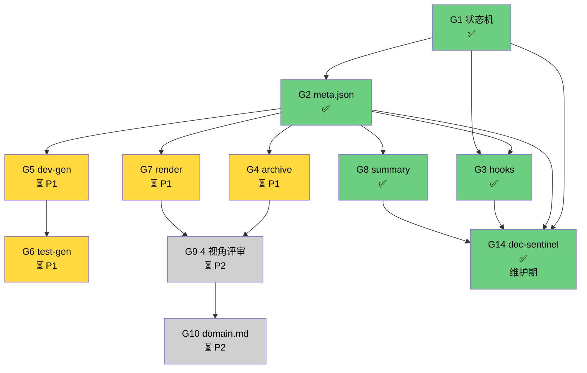

# god 改造路线图

> CLAUDE.md §5 指向的子文档。**剩余缺口 + 优先级 + 依赖 + 里程碑**。
> 改 god 的方向 = 看本文件。

## 0. 文档定位

- **本文件是 god 的施工计划**：列缺口、定优先级、排执行序
- **本文件不承载**：每块缺口的详细设计（那些在各自 RFC / 文档）
- **修改本文件**：需走 RFC，影响 god 演进方向
- **状态约定**：✅ 已落 / ⏳ 规划中 / ❓ 搁置；G1-G10 是历史编号（按落地顺序）非优先级序号

---

## 1. 真实状态速览

CLAUDE.md §5 把 10 块缺口按性质归并为 4 层。下表是**每块缺口的当前真实状态**。

| 层 | 历史编号 | 缺口 | 真实状态 | 落点 |
|---|---|---|---|---|
| 规范层 | G1 | spec-cli 状态机 | ✅ 已落（commit `fc31904`）| `spec/scripts/spec-cli.js` |
| 规范层 | G2 | spec.meta.json | ✅ 已落（commit `fc31904`）| `spec/meta.json` schema + spec-cli 读写 |
| 呈现层 | G7 | spec-render | ⏳ 规划中（P1）| — |
| 呈现层 | G8 | spec-summary | ✅ 已落 | `spec/scripts/spec-summary.js` + `templates/spec-summary/v0.1.0.md` |
| 驱动层 | G5 | dev-gen | ⏳ 规划中（P1）| — |
| 驱动层 | G6 | test-gen | ⏳ 规划中（P1）| — |
| 驱动层 | G4 | spec-archive | ⏳ 规划中（P1）| — |
| 防护层 | G3 | hooks 防漂移 | ✅ 已落（commit `229ab76`）| `templates/hooks/pre-commit.sh` + `session-end.sh` + `install-hooks.js` |
| 防护层 | G9 | 4 视角评审 | ⏳ 规划中（P2）| — |
| 防护层 | G10 | domain.md | ⏳ 规划中（P2）| — |
| 维护层 | **G14** | **doc-sentinel 后台文档巡检** | **✅ 已落** | **`commands/doc-sentinel.md` + `skills/doc-sentinel/` + `scripts/doc-sentinel/`（9 check + 42 测）** |

**P0 已全部落地**（G1/G2/G3/G8，4 块）。**维护期 G14 已落**。当前剩余 = P1（4 块）+ P2（2 块）。

> **v0.2.x 状态说明**：早版 `scripts/hooks/` 7 个文件因从未挂载到 `settings.json` 而作为孤岛脚本被删除。G3 已用**新形态**（`templates/hooks/` 模板 + `install-hooks.js` 一键安装）重建，**不重建老 7 个脚本**。

---

## 2. 剩余缺口清单（6 项 × 5 列）

| # | 缺口名 | 当前状态 | 目标状态 | 优先级 | 验收标准 |
|---|---|---|---|---|---|
| G4 | spec-archive | 无 | `spec-archive snapshot v1.2.0` 写一份不可变快照 + 索引 | P1 | 历史任意 spec 版本可恢复；`spec-archive list` 输出索引 |
| G5 | dev-gen | 无 | `dev-gen <spec>` 输出函数骨架 + `@spec SC-xxx` 标注 + TODO 列表 | P1 | dev-gen 产出物通过 spec-validate（"SC 有代码标注"项） |
| G6 | test-gen | 无 | `test-gen <spec>` 输出 playwright 桩 + `SC-xxx:` 用例名 | P1 | test-gen 产出物通过 spec-validate（"SC 有测试"项） |
| G7 | spec-render | 无 | `spec-render <spec>` 输出 `review.md`（评审者视角的 checklist + 边界 + 异常） | P1 | 输出文件可独立读懂；含 D1-D4 自评分草稿 |
| G9 | 4 视角评审 | 4 维度评分 | 4 个独立角色（QA/架构/用户/AI 自审）独立跑 spec-review，输出 4 份独立报告 + 仲裁 | P2 | 4 份报告 + 仲裁 1 份 = 5 份产物；`spec-cli review-status` 看汇总 |
| G10 | domain.md | 无 | 项目根 `domain.md` 模板（术语/角色/业务流程/反模式），prd 阶段 0 自动加载 | P2 | prd 调研摘要里能引到 `domain.md` 内容；脑暴阶段术语不再漂移 |

### 2.1 依赖序

```
G2(meta 已落) ─┬─→ G4(archive) ─→ G9(评审)
              ├─→ G5(dev-gen) ─→ G6(test-gen)
              └─→ G7(render)  ─→ G9

G10(domain) ─ 独立
```

P1 4 项可**并行**启动（无 G7 → G8 依赖，已 G8 落地）。P2 2 项需 P1 全完 + 真实项目验证后启动。

---

## 3. P1 应做（4 项，缺则 god 自我驱动能力 < 50%）

> 缺了，god 自我演进效率 < 50%。当前 spec.feature 全靠 AI 读 + AI 写 + AI 验，**没有任何"机器可重放的产物"**。一旦换模型/换人，整个 god 知识归零。

### 3.1 G4 spec-archive

- `spec-archive snapshot <project> --tag v1.2.0` → 把 spec/ 整个目录打成不可变 tar + 写一行索引到 `spec/.archive-index`
- `spec-archive list [project]` → 列出所有快照
- `spec-archive restore <project> --tag v1.1.0` → 还原到该版本（**仅在 drafted 阶段允许**）
- 依赖：G1（读 meta 的 phase）、G2（写 meta 的 version）

### 3.2 G5 dev-gen

- `dev-gen <project>` → 读 spec.feature，产出 `src/<feature>/` 目录骨架
- 每个 SC 生成一个空函数，标注 `/** @spec SC-xxx */` + 注释 `// TODO: 实现 SC-xxx` + 引用 spec.feature 行号
- 产出物必须通过 `spec-validate.js` 的"SC 有代码标注"项
- 不写实现，只写骨架（避免与 AI 写实现冲突）
- 依赖：G1（确认在 drafted 阶段才能 gen）、G2（写 owner + updatedAt）

### 3.3 G6 test-gen

- `test-gen <project>` → 读 spec.feature + dev-gen 骨架，产出 `tests/<feature>.spec.ts`
- 每个 SC 一个 `test('SC-xxx: <Scenario 名>', () => { /* TODO */ })` 桩
- 产出物必须通过 `spec-validate.js` 的"SC 有测试"项
- 不写断言，只写用例名 + 空函数体
- 依赖：G5（dev-gen 先产出代码位置）

### 3.4 G7 spec-render

- `spec-render <project>` → 输出 `spec/review.md`，含：
  - D1 需求完整性 checklist（每 REQ → 覆盖 SC？）
  - D2 用户视角（Given/When/Then 转"用户故事"视角）
  - D3 GWT 可验证性（机械检查"是否可写 playwright 脚本"）
  - D4 双向绑定矩阵
- 这是 spec-review skill 的前置产物（评审者拿 review.md 看，不看 Gherkin 原文）
- 依赖：G2（读 meta 的 c5 状态，避免重复评）

---

## 4. P2 锦上添花（2 项）

| 缺口 | 作用 | 何时启动 |
|---|---|---|
| G9 4 视角评审 | 用户/QA/架构/AI 自审 4 份独立报告 → 仲裁 | G7 完成后 + god 已有 ≥ 3 个真实项目用过 |
| G10 domain.md | 项目根领域知识入口模板，prd 调研自动加载 | god 自身 demo 完成 v1.1 后（看 demo 是不是需要"术语表"才能说清） |

P2 启动信号：P1 全部完成 + god 在 ≥ 3 个真实项目跑通过 + 用户反馈"还有这个痛点"。

---

## 5. 依赖图



> P0 4 块全绿。**维护期 G14 已闭环**。P1 4 块可并行启动。P2 等 P1 完。

---

## 6. 里程碑

### M1：god 自我闭环（已完成）

**目标**：god 能跑、能校验、能门禁。

**交付物清单**：
- [x] `spec/scripts/spec-cli.js`（G1）—— commit `fc31904`
- [x] `spec/meta.json` schema + 写读逻辑（G2，并入 spec-cli）—— commit `fc31904`
- [x] `templates/hooks/pre-commit.sh` + `templates/hooks/session-end.sh`（G3）—— commit `229ab76`
- [x] `spec/scripts/install-hooks.js` 一键安装（G3）—— commit `229ab76`
- [x] `spec/scripts/spec-summary.js` + 11 单元测试 + 模板（G8）—— commit `2644f35`
- [x] `spec/TESTING.md` 加 L7：spec-cli 状态机测试
- [x] ADR/RFC 4 位补零编号规约

**完成定义**（实测达成）：
- `spec-cli status` 在 god 自己 demo 上输出正确阶段 ✅
- `spec-cli advance` 拒绝非法转移（如 drafted → verified）✅
- git pre-commit 拒绝绕道改 spec.feature（`--no-verify` 例外）✅
- god demo `node spec-validate.js .` 仍全过（不破回归）✅

### M2：god 自我驱动（P1 4 块并行启动）

**目标**：从"AI 全程手写"升级为"AI + 机器骨架"。

**交付物清单**：
- [ ] `spec/scripts/spec-archive.js`（G4）
- [ ] `spec/scripts/dev-gen.js`（G5）
- [ ] `spec/scripts/test-gen.js`（G6）
- [ ] `spec/scripts/spec-render.js`（G7）
- [ ] 4 个脚本各自独立 `--help` 文档
- [ ] 把 4 个脚本接进 `/god:prd` `/god:dev` `/god:test` command（command 阶段里调脚本，不再让 AI 从零手写）
- [ ] `spec/TESTING.md` 加 L8：4 个脚本的 fixture 测试

**完成定义**：
- `/god:prd` 阶段 2 末尾自动跑 `spec-render` + `spec-summary`（G8 已自动调）
- `/god:dev` 阶段 1 自动跑 `dev-gen` 产出代码骨架，AI 改骨架而非从零写
- `/god:test` 阶段 1 自动跑 `test-gen` 产出测试桩，AI 补断言而非从零写
- spec 变更前自动 `spec-archive snapshot`
- 端到端：`/god:prd` → `/god:dev` → `/god:test` 全程**AI 操作数 < 当前 50%**

**预计工时**：3-4 周（单人，含 god 自身 demo 走通）

### M3：god 自我演进（评审升级 + 领域知识）

**目标**：god 学会"从经验里学"。

**交付物清单**：
- [ ] `skills/spec-review-multi/` 替代 `skills/spec-review/`（G9，4 角色独立跑）
- [ ] 4 份报告的输出格式（用户/QA/架构/AI 自审 各自模板）
- [ ] 仲裁逻辑（4 份报告如何合并 1 个最终结论）
- [ ] `templates/domain.md` 模板（G10）
- [ ] `/god:prd` 阶段 0 调研清单加一行"读 `domain.md`"

**完成定义**：
- `spec-cli review-status` 列出 4 视角 + 仲裁分
- 新项目用 `templates/domain.md` 起步，prd 阶段 0 自动加载
- god 自己的 `docs/incidents/` 至少沉淀 3 条"评审曾卡住过 → 现在不卡了"的案例

**预计工时**：4-6 周（单人，**含 god 在 3 个真实项目试用 + 收集反馈**）

---

## 7. 反模式（明确不做）

| 反模式 | 为什么不做 |
|---|---|
| 自动生成 spec.feature（让 AI 直接落 Gherkin） | 违反 CLAUDE.md §4.1 铁律 2 "人看得懂是第一约束"。AI 写的 Gherkin 人看着头大，OPC 评审卡死 |
| 把 dev-gen 写成"AI 一次性产出完整实现" | 违反 G5 的"骨架不写实现"原则。AI 实现放在 `/god:dev` 阶段，dev-gen 只给位置 |
| hooks 强制阻塞（不允许 `--no-verify`） | 救命场景（hotfix）会被堵死。trace 留底即可 |
| G9 4 视角做成 4 个独立 command | 评审不应该让用户手动跑 4 次。应该是 1 个 command + 内部 fan-out 4 个 subagent |
| 用大模型 API 做 spec-validate | 漂移检测是机械规则（看是否有标注），LLM 介入既慢又不可靠 |
| 重建老的 `scripts/hooks/` 7 个孤岛脚本 | 老形态失败原因 = 未挂载 settings.json。G3 用 templates/hooks/ + install-hooks.js 新形态替代，不回头 |

---

## 8. 与其他文档的关系

| 本文件章节 | 详细在哪 |
|---|---|
| §3 P1 详细 | 各自 RFC（`docs/rfcs/NNNN-*.md`，启动 P1 时先写 RFC 再写代码） |
| §6 M1 验收 | 与 `spec/TESTING.md` 的 L1-L7 集成 |
| §6 M2 完成 | 与 `spec/TESTING.md` L8 集成（待 M2 启动时加） |
| §7 反模式 | 与 `commands/prd.md` 的"command 编排 skill 承载"原则对齐 |
