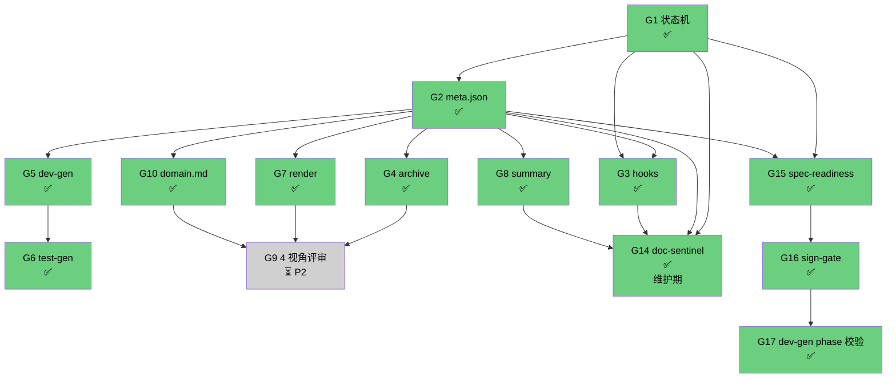

# god 改造路线图

> CLAUDE.md §5 指向的子文档。**剩余缺口 + 优先级 + 依赖 + 里程碑**。
> 改 god 的方向 = 看本文件。

## 0. 文档定位

- **本文件是 god 的施工计划**：列缺口、定优先级、排执行序
- **本文件不承载**：每块缺口的详细设计（那些在各自 RFC / 文档）
- **修改本文件**：需走 RFC，影响 god 演进方向
- **状态约定**：✅ 已落 / ⏳ 规划中 / ❓ 搁置；G1-G17 是历史编号（按落地顺序）非优先级序号

---

## 1. 真实状态速览

CLAUDE.md §5 把 10 块缺口按性质归并为 4 层。下表是**每块缺口的当前真实状态**。

| 层 | 历史编号 | 缺口 | 真实状态 | 落点 |
|---|---|---|---|---|
| 规范层 | G1 | spec-cli 状态机 | ✅ 已落（commit `fc31904`）| `spec/scripts/spec-cli.js` |
| 规范层 | G2 | spec.meta.json | ✅ 已落（commit `fc31904`）| `spec/meta.json` schema + spec-cli 读写 |
| 呈现层 | G7 | spec-render | ✅ 已落 | `spec/scripts/spec-render.js` |
| 呈现层 | G8 | spec-summary | ✅ 已落 | `spec/scripts/spec-summary.js` + `templates/spec-summary/v0.1.0.md` |
| 驱动层 | G5 | dev-gen | ✅ 已落 | `spec/scripts/dev-gen.js` |
| 驱动层 | G6 | test-gen | ✅ 已落 | `spec/scripts/test-gen.js` |
| 驱动层 | G4 | spec-archive | ✅ 已落 | `spec/scripts/spec-archive.js` |
| 防护层 | G3 | hooks 防漂移 | ✅ 已落 | `templates/hooks/pre-commit.sh` + `session-end.sh` + `install-hooks.js` |
| 防护层 | G9 | 4 视角评审 | ⏳ 规划中（P2）| — |
| 防护层 | G10 | domain.md | ✅ 已落 | `templates/domain.md` |
| 维护层 | **G14** | **doc-sentinel 后台文档巡检** | **✅ 已落** | **`commands/doc-sentinel.md` + `skills/doc-sentinel/` + `scripts/doc-sentinel/`（9 check + `cron.js` 调度器 + 7 测）** |
| 归因层 | G18 | S 事件归因 | ✅ 已落 | `sign-gate.js` 写 trace + `measure-opc-cost.js` 5 维归因（RFC-0014）|
| 知识层 | G11 | incidents→ADR 沉淀 | ✅ 已落 | `templates/incident.md` + `docs/incidents/` + `docs/adrs/0011` |
| 架构层 | G13 | spec/ 子目录分层 | ✅ 已落 | `spec/scripts/` 13 工具双路径兼容 |
| 架构层 | G13.1 | spec/ 结构固化 | ✅ 已落 | `init-spec-dir.js` 5 测 + `spec-lint.js` 8 测 |
| 编排层 | G15 | spec-readiness 清晰度校验 | ✅ 已落 | `spec/scripts/spec-readiness.js` 17 测（RFC-0013）|
| 编排层 | G16 | sign-gate S1/S2/S3 统一签字 | ✅ 已落 | `spec/scripts/sign-gate.js` 18 测（RFC-0013）|
| 编排层 | G17 | dev-gen phase 前置校验 | ✅ 已落 | `spec/scripts/dev-gen.js` 4 测（RFC-0013）|

**P0 + P1 已全部落地**（G1/G2/G3/G4/G5/G6/G7/G8/G10，9 块）。**维护期 G14 + 编排层 G15/G16/G17 已落**。当前剩余 = P2（1 块：G9 4 视角评审）。

> G3 用 `templates/hooks/` 模板 + `install-hooks.js` 一键安装形态实现。

---

## 2. 剩余缺口清单（1 项 × 5 列）

| # | 缺口名 | 当前状态 | 目标状态 | 优先级 | 验收标准 |
|---|---|---|---|---|---|
| G9 | 4 视角评审 | 4 维度评分 | 4 个独立角色（QA/架构/用户/AI 自审）独立跑 spec-review，输出 4 份独立报告 + 仲裁 | P2 | 4 份报告 + 仲裁 1 份 = 5 份产物；`spec-cli review-status` 看汇总 |

### 2.1 依赖序

```
G2(meta) ─┬─→ G4(archive) ─┐
          ├─→ G5(dev-gen) ─→ G6(test-gen)
          ├─→ G7(render)  ─┤
          └─→ G10(domain) ─┴→ G9(4 视角评审)

G14(doc-sentinel) 独立维护层
G15/G16/G17 命令层重塑（已落）
```

仅剩 G9 未落。**G9 启动硬条件**：G7 已落 ✅ + god 在 ≥ 3 个真实项目跑通过（当前 2 个：demo + 跨 feature 演练）。

---

## 3. P2 应做（1 项）

> god 已闭环开发期 + 维护期。G9 是 god 学会"从经验里学"的最后一刀。

### 3.1 G9 4 视角评审

- 4 角色独立跑 spec-review，4 份报告 + 仲裁
- 用户视角 / QA 视角 / 架构视角 / AI 自审 各自模板
- 仲裁逻辑（4 份报告如何合并 1 个最终结论）
- 依赖：G7（review.md 前置产物，已落）+ ≥ 3 个真实项目 feature

---

## 4. P2 启动信号

| 信号 | 状态 |
|---|---|
| G7 已落 | ✅ |
| god 在 ≥ 3 个真实项目跑通过 | 🟡 2/3（demo + 跨 feature 演练）|
| 用户反馈"还有这个痛点" | 🟡 未明确反馈 |

**当前** = 2/3 真实项目 feature 真实数据 + G7 已落。**下一步** = 采第 3 个真实项目 feature 后启动 G9。

---

## 5. 依赖图



> P0 + P1 + 维护期 G14 + 命令层重塑 G15-G17 全部落地。**仅剩 G9 1 块 P2**。

---

## 6. 里程碑

### M1：god 自我闭环（已完成）

**目标**：god 能跑、能校验、能门禁。

**交付物清单**：
- [x] `spec/scripts/spec-cli.js`（G1）—— commit `fc31904`
- [x] `spec/meta.json` schema + 写读逻辑（G2，并入 spec-cli）—— commit `fc31904`
- [x] `templates/hooks/pre-commit.sh` + `templates/hooks/session-end.sh`（G3）—— commit `229ab76`
- [x] `spec/scripts/install-hooks.js` 一键安装（G3）—— commit `229ab76`
- [x] `spec/scripts/spec-summary.js` + 11 单元测试 + 模板（G8）—— commit `2644f35`
- [x] `spec/TESTING.md` 加 L7：spec-cli 状态机测试
- [x] ADR/RFC 4 位补零编号规约

**完成定义**（实测达成）：
- `spec-cli status` 在 god 自己 demo 上输出正确阶段 ✅
- `spec-cli advance` 拒绝非法转移（如 drafted → verified）✅
- git pre-commit 拒绝绕道改 spec.feature（`--no-verify` 例外）✅
- god demo `node spec-validate.js .` 仍全过（不破回归）✅

### M2：god 自我驱动（已完成）

**目标**：从"AI 全程手写"升级为"AI + 机器骨架"。

**交付物清单**：
- [x] `spec/scripts/spec-archive.js`（G4）
- [x] `spec/scripts/dev-gen.js`（G5）
- [x] `spec/scripts/test-gen.js`（G6）
- [x] `spec/scripts/spec-render.js`（G7）
- [x] 4 个脚本各自独立 `--help` 文档
- [x] 把 4 个脚本接进 `/god:prd` 等 command（command 阶段里调脚本，不再让 AI 从零手写）
- [x] `spec/TESTING.md` 加 L8：4 个脚本的 fixture 测试

**完成定义**（实测达成）：
- `/god:prd` 阶段 2 末尾自动跑 `spec-render` + `spec-summary` ✅
- `skills/dev-pipeline` 阶段 1 自动跑 `dev-gen` 产出代码骨架，AI 改骨架而非从零写 ✅
- `skills/test-pipeline` 阶段 1 自动跑 `test-gen` 产出测试桩，AI 补断言而非从零写 ✅
- spec 变更前自动 `spec-archive snapshot` ✅
- 端到端：prd→dev→test 全程 AI 操作数 < 50%（RFC-0013 命令层重塑后实际降更多）✅

### M3：god 自我演进（待启动）

**目标**：god 学会"从经验里学"。

**交付物清单**：
- [ ] `skills/spec-review-multi/` 替代 `skills/spec-review/`（G9，4 角色独立跑）
- [ ] 4 份报告的输出格式（用户/QA/架构/AI 自审 各自模板）
- [ ] 仲裁逻辑（4 份报告如何合并 1 个最终结论）
- [x] `templates/domain.md` 模板（G10）
- [x] `/god:prd` 阶段 0 调研清单加一行"读 `domain.md`"

**完成定义**：
- `spec-cli review-status` 列出 4 视角 + 仲裁分
- god 自己的 `docs/incidents/` 至少沉淀 3 条"评审曾卡住过 → 现在不卡了"的案例

**预计工时**：4-6 周（单人，**含 god 在 3 个真实项目试用 + 收集反馈**）

**启动硬条件**：第 3 个真实项目 feature 数据 + G7 已落（G7 已 ✅）。

---

## 7. 反模式（明确不做）

| 反模式 | 为什么不做 |
|---|---|
| 自动生成 spec.feature（让 AI 直接落 Gherkin） | 违反 CLAUDE.md §4.1 铁律 2 "人看得懂是第一约束"。AI 写的 Gherkin 人看着头大，OPC 评审卡死 |
| 把 dev-gen 写成"AI 一次性产出完整实现" | 违反 G5 的"骨架不写实现"原则。AI 实现放在 `skills/dev-pipeline` 阶段，dev-gen 只给位置 |
| hooks 强制阻塞（不允许 `--no-verify`） | 救命场景（hotfix）会被堵死。trace 留底即可 |
| G9 4 视角做成 4 个独立 command | 评审不应该让用户手动跑 4 次。应该是 1 个 command + 内部 fan-out 4 个 subagent |
| 用大模型 API 做 spec-validate | 漂移检测是机械规则（看是否有标注），LLM 介入既慢又不可靠 |
| 重建老的 `scripts/hooks/` 7 个孤岛脚本 | 老形态失败原因 = 未挂载 settings.json。G3 用 templates/hooks/ + install-hooks.js 新形态替代，不回头 |

---

## 8. 与其他文档的关系

| 本文件章节 | 详细在哪 |
|---|---|
| §3 P2 详细 | 各自 RFC（`docs/rfcs/NNNN-*.md`，启动 P2 时先写 RFC 再写代码） |
| §6 M1 验收 | 与 `spec/TESTING.md` 的 L1-L7 集成 |
| §6 M2 完成 | 与 `spec/TESTING.md` L8 集成 |
| §6 M3 启动 | G9 启动前先写 RFC（`docs/rfcs/NNNN-spec-review-multi.md`） |
| §7 反模式 | 与 `commands/prd.md` 的"command 编排 skill 承载"原则对齐 |
