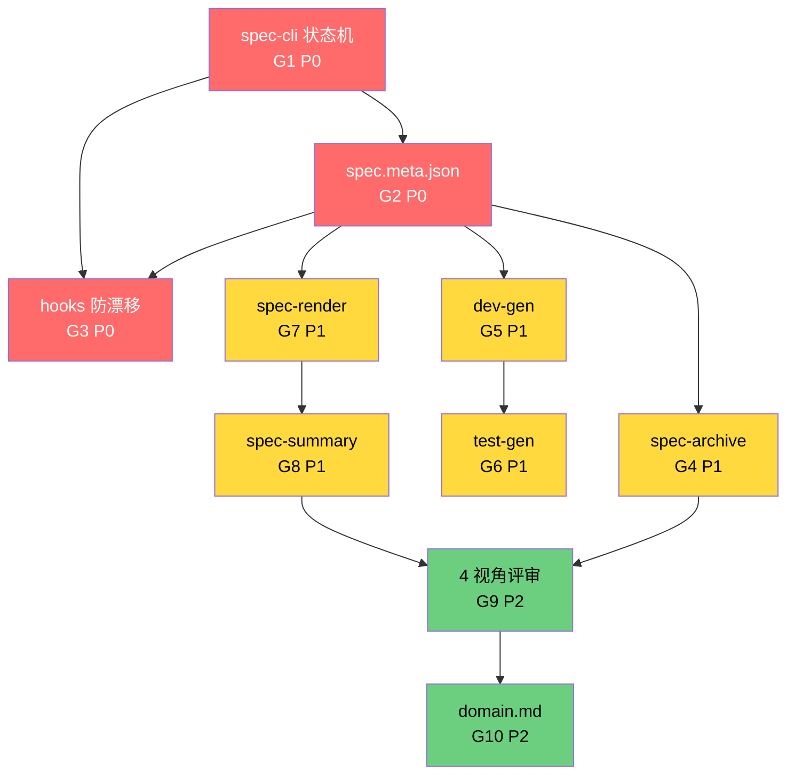

# god 改造路线图

> CLAUDE.md §5 指向的子文档。**完整缺口 + 优先级 + 依赖 + 里程碑**。
> 改 god 的方向 = 看本文件。

## 0. 文档定位

- **本文件是 god 的施工计划**：列缺口、定优先级、排执行序
- **本文件不承载**：每块缺口的详细设计（那些在各自 RFC / 文档）
- **修改本文件**：需走 RFC，影响 god 演进方向

---

## 1. 缺口归并与现状速览

CLAUDE.md §5 把 10 块缺口按性质归并为 4 层。下表是**每块缺口的当前真实状态**，不是 CLAUDE.md 的笼统描述。

| 层 | 缺口 | 现状文件 | 真实状态 |
|---|---|---|---|
| 规范层 | spec-cli 状态机 | 无 | ❌ 缺。spec 生命周期（drafted/implemented/verified/accepted）只在 `spec/README.md` 文字描述，无任何机器可读状态 |
| 规范层 | spec.meta.json | 无 | ❌ 缺。spec/ 下无元数据文件，版本、owner、关联 PR 散落各处 |
| 呈现层 | spec-render | 无 | ❌ 缺。spec.feature 是 Gherkin 原始文本，评审者看到要自己脑补 |
| 呈现层 | spec-summary | 无 | ❌ 缺。没有"一页纸 spec 摘要"产出，**OPC 视角下目标 1 没法验收** |
| 驱动层 | dev-gen | 无 | ❌ 缺。`/god:dev` 完全靠 AI 读 spec 写代码，零骨架产出 |
| 驱动层 | test-gen | 无 | ❌ 缺。`/god:test` 同上，零测试桩产出 |
| 驱动层 | spec-archive | 无 | ❌ 缺。spec 没有版本快照能力，回滚靠 git diff |
| 防护层 | hooks 防漂移 | 无 | ❌ 缺。早期的 `scripts/hooks/` 7 个文件为孤岛脚本（未挂载到 `settings.json`），已删除；G3 路线图需从头重建 |
| 防护层 | 4 视角评审 | `skills/spec-review/` | ⚠️ 部分。当前是 D1-D4 4 维度评分（需求完整/用户视角/GWT/绑定），**不是 4 个独立角色**（QA/架构/用户/AI 自审） |
| 防护层 | domain.md | 无 | ❌ 缺。`prd` 阶段 0 调研清单里有 `docs/` `wiki/`，但 god 自身没有"领域知识入口"约定 |

> 标注说明：❌ 缺 = 完全没实现；⚠️ 部分 = 有但不达标。

---

## 2. 缺口清单表（10 项 × 6 列）

| # | 缺口名 | 当前状态 | 目标状态 | 优先级 | 依赖的前置缺口 | 验收标准 |
|---|---|---|---|---|---|---|
| G1 | spec-cli 状态机 | 文字描述 | 脚本：列出/推进/回滚/校验状态，禁止非法转移 | **P0** | — | `spec-cli status` 输出 4 阶段；非法转移报错；CI 可调用 |
| G2 | spec.meta.json | 无 | `spec/meta.json` 含 version/owner/createdAt/relatedPR/scopes | **P0** | G1 | 改 spec 时 meta 自动更新；`spec-cli info` 读得到 |
| G3 | hooks 防漂移（git/session 集成） | 无（已删早版脚本） | git pre-commit + session-end 双 hook，挡绕道改 spec | **P0** | G1, G2 | 绕过 build-spec 改 spec.feature → hook 拒绝；session 结束自动跑 spec-validate |
| G4 | spec-archive | 无 | `spec-archive snapshot v1.2.0` 写一份不可变快照 + 索引 | P1 | G1, G2 | 历史任意 spec 版本可恢复；`spec-archive list` 输出索引 |
| G5 | dev-gen | 无 | `dev-gen <spec>` 输出函数骨架 + `@spec SC-xxx` 标注 + TODO 列表 | P1 | G1, G2 | dev-gen 产出物通过 spec-validate（"SC 有代码标注"项） |
| G6 | test-gen | 无 | `test-gen <spec>` 输出 playwright 桩 + `SC-xxx:` 用例名 | P1 | G1, G2, G5 | test-gen 产出物通过 spec-validate（"SC 有测试"项） |
| G7 | spec-render | 无 | `spec-render <spec>` 输出 `review.md`（评审者视角的 checklist + 边界 + 异常） | P1 | G2 | 输出文件可独立读懂；含 D1-D4 自评分草稿 |
| G8 | spec-summary | 无 | `spec-summary <spec>` 输出 `summary.md`（1 页纸：目标/角色/流程/边界/不在范围内）| **P0** | G2 | OPC 不开 spec.feature 也能签字（CLAUDE.md §1.1 目标 1 唯一验收手段）|
| G9 | 4 视角评审 | 4 维度评分 | 4 个独立角色（QA/架构/用户/AI 自审）独立跑 spec-review，输出 4 份独立报告 + 仲裁 | P2 | G7, G8 | 4 份报告 + 仲裁 1 份 = 5 份产物；`spec-cli review-status` 看汇总 |
| G10 | domain.md | 无 | 项目根 `domain.md` 模板（术语/角色/业务流程/反模式），prd 阶段 0 自动加载 | P2 | — | prd 调研摘要里能引到 `domain.md` 内容；脑暴阶段术语不再漂移 |

### 2.1 缺口编号与 CLAUDE.md §5 的对应

| 本文件 # | CLAUDE.md §5 归并层 |
|---|---|
| G1, G2 | 规范层 |
| G3 | 防护层（hook 集成） |
| G4, G5, G6 | 驱动层 |
| G7, G8 | 呈现层 |
| G9 | 防护层（评审） |
| G10 | 防护层（领域知识） |

---

## 3. P0 必做（4 项，缺则 god 不闭环）

### 3.1 P0 判断依据（CLAUDE.md §1.1 OPC 视角）

| 缺口 | 缺了哪个产品目标达不成 | 论证 |
|---|---|---|
| G1 spec-cli 状态机 | 目标 2 "活规格" | 无状态机 = 改完 spec 不知道"现在到哪了"，漂移检测就是空话 |
| G2 spec.meta.json | 目标 2 + 目标 4 | 无元数据 = 无法追溯 spec ↔ PR ↔ 责任人，验收报告没锚点 |
| G3 hooks 防漂移 | 目标 3 "自动化执行" | 无 hook = AI 可以绕过 build-spec 改 spec，**整个 §4.2 防漂移机制是空架子** |
| G8 spec-summary | 目标 1 "OPC 看 summary 签字" | 无 summary = OPC 必须打开 spec.feature 读 Gherkin，**违反目标 1 的字面定义** |

### 3.2 P0 详细定义

#### G1: spec-cli 状态机

**职责**：把 spec/README.md 第 16 行的生命周期图，固化为可执行命令。

```
(idea) → drafted → reviewed → implemented → verified → accepted
            ↑           │           │            │
            └───────────┴───────────┴────────────┘  （变更回 prd 重走）
```

**状态定义**：以 [[spec-directory#3 spec 生命周期]] 为准（6 状态），不是 4 状态。
- `(idea)`：仅口头/模糊需求，无文件
- `drafted`：spec.feature + sources.md 完整、绑定通过
- `reviewed`：跑过 spec-review（≥90 分 或 显式跳过 + C5 锚点）
- `implemented`：每个 SC 在源码有 `@spec SC-xxx` 标注
- `verified`：每个 SC 在测试有 `SC-xxx:` 用例
- `accepted`：`/god:test` 输出验收报告 + 用户签字

**子命令**：
- `spec-cli status [project]` → 打印当前所处阶段 + 5 个 gate 的过/未过
- `spec-cli advance [project]` → 推进到下一状态（前置 gate 没过则拒绝）
- `spec-cli rollback [project] --to <phase>` → 回滚（强制要求写原因）
- `spec-cli check [project]` → 跑 `spec-validate.js` + 状态 gate 双校验

**关键设计**：
- 状态写到 `spec/meta.json`（G2 产出），`phase` 字段取 6 状态之一
- 状态转移不可跳过（`drafted → verified` 拒绝；必须经 `reviewed`）
- `drafted → reviewed` 是 review gate（在 advance 前由 spec-review skill 跑完，详见 [[human-ai-contract#1 C2 方案评审 Gate]]）
- 每次 advance 写一行 trace 到 `spec/.trace`（便于 G4 archive）

**落点**：`spec/scripts/spec-cli.js`，对应 CLAUDE.md §3 索引图里"规划中"标记。

#### G2: spec.meta.json

**职责**：spec/ 目录的元数据真相源。

```json
{
  "version": "1.0.0",
  "phase": "drafted",
  "owner": "user-uuid",
  "createdAt": "2026-06-15T10:00:00Z",
  "updatedAt": "2026-06-15T14:30:00Z",
  "relatedPR": ["#123"],
  "scopes": ["guess-number"],
  "c5": { "passed": true, "score": 92, "at": "2026-06-15T14:30:00Z" },
  "c6": ["SC-001"]
}
```

**落点**：`spec/scripts/spec-cli.js` 读写；`spec-validate.js` 阶段 3a 校验存在性。

#### G3: hooks 防漂移（集成层）

**职责**：在新设的 `scripts/hooks/` 下重建 7 个 hook 脚本，并接进 git/session 事件流。

| 触发点 | 检查 | 拒绝条件 |
|---|---|---|
| git pre-commit | `spec-validate.js` | 漂移（SC 缺代码/测试）→ 拒绝 commit |
| git pre-commit | `spec-cli status` 与实际产物一致性 | 状态机说 implemented 但代码未就绪 → 拒绝 |
| session-end | `spec-archive --check-pending` | 有未快照的 spec 变更 → 提示（不阻塞） |

**关键设计**：
- **不阻塞救命场景**：`--no-verify` 仍可用，但写一条 trace
- hook 配置在 `.claude/settings.json`（god 插件外的项目侧，不污染 god 自身）
- god 自己的 hook 模板写在 `templates/hooks/`（CLAUDE.md §3 已预留 templates/ 入口）

**落点**：`templates/hooks/pre-commit`、`templates/hooks/session-end.sh`，加 `scripts/hooks/install.js` 一键安装。

> **状态说明（v0.2.x）**：早版的 `scripts/hooks/` 7 个文件因从未挂载到 `settings.json` 而作为孤岛脚本被删除。G3 路线图本身保留，但需从头重建脚本与挂载。

#### G8: spec-summary（OPC 验收界面）

**职责**：把 spec.feature 的 Gherkin 转成 OPC 能直接签字的 1 页纸。**这是 CLAUDE.md §1.1 目标 1 的唯一验收手段**。

**子命令**：
- `spec-summary <project>` → 输出 `spec/summary.md`，1 页纸
- `/god:prd` 阶段 2 末尾**自动调用**，与 spec-render 一起产出
- OPC 在 C1 入口 / S1 出口**只看 summary.md**，不直接读 spec.feature

**输出结构**（`spec/summary.md`）：

```markdown
# <Feature 名> — 1 页纸摘要

## 目标（1 句）
OPC 想 <做什么>，god 自动 <怎么做>。

## 角色 + 核心流程（5 行内）
1. <角色 A> → 触发 → <角色 B>
2. <角色 B> → 处理 → <结果>
...

## 边界 / 异常清单
- ✅ <正常情况>：<预期>
- ⚠️ <边界情况>：<处理>
- ❌ <异常情况>：<处理>

## 不在范围内（明确排除项）
- <什么不做>（避免评审时翻案）
```

**关键设计**：
- **零 Gherkin**：summary.md 不出现 `Given/When/Then/SC-xxx` 任何字眼
- **零代码**：summary.md 不出现函数名/类名/技术栈
- **可独立签字**：OPC 拿 summary.md，**关掉 spec.feature 也能决定签不签**
- 自动调 brainstorm M3 末尾"5 行核心流程"产物

**落点**：`spec/scripts/spec-summary.js`，调用 `/god:prd` 阶段 2 末尾。

**与 G7 区别**：G7 review.md 是**评审者**（OPC 想找 bug 时）看，含 D1-D4 checklist；G8 summary.md 是**签字**（OPC 想拍板时）看，1 页。

---

## 4. P1 应做（4 项，缺则 god 自我驱动能力 < 50%）

### 4.1 P1 判断依据

> 缺了，god 自我演进效率 < 50%。当前 spec.feature 全靠 AI 读 + AI 写 + AI 验，**没有任何"机器可重放的产物"**。一旦换模型/换人，整个 god 知识归零。

| 缺口 | 缺了什么能力 | 现状成本 |
|---|---|---|
| G4 spec-archive | 版本快照/回滚 | 改坏 spec 后回滚靠 git diff，**没有 spec 维度的快照语义** |
| G5 dev-gen | 代码骨架 | 每次 `/god:dev` AI 从零开始，重复劳动 |
| G6 test-gen | 测试桩 | 每次 `/god:test` AI 从零开始，重复劳动 |
| G7 spec-render | 评审产物 | 评审者看 spec 要脑补 Gherkin 文本，门槛高 |

### 4.2 P1 详细定义

**G4 spec-archive**
- `spec-archive snapshot <project> --tag v1.2.0` → 把 spec/ 整个目录打成不可变 tar + 写一行索引到 `spec/.archive-index`
- `spec-archive list [project]` → 列出所有快照
- `spec-archive restore <project> --tag v1.1.0` → 还原到该版本（**仅在 drafted 阶段允许**）
- 依赖：G1（读 meta 的 phase）、G2（写 meta 的 version）

**G5 dev-gen**
- `dev-gen <project>` → 读 spec.feature，产出 `src/<feature>/` 目录骨架
- 每个 SC 生成一个空函数，标注 `/** @spec SC-xxx */` + 注释 `// TODO: 实现 SC-xxx` + 引用 spec.feature 行号
- 产出物必须通过 `spec-validate.js` 的"SC 有代码标注"项
- 不写实现，只写骨架（避免与 AI 写实现冲突）
- 依赖：G1（确认在 drafted 阶段才能 gen）、G2（写 owner + updatedAt）

**G6 test-gen**
- `test-gen <project>` → 读 spec.feature + dev-gen 骨架，产出 `tests/<feature>.spec.ts`
- 每个 SC 一个 `test('SC-xxx: <Scenario 名>', () => { /* TODO */ })` 桩
- 产出物必须通过 `spec-validate.js` 的"SC 有测试"项
- 不写断言，只写用例名 + 空函数体
- 依赖：G5（dev-gen 先产出代码位置）

**G7 spec-render**
- `spec-render <project>` → 输出 `spec/review.md`，含：
  - D1 需求完整性 checklist（每 REQ → 覆盖 SC？）
  - D2 用户视角（Given/When/Then 转"用户故事"视角）
  - D3 GWT 可验证性（机械检查"是否可写 playwright 脚本"）
  - D4 双向绑定矩阵
- 这是 spec-review skill 的前置产物（评审者拿 review.md 看，不看 Gherkin 原文）
- 依赖：G2（读 meta 的 c5 状态，避免重复评）

**G8 spec-summary**
- ~~`spec-summary <project>` → 输出 `spec/summary.md`~~ → **已升级为 P0（见 §3），移到 G3 之后执行**
- 删除：原 §4.2 段落，避免重复

### 4.3 P1 内部依赖序

```
G2(meta) ─┬─→ G4(archive) ─→ G9(评审,G2 依赖)
          ├─→ G5(dev-gen) ─→ G6(test-gen)
          └─→ G7(render)  ─→ G8(summary) ─→ G9
```

P1 5 项必须**串行**做，不能并行（共用 G2 的 meta schema）。

---

## 5. P2 锦上添花（2 项）

| 缺口 | 作用 | 何时启动 |
|---|---|---|
| G9 4 视角评审 | 用户/QA/架构/AI 自审 4 份独立报告 → 仲裁 | G7+G8 完成后，且 god 已有 ≥ 3 个真实项目用过 |
| G10 domain.md | 项目根领域知识入口模板，prd 调研自动加载 | god 自身 demo 完成 v1.1 后（看 demo 是不是需要"术语表"才能说清） |

P2 启动信号：P0+P1 全部完成 + god 在 ≥ 3 个真实项目跑通过 + 用户反馈"还有这个痛点"。

---

## 6. 依赖图（P0 内部执行序）



> G1 → G2 → G3 是 P0 强串行。G2 是 P1 所有项的前置。

---

## 7. 里程碑（M1 / M2 / M3）

### M1：god 自我闭环（必备 3 块）

**目标**：god 能跑、能校验、能门禁。**当前缺的就是这块**。

**交付物清单**：
- [ ] `spec/scripts/spec-cli.js`（G1）
- [ ] `spec/meta.json` schema + 写读逻辑（G2，并入 spec-cli）
- [ ] `templates/hooks/pre-commit` + `templates/hooks/session-end.sh`（G3）
- [ ] `scripts/hooks/install.js` 一键安装（G3，重建）
- [ ] `scripts/hooks/` 7 个 hook 脚本本体（重建，原版已删）
- [ ] god 自身的 `spec/SPEC-FORMAT.md` 加 1 节"§8 状态机"（指向 spec-cli）
- [ ] 回归测试（参考 `spec/TESTING.md` 加 L7：spec-cli 状态机测试）

**完成定义**：
- `spec-cli status` 在 god 自己 demo 上输出正确阶段
- `spec-cli advance` 拒绝非法转移（如 drafted → verified）
- git pre-commit 拒绝绕道改 spec.feature（`--no-verify` 例外）
- god demo `node spec-validate.js .` 仍全过（**不破回归**）

**预计工时**：1-2 周（单人）

---

### M2：god 自我驱动（5 块自动化产出）

**目标**：从"AI 全程手写"升级为"AI + 机器骨架"。

**交付物清单**：
- [ ] `spec/scripts/spec-archive.js`（G4）
- [ ] `spec/scripts/dev-gen.js`（G5）
- [ ] `spec/scripts/test-gen.js`（G6）
- [ ] `spec/scripts/spec-render.js`（G7）
- [ ] `spec/scripts/spec-summary.js`（G8）
- [ ] 5 个脚本各自独立 `--help` 文档
- [ ] 把 5 个脚本接进 `/god:prd` `/god:dev` `/god:test` command（command 阶段里调脚本，不再让 AI 从零手写）
- [ ] `spec/TESTING.md` 加 L8：5 个脚本的 fixture 测试

**完成定义**：
- `/god:prd` 阶段 2 末尾自动跑 `spec-render` + `spec-summary`，OPC 拿 review.md/summary.md 评审签字
- `/god:dev` 阶段 1 自动跑 `dev-gen` 产出代码骨架，AI 改骨架而非从零写
- `/god:test` 阶段 1 自动跑 `test-gen` 产出测试桩，AI 补断言而非从零写
- spec 变更前自动 `spec-archive snapshot`
- 端到端：`/god:prd` → `/god:dev` → `/god:test` 全程**AI 操作数 < 当前 50%**

**预计工时**：3-4 周（单人，含 god 自身 demo 走通）

---

### M3：god 自我演进（评审升级 + 领域知识）

**目标**：god 学会"从经验里学"。

**交付物清单**：
- [ ] `skills/spec-review-multi/` 替代 `skills/spec-review/`（G9，4 角色独立跑）
- [ ] 4 份报告的输出格式（用户/QA/架构/AI 自审 各自模板）
- [ ] 仲裁逻辑（4 份报告如何合并 1 个最���结论）
- [ ] `templates/domain.md` 模板（G10）
- [ ] `/god:prd` 阶段 0 调研清单加一行"读 `domain.md`"
- [ ] `scripts/hooks/learn-lesson.js`（P2 衍生：把评审不通过 / 测试失败案例写到 `docs/lessons/`；随 G3 重建）

**完成定义**：
- `spec-cli review-status` 列出 4 视角 + 仲裁分
- 新项目用 `templates/domain.md` 起步，prd 阶段 0 自动加载
- god 自己的 `docs/lessons/` 至少沉淀 3 条"评审曾卡住过 → 现在不卡了"的案例

**预计工时**：4-6 周（单人，**含 god 在 3 个真实项目试用 + 收集反馈**）

---

## 8. 反模式（明确不做）

| 反模式 | 为什么不做 |
|---|---|
| 自动生成 spec.feature（让 AI 直接落 Gherkin） | 违反 CLAUDE.md §4.1 铁律 2 "人看得懂是第一约束"。AI 写的 Gherkin 人看着头大，OPC 评审卡死 |
| 把 dev-gen 写成"AI 一次性产出完整实现" | 违反 G5 的"骨架不写实现"原则。AI 实现放在 `/god:dev` 阶段，dev-gen 只给位置 |
| hooks 强制阻塞（不允许 `--no-verify`） | 救命场景（hotfix）会被堵死。trace 留底即可 |
| G9 4 视角做成 4 个独立 command | 评审不应该让用户手动跑 4 次。应该是 1 个 command + 内部 fan-out 4 个 subagent |
| 用大模型 API 做 spec-validate | 漂移检测是机械规则（看是否有标注），LLM 介入既慢又不可靠 |

---

## 9. 与其他文档的关系

| 本文件章节 | 详细在哪 |
|---|---|
| §3.2 G1/G2/G3 详细 | 各自 RFC（**待建**，启动 P0 时先写 RFC 再写代码） |
| §4.2 G4-G8 详细 | 各自 RFC（**待建**，启动 P1 时先写 RFC） |
| §7 里程碑验收 | 与 `spec/TESTING.md` 的 L1-L6 集成，**M1 完成时 TESTING.md 加 L7-L8** |
| §1 现状速览 | 与 `spec/README.md` 的"组成"表对齐（**M1 完成时 README.md 加 spec-cli 一行**） |
| §8 反模式 | 与 `commands/prd.md` 的"command 编排 skill 承载"原则对齐 |

---

## 10. 文档版本

- **v0.1.0** (2026-06-16)：初版路线图。P0 详细设计待 RFC，P1/P2 待 RFC。
