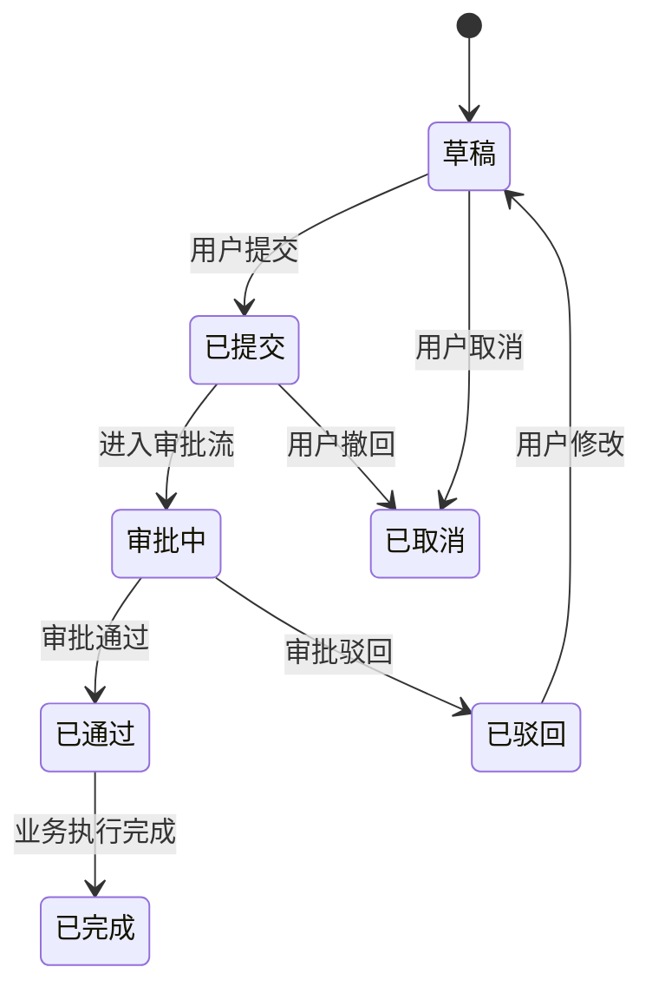

# {需求名称} 技术方案

## 1. 需求概述

简要描述需求背景和目标。

### 1.1 现有代码基础

> 此章节支持历史沉淀：查看 `$JLC_AI_WORKSPACE/biz-tech-docs/INDEX.md` 路由表定位相关文档，直接读取复用并按需更新；如果没有，则自动探索项目代码结构后输出，并沉淀到项目知识库供后续复用。

分析项目中与本需求相关的已有代码，按层级标注完成状态。**必须覆盖所有涉及的服务模块**，不仅限于本次新增代码所在服务。

**排查要求：**
1. 根据需求关键词在 `biz-tech-docs/INDEX.md` 中搜索db相关文档,然后找寻可能相关的现有表
2. 在 `projects/` 下 grep 关键词（Entity 类名、表名关键词），发现相关 Entity/Mapper/Service
3. 在 `biz-tech-docs/INDEX.md` 中搜索相关模块文档

| 层级 | 状态               | 说明 |
|------|------------------|------|
| Entity | 已完成 / 部分完成 / 未开始 | 如"部分完成"，列出已有的 Entity 及所属服务 |
| Mapper | 已完成 / 部分完成 / 未开始 | 如"部分完成"，列出已有的 Mapper |
| Service 接口 | 已完成 / 部分完成 / 未开始 | 如"部分完成"，列出已有的方法签名 |
| Service 实现 | 已完成 / 部分完成 / 未开始 | |
| Controller | 已完成 / 部分完成 / 未开始 | |
| VO/BO/Convert | 已完成 / 部分完成 / 未开始 | |
| Feign API | 已完成 / 部分完成 / 未开始 | 是否已有跨服务调用接口 |
| 前端页面 | 已完成 / 部分完成 / 未开始 | |

### 1.2 验收标准（AC）

> 详细验收标准见 [ac.md（位于 design/ 或 requirement/ 目录）](../../design/ac.md)，此处仅做引用，不重复 AC 内容。

- **业务目标（GOAL）**：GOAL-01 ~ GOAL-NN，见 ac.md
- **业务验收标准（AC）**：AC-01 ~ AC-NN，见 ac.md
- **UI 验收标准（UI）**：UI-01 ~ UI-NN，见 ac.md

## 2. 微服务划分

| 服务名 | 代码库路径 | 职责 |
|--------|-----------|------|
| xxx-service | `/path/to/repo` | ... |

### 服务依赖关系

描述服务间调用链路。

### 后端架构

#### 核心分层设计

描述 Service 层的分层策略（如：公共核心 + 差异化实现、完全独立等），说明各 Service 的职责和方法划分。

#### 跨模块数据获取

| 数据 | 来源模块 | Service 类名 |
|------|---------|-------------|
| ... | ... | ... |

#### 新增文件清单

| 文件 | 包路径 | 说明 |
|------|--------|------|
| ... | ... | ... |

## 3. API 接口设计

列出本次涉及的所有接口总览表。每个接口的详细定义（请求参数、响应参数、错误码、调用示例）由 `api-creator` skill 生成到 `design/api/` 目录。API 接口的选取遵循 `api-creator` skill 定义的 Brainstorming 规范。

### 1. 新增API接口设计
| 接口 | 方法 | 路径 | 所属服务 | 接口描述 | 说明 | 接口明细 |
|------|------|------|---------|---------|------|---------|
|      |      |      |         | 为什么要有这个接口，解决什么问题 |      | [`POST-xxx.md`](api/POST-xxx.md) |

### 2. 需要修改的现有API接口
| 接口 | 方法 | 路径 | 所属服务 | 接口描述 | 说明 | 接口明细 |
|------|------|------|---------|---------|------|---------|
|      |      |      |         | 为什么要有这个接口，解决什么问题 |      | [`POST-xxx.md`](api/POST-xxx.md) |

### 3. 需要复用的API接口

> **以下接口已通过 brainstorming 候选枚举 → 用户确认流程选定。**
> 来源：`biz-tech-docs/INDEX.md` 路由定位 → 项目代码 Controller 扫描

| 接口 | 方法 | 路径 | 所属服务 | 接口描述 | 接口类型 | 来源文档 | 复用场景说明 | 接口明细 |
|------|------|------|---------|---------|---------|---------|------------|---------|
|      |      |      |         | 为什么要有这个接口，解决什么问题 | Web/Feign | INDEX.md → {模块文档} | 用户确认的复用场景 | [`POST-xxx.md`](api/POST-xxx.md) |

> 所有接口的详细定义（请求/响应/错误码/curl示例）见 `design/api/` 目录下各接口文档（由 `api-creator` skill 生成）。

### 4. 可复用数据源清单

> **以下数据源由知识加载阶段扫描发现，供前后端设计参考。**

| 数据源类型 | 名称 | 路径/表名 | 复用方式 | 复用场景说明 |
|-----------|------|----------|---------|------------|
| 字典表 | ... | ... | ... | ... |
| 后端接口 | ... | ... | ... | ... |
| 前端 hook | ... | ... | ... | ... |

## 4. 核心处理流程

> **流程图与状态机图按需输出**：根据业务复杂度判断是否需要。判断规则见 `arch-design` skill 中"流程图与状态机图生成规则"。如果业务简单（如单表 CRUD、纯查询展示），可仅用文字描述，跳过图表。

### 4.x 核心业务流程（按需输出流程图）

> 当业务操作涉及多步骤、跨服务调用、条件分支或时序依赖时，**必须**输出流程图。

使用 mermaid 流程图展示业务决策分支。

每个核心流程除流程图外，还需附"实现描述"段落（纯文字，不含代码），标注：
- 关键 Service 调用链（如"调用 OrderBizService 查询销售订单"）
- 跨模块调用点（如"跨模块调用 inventory 模块获取采购数据"）
- 数据库操作要点（如"写入对账单主表和明细表"）

### 4.x 状态流转（按需输出状态机图）

> 当业务实体有 3 个以上状态、流转有前置条件或约束、PRD 中定义了状态枚举和流转规则时，**必须**输出状态机图。

使用 mermaid `stateDiagram-v2` 展示核心业务实体的状态流转，标注：
- 所有状态值及其含义
- 触发事件（用户操作或系统事件）
- 流转条件（如"仅创建人可撤回"）
- 异常回退路径（如"审批驳回→退回修改"）

## 5. 领域模型

各服务核心领域模型定义。

## 6. 数据库设计

数据库设计详细文档（新增表结构、现有表变更、历史数据兼容方案）由 `db-migration` skill 生成，见 [`db/db.md`](db/db.md)。

本章节仅保留汇总清单：

| 表名 | 状态 | 说明 | 详细设计 |
|------|------|------|---------|
| ... | 新增/已存在/需变更 | ... | [`db.md`](db/db.md) |

## 7. 迭代规划

每个迭代应包含前后端闭环，确保独立可验证（前端页面可操作、后端接口可联调、数据可持久化）。

| 迭代 | 范围 | 说明 |
|------|------|------|
| IT-01 | ... | ... |

## 8. 前端架构（涉及前端页面时必填）

> 技术组件选型遵循 `tech-selection` skill 定义的 Brainstorming 规范。

### 8.1 路由规划

列出所有新增路由及对应页面。

### 8.2 技术组件选型

> **以下组件选型已通过 brainstorming 候选枚举 → 用户确认流程选定。**
> 分析来源：原型/UI 设计稿

| 选型项 | 原型页面 | UI模式 | 选定方案 | 实现方式 | 选择理由 |
|--------|---------|--------|---------|---------|---------|
| ... | ... | ... | ... | ... | ... |

### 8.3 组件结构

描述页面/组件目录结构，标注共享组件。

### 8.4 差异化策略

如存在相似但有差异的页面（如客户/供应商），描述配置化差异策略。

### 8.5 API 调用模式

如项目有特殊的 API 调用约定，在此说明。

## 9. 数据校验规则（涉及数据校验时必填）

| 校验项 | 规则 | 异常判定标准 |
|--------|------|-------------|
| ... | ... | ... |

校验结果分级定义（如 PASS/WARNING/FAIL）。

## 10. 异常处理

| 异常场景 | 处理方式 | 前端提示文案 |
|---------|---------|-------------|
| ... | ... | ... |
